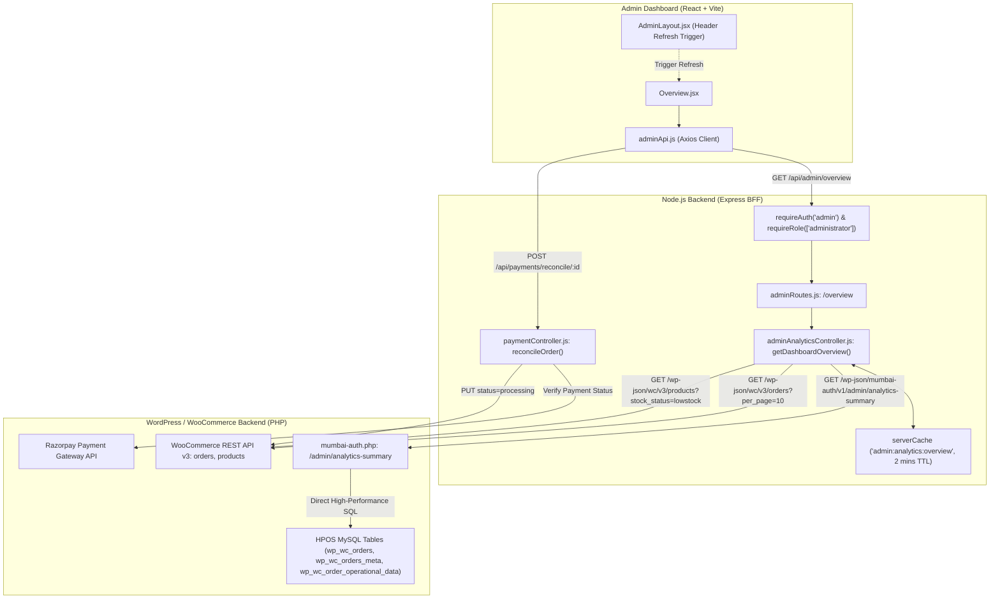
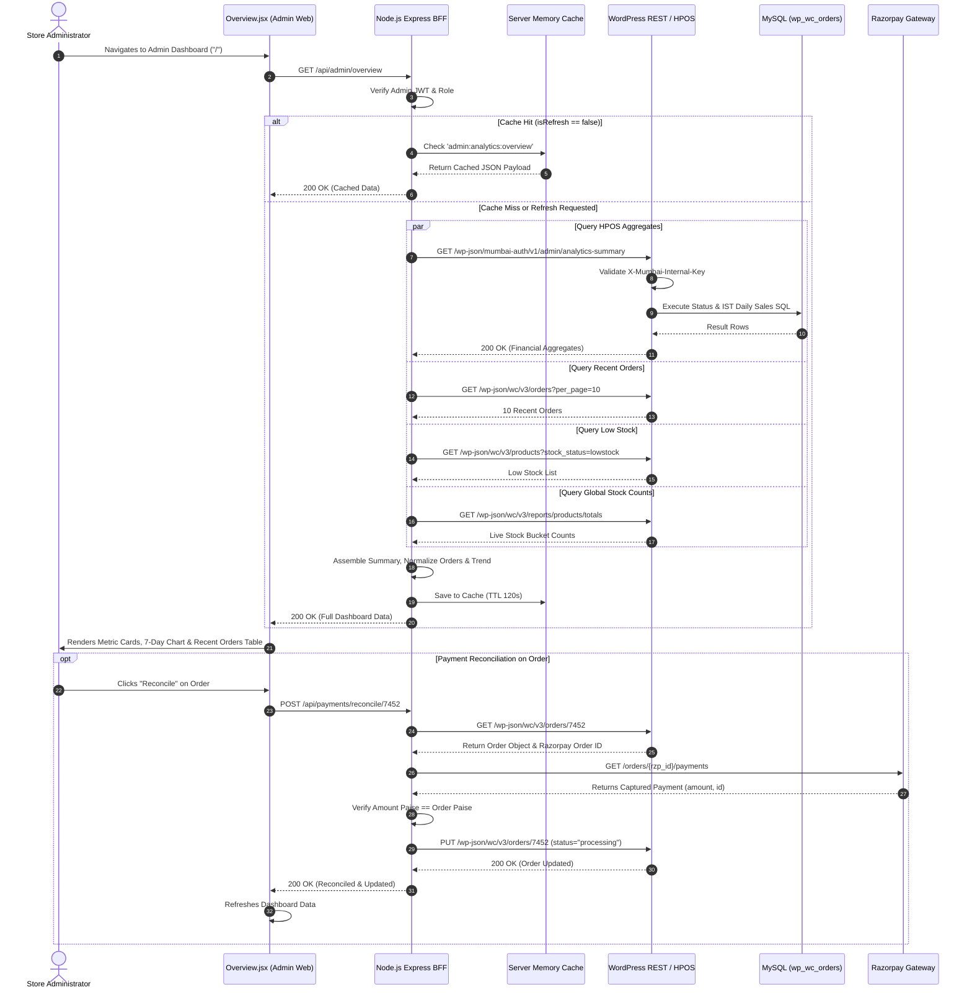

# Admin Audit: Feature 01 — Executive Overview Dashboard

> **Feature Scope**: Administrative Mission Control & Executive Store Operations  
> **Target Audience**: Technical Architects, Backend Developers, and System Auditors  
> **Authoritative Baseline**: WordPress HPOS (High-Performance Order Storage) & Node.js BFF  
> **Date**: November 2026

---

## 1. High-Level Architecture & System Role

The **Executive Overview** feature serves as the operational cockpit of the Mumbai Collection administration suite. It aggregates real-time sales figures, inventory alerts, revenue trends, and live order processing streams into a unified interface for store operators.



---

## 2. Frontend Layer (React + Tailwind CSS)

### 2.1 File Map & Responsibilities
- **Page Component**: [`apps/admin-dashboard/src/pages/Overview.jsx`](file:///c:/Users/asus/Desktop/Mumbai%20Collection/apps/admin-dashboard/src/pages/Overview.jsx)
- **Navigation Layout**: [`apps/admin-dashboard/src/layouts/AdminLayout.jsx`](file:///c:/Users/asus/Desktop/Mumbai%20Collection/apps/admin-dashboard/src/layouts/AdminLayout.jsx)
- **API Client**: [`apps/admin-dashboard/src/services/adminApi.js`](file:///c:/Users/asus/Desktop/Mumbai%20Collection/apps/admin-dashboard/src/services/adminApi.js)
- **Formatting Helpers**: [`apps/admin-dashboard/src/utils/recentOrdersFormatter.js`](file:///c:/Users/asus/Desktop/Mumbai%20Collection/apps/admin-dashboard/src/utils/recentOrdersFormatter.js)

### 2.2 Deep Logic & Implementation Details

#### A. Request Lifecycle & Race Condition Defense
- **Lines 29–47 (`Overview.jsx`)**: Implements an `AbortController` stored in `dashboardRequestRef`. If a new fetch or manual refresh is triggered before the prior HTTP request finishes, the previous request is immediately aborted, preventing stale responses from overriding newer data.
- **Lines 52–55 (`Overview.jsx`)**: Subscribes to the layout-level refresh callback via `setDashboardRefresh`. When the admin clicks the refresh button in the top navigation bar of `AdminLayout.jsx`, `fetchDashboardData(true)` executes with `{ refresh: "true" }` to bypass the 2-minute server cache.

#### B. Executive Metric Cards (Lines 125–191)
1. **Today's Revenue**:
   - Displays `summary.todaySales` formatted as Indian Rupees (`en-IN`).
   - Displays average order value (`summary.avgOrderValue`).
2. **Monthly Sales**:
   - Displays `summary.monthSales` and `summary.monthOrdersCount`.
3. **Low Stock Warnings**:
   - Displays `summary.lowStockCount`.
   - Offers an instant deep link to `/products` for immediate inventory replenishment.

#### C. Weekly Revenue Dynamic Scaling (Lines 195–225)
- Computes `maxRevenue = Math.max(...salesTrend.map(d => d.revenue), 1000)` on line 121.
- Each bar's percentage height is calculated dynamically on line 210:
  ```javascript
  const heightPercent = Math.max(8, Math.round((day.revenue / maxRevenue) * 100));
  ```
  This guarantees a minimum visual height of 8% even on zero-revenue days, avoiding broken chart aesthetics.

#### D. Live Recent Orders & One-Click Payment Reconciler (Lines 57–84, 266–463)
- Features responsive rendering:
  - **Mobile (<768px)**: Card-based layout with telephone direct-call links (`tel:`) and item breakdown.
  - **Desktop (>=768px)**: High-density administrative table with customer email/phone, line item count, order totals, and live status badges.
- **Razorpay Reconciliation Button (`handleReconcile`)**:
  - Triggers `reconcilePayment(orderId)` against the backend payment gateway sync service.
  - Displays contextual feedback banners (Success / Info / Error) with spinner state via `Loader2`.
  - Automatically refetches dashboard metrics if an order successfully transitions from `pending`/`on-hold` to `processing`.

---

## 3. Node.js BFF (Backend For Frontend) Layer

### 3.1 File Map & Responsibilities
- **Router**: [`apps/backend/src/routes/adminRoutes.js`](file:///c:/Users/asus/Desktop/Mumbai%20Collection/apps/backend/src/routes/adminRoutes.js#L117-L122)
- **Controller**: [`apps/backend/src/controllers/adminAnalyticsController.js`](file:///c:/Users/asus/Desktop/Mumbai%20Collection/apps/backend/src/controllers/adminAnalyticsController.js#L50-L212)
- **Reconciliation Endpoint**: [`apps/backend/src/controllers/paymentController.js`](file:///c:/Users/asus/Desktop/Mumbai%20Collection/apps/backend/src/controllers/paymentController.js#L1622-L1705)

### 3.2 Deep Logic & Implementation Details

#### A. Security Gateways
- Route definition in [`adminRoutes.js:117-122`](file:///c:/Users/asus/Desktop/Mumbai%20Collection/apps/backend/src/routes/adminRoutes.js#L117-L122):
  ```javascript
  router.get(
    "/overview",
    requireAuth("admin"),
    requireRole(["administrator"]),
    getDashboardOverview
  );
  ```
  Requires a verified JWT with administrative role authorization issued specifically for the admin panel.

#### B. IST Boundary Calculations (Lines 10–44, 63–66)
All commercial metrics in India must align with Indian Standard Time (UTC+05:30), not server UTC:
- `getISTDateBoundaries("today")` resolves UTC timestamps corresponding to `00:00:00.000+05:30` and `23:59:59.999+05:30`.
- `getISTMonthBoundaries()` handles year transitions (e.g. December to January) to compute exact calendar month boundaries.

#### C. Asynchronous Aggregation via `Promise.all` (Lines 76–100)
Rather than executing sequential round-trips, the BFF fires 4 parallel requests with graceful fallbacks:
```javascript
const [summaryRes, recentOrdersRes, lowStockRes, stockCounts] = await Promise.all([
  wp.get("/wp-json/mumbai-auth/v1/admin/analytics-summary", {
    headers: { "X-Mumbai-Internal-Key": process.env.MUMBAI_INTERNAL_API_KEY },
    params: { today_after, today_before, month_after, month_before },
    timeout: 6000,
  }).catch(() => null),

  api.get("orders", { per_page: 10, orderby: "date", order: "desc" }).catch(() => ({ data: [] })),
  api.get("products", { stock_status: "lowstock", per_page: 6 }).catch(() => ({ data: [] })),
  fetchStockCounts().catch(() => ({ all: 0, instock: 0, lowstock: 0, outofstock: 0 })),
]);
```

#### D. Active Order Count Logic (Lines 149–155)
Store operations define active orders as all non-terminal fulfillment states:
```javascript
const activeOrdersCount =
  (sc.processing || 0) +
  (sc.packed || 0) +
  (sc["on-hold"] || 0) +
  (sc["out-for-delivery"] || 0) +
  (sc.dispatched || 0);
```

#### E. Two-Tier Caching & Invalidation (Lines 52–61, 198)
- Unrefreshed calls retrieve a cached response from memory (`serverCache.get("admin:analytics:overview")`), TTL = 120,000ms (2 minutes).
- Cache headers explicitly disallow client-side browser caching (`Cache-Control: no-store, no-cache, must-revalidate, private`) ensuring that when the admin commands a refresh, the fresh server response is always delivered.

#### F. Payment Reconciliation Engine (`paymentController.js:1622–1705`)
When the admin clicks "Reconcile" on an order:
1. Validates order status is not already `processing` or `completed`.
2. Retrieves the stored `_razorpay_order_id`.
3. Calls Razorpay API (`fetchRazorpayOrderPayments`) to inspect transactions.
4. **Amount Integrity Check**: Compares `capturedPayment.amount` (in paise) against WooCommerce `totalToPaise(order.total)`. Rejects mismatch with `409 AMOUNT_MISMATCH` to protect against underpaid orders.
5. Updates WooCommerce order status to `processing` with audit metadata (`_razorpay_payment_id`, `_payment_verified_at`, `_payment_verified_by: "reconciliation"`).
6. Purges Redis/memory caches for both customer and admin.

---

## 4. WordPress / WooCommerce Core & PHP Layer

### 4.1 File Map & Responsibilities
- **Internal REST Controller**: [`mumbai-auth.php`](file:///c:/Users/asus/Desktop/Mumbai%20Collection/mumbai-auth.php#L670-L674)
- **Aggregation Handler**: [`mumbai_admin_get_analytics_summary()`](file:///c:/Users/asus/Desktop/Mumbai%20Collection/mumbai-auth.php#L5804-L6050)

### 4.2 Deep Logic & Implementation Details

#### A. Internal Route Registration & Zero-Trust Verification (Lines 670–674)
```php
register_rest_route('mumbai-auth/v1', '/admin/analytics-summary', [
    'methods'             => 'GET',
    'callback'            => 'mumbai_admin_get_analytics_summary',
    'permission_callback' => 'mumbai_internal_server_permission',
]);
```
- `mumbai_internal_server_permission` enforces cryptographic verification of `X-Mumbai-Internal-Key` via `hash_equals()`. Public or unauthorized requests receive an immediate `403 Forbidden`.

#### B. Authoritative HPOS SQL Architecture (Lines 5806–5820)
- Enforces WooCommerce High-Performance Order Storage (`wp_wc_orders`), failing early with HTTP 503 if traditional posts-table mode is active.

#### C. Operational Status Resolution (Lines 5849–5860)
Orders in Mumbai Collection utilize an operational delivery sub-status stored in `wp_wc_orders_meta` under `_delivery_status` (e.g. `packed`, `out-for-delivery`, `dispatched`). The query resolves terminal statuses authoritative to WooCommerce core, while preserving operational delivery stages for active orders:
```sql
SELECT 
    CASE 
        WHEN REPLACE(o.status, 'wc-', '') IN ('cancelled','failed','refunded','completed') 
            THEN REPLACE(o.status, 'wc-', '') 
        ELSE LOWER(TRIM(COALESCE(NULLIF(dm.meta_value, ''), REPLACE(o.status, 'wc-', '')))) 
    END AS clean_status,
    COUNT(o.id) AS count,
    COALESCE(SUM(o.total_amount), 0) AS total_revenue
FROM {$reporting_source} o
LEFT JOIN (
    SELECT order_id, MAX(meta_value) AS meta_value 
    FROM {$table_meta} 
    WHERE meta_key = '_delivery_status' 
    GROUP BY order_id
) dm ON dm.order_id = o.id
GROUP BY clean_status
```

#### D. Accounting Rule for Clean Revenue (Lines 5862, 5917–5948)
```sql
WHERE REPLACE(LOWER(TRIM(o.status)), 'wc-', '') IN ('processing', 'completed')
```
- Only paid, legitimate orders contribute to `total_revenue`, `today_sales`, `month_sales`, and `avg_order_value`.
- Pending, failed, cancelled, and refunded orders are strictly excluded from gross financial figures.

#### E. 7-Day Rolling Trend in Indian Standard Time (Lines 5994–6019)
The database converts UTC stored timestamps to Indian Standard Time directly within MySQL using `INTERVAL 330 MINUTE` (+5.5 hours):
```sql
SELECT 
    DATE(DATE_ADD(o.date_created_gmt, INTERVAL 330 MINUTE)) AS ist_date,
    COUNT(o.id) AS orders_count,
    COALESCE(SUM(o.total_amount), 0) AS daily_revenue
FROM {$reporting_source} o
{$join_dm_sql}
WHERE o.date_created_gmt >= DATE_SUB(UTC_TIMESTAMP(), INTERVAL 8 DAY)
  AND {$valid_revenue_where}
GROUP BY ist_date
ORDER BY ist_date ASC
```
This ensures zero date-boundary slippage between midnight IST and midnight UTC.

---

## 5. End-to-End Sequence Diagram



---

## 6. Deep Logic Code & Line Reference Index

| Layer | File Path | Line Range | Core Purpose & Logic |
| :--- | :--- | :--- | :--- |
| **Frontend** | `apps/admin-dashboard/src/pages/Overview.jsx` | [L29–47](file:///c:/Users/asus/Desktop/Mumbai%20Collection/apps/admin-dashboard/src/pages/Overview.jsx#L29-L47) | `AbortController` cancellation prevents race conditions on rapid re-renders. |
| **Frontend** | `apps/admin-dashboard/src/pages/Overview.jsx` | [L52–55](file:///c:/Users/asus/Desktop/Mumbai%20Collection/apps/admin-dashboard/src/pages/Overview.jsx#L52-L55) | Connects header refresh trigger to bypass server cache. |
| **Frontend** | `apps/admin-dashboard/src/pages/Overview.jsx` | [L57–84](file:///c:/Users/asus/Desktop/Mumbai%20Collection/apps/admin-dashboard/src/pages/Overview.jsx#L57-L84) | One-click payment reconciliation with Razorpay and auto-refresh. |
| **Frontend** | `apps/admin-dashboard/src/pages/Overview.jsx` | [L208–225](file:///c:/Users/asus/Desktop/Mumbai%20Collection/apps/admin-dashboard/src/pages/Overview.jsx#L208-L225) | 7-day revenue bar chart with minimum 8% height scaling and hover tooltips. |
| **BFF** | `apps/backend/src/routes/adminRoutes.js` | [L117–122](file:///c:/Users/asus/Desktop/Mumbai%20Collection/apps/backend/src/routes/adminRoutes.js#L117-L122) | RBAC security check (`requireAuth("admin")`, `requireRole(["administrator"])`). |
| **BFF** | `apps/backend/src/controllers/adminAnalyticsController.js` | [L10–44](file:///c:/Users/asus/Desktop/Mumbai%20Collection/apps/backend/src/controllers/adminAnalyticsController.js#L10-L44) | IST Date and Month boundary calculations with timezone offset. |
| **BFF** | `apps/backend/src/controllers/adminAnalyticsController.js` | [L76–100](file:///c:/Users/asus/Desktop/Mumbai%20Collection/apps/backend/src/controllers/adminAnalyticsController.js#L76-L100) | `Promise.all` parallel fetch across internal HPOS, orders, and stock buckets. |
| **BFF** | `apps/backend/src/controllers/adminAnalyticsController.js` | [L149–155](file:///c:/Users/asus/Desktop/Mumbai%20Collection/apps/backend/src/controllers/adminAnalyticsController.js#L149-L155) | Computation of `activeOrdersCount` across non-terminal fulfillment states. |
| **BFF** | `apps/backend/src/controllers/adminAnalyticsController.js` | [L198–202](file:///c:/Users/asus/Desktop/Mumbai%20Collection/apps/backend/src/controllers/adminAnalyticsController.js#L198-L202) | 120s server-side cache and strict client `no-store` cache header dispatch. |
| **BFF** | `apps/backend/src/controllers/paymentController.js` | [L1668–1695](file:///c:/Users/asus/Desktop/Mumbai%20Collection/apps/backend/src/controllers/paymentController.js#L1668-L1695) | Payment reconciliation amount matching and state promotion to `processing`. |
| **WordPress PHP** | `mumbai-auth.php` | [L670–674](file:///c:/Users/asus/Desktop/Mumbai%20Collection/mumbai-auth.php#L670-L674) | REST route registration with `mumbai_internal_server_permission` verification. |
| **WordPress PHP** | `mumbai-auth.php` | [L5850–5864](file:///c:/Users/asus/Desktop/Mumbai%20Collection/mumbai-auth.php#L5850-L5864) | Authoritative HPOS SQL query resolving operational delivery status overrides. |
| **WordPress PHP** | `mumbai-auth.php` | [L5917–5955](file:///c:/Users/asus/Desktop/Mumbai%20Collection/mumbai-auth.php#L5917-L5955) | Clean revenue aggregation filtering out unpaid, cancelled, or refunded orders. |
| **WordPress PHP** | `mumbai-auth.php` | [L5994–6019](file:///c:/Users/asus/Desktop/Mumbai%20Collection/mumbai-auth.php#L5994-L6019) | 7-day daily rolling aggregation in Indian Standard Time (`INTERVAL 330 MINUTE`). |
