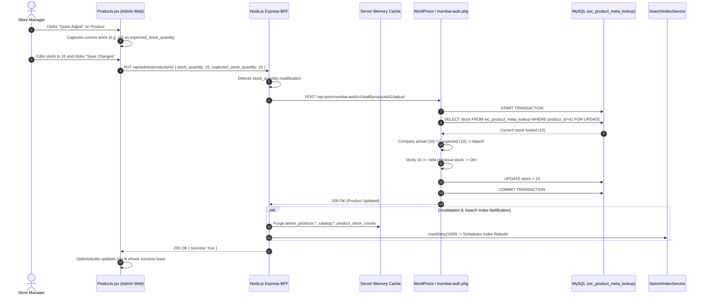

# Admin Audit: Feature 02 — Inventory & Stock Management

> **Feature Scope**: Product Catalog Management, Real-Time Stock Control, Concurrency Safeguards & Category Hierarchy  
> **Target Audience**: Technical Architects, Backend Developers, and System Auditors  
> **Authoritative Baseline**: WordPress HPOS, WooCommerce Data Store & Node.js BFF  
> **Date**: November 2026

---

## 1. High-Level Architecture & System Role

The **Inventory & Stock** module manages the core catalog of the Mumbai Collection store. It provides store managers with tools for browsing, searching, filtering, editing, and soft-deleting products, while guaranteeing real-time inventory consistency across concurrent checkout sessions.

```mermaid
flowchart TD
    subgraph Frontend["Admin Dashboard (React + Vite)"]
        UI["Products.jsx (Catalog Table & Quick Adjust)"]
        Adjuster["productAdjuster.js (Validation & Optimistic Math)"]
        ClientAPI["adminApi.js (getProducts, updateProduct, deleteProduct)"]
        UI --> Adjuster
        UI --> ClientAPI
    end

    subgraph BFF["Node.js Backend (Express BFF)"]
        Router["adminRoutes.js: /products"]
        ProductCtrl["adminProductController.js"]
        SearchIndex["searchIndexService (Search Engine Ingestion)"]
        Cache["serverCache ('admin_products:*', 60s TTL)"]
        SSRF["imageValidator.js (SSRF Defense)"]

        ClientAPI -->|GET /products| Router
        ClientAPI -->|PUT /products/:id (with expected_stock)| Router
        Router --> ProductCtrl
        ProductCtrl <--> Cache
        ProductCtrl -.->|markDirty()| SearchIndex
        ProductCtrl --> SSRF
    end

    subgraph WordPress["WordPress / WooCommerce Backend (PHP)"]
        StaffAdjust["mumbai-auth.php: /staff/products/:id/adjust"]
        WCRest["WooCommerce REST API v3: products"]
        RowLock["MySQL: FOR UPDATE on wc_product_meta_lookup / posts"]
        HoldCheck["wc_get_held_stock_quantity() (Active Checkouts)"]

        ProductCtrl -->|If stock_quantity changed| StaffAdjust
        ProductCtrl -->|Non-stock updates| WCRest
        StaffAdjust --> RowLock
        StaffAdjust --> HoldCheck
        StaffAdjust -->|Authoritative Update| WCRest
    end
```

---

## 2. Frontend Layer (React + Tailwind CSS)

### 2.1 File Map & Responsibilities
- **Page Component**: [`apps/admin-dashboard/src/pages/Products.jsx`](file:///c:/Users/asus/Desktop/Mumbai%20Collection/apps/admin-dashboard/src/pages/Products.jsx) (1,079 lines)
- **Adjustment Helpers**: [`apps/admin-dashboard/src/utils/productAdjuster.js`](file:///c:/Users/asus/Desktop/Mumbai%20Collection/apps/admin-dashboard/src/utils/productAdjuster.js)
- **Read Retry Strategy**: [`apps/admin-dashboard/src/utils/readRetry.js`](file:///c:/Users/asus/Desktop/Mumbai%20Collection/apps/admin-dashboard/src/utils/readRetry.js)
- **API Client**: [`apps/admin-dashboard/src/services/adminApi.js`](file:///c:/Users/asus/Desktop/Mumbai%20Collection/apps/admin-dashboard/src/services/adminApi.js#L48-L67)

### 2.2 Deep Logic & Implementation Details

#### A. Race Condition & Debounce Defense (Lines 62–64, 76–133)
- **400ms Debounce (`searchQuery`)**: Prevents flooding upstream WooCommerce with search requests on every keystroke. Searches require a minimum of 2 characters.
- **Request Counter (`requestIdRef`) & AbortController**:
  ```javascript
  abortControllerRef.current?.abort();
  const controller = new AbortController();
  abortControllerRef.current = controller;
  const currentRequestId = ++requestIdRef.current;
  // ...
  if (currentRequestId !== requestIdRef.current) return;
  ```
  Guarantees that an older slow query returning late will never overwrite the UI of a newer search or filter selection.

#### B. Filter Bar with Live Inventory Badges (Lines 35–37, 111–113)
- Supports 4 stock status buckets: `all`, `instock`, `lowstock` (≤5 units), and `outofstock`.
- Displays real-time counts retrieved from `res.counts` (`all`, `instock`, `lowstock`, `outofstock`).

#### C. Optimistic Quick Adjust Modal (Lines 183–230)
- Opens an inline modal or mobile bottom sheet allowing instant adjustments to `regular_price`, `sale_price`, and `stock_quantity`.
- Uses [`productAdjuster.js`](file:///c:/Users/asus/Desktop/Mumbai%20Collection/apps/admin-dashboard/src/utils/productAdjuster.js):
  - **Sale Price Rule**: Enforces that `sale_price < regular_price`.
  - **Stock Integrity**: Enforces that `stock_quantity` is a non-negative integer.
  - **Optimistic Concurrency Payload**: Sends `expected_stock_quantity: quickAdjustProduct.stock_quantity` to the server to prevent clobbering simultaneous updates.

#### D. Soft Deletion to Trash with Page Auto-Recalculation (Lines 232–250)
- Deleting a product triggers `deleteProduct(id)`, moving the product to WooCommerce Trash (`force: false`).
- If the deleted product was the sole item remaining on page `N` (where `N > 1`), the UI automatically steps back to page `N - 1`:
  ```javascript
  setProducts((prev) => {
    const updated = prev.filter((p) => p.id !== product.id);
    if (updated.length === 0 && page > 1) {
      setPage((p) => Math.max(1, p - 1));
    }
    return updated;
  });
  ```

---

## 3. Node.js BFF (Backend For Frontend) Layer

### 3.1 File Map & Responsibilities
- **Router**: [`apps/backend/src/routes/adminRoutes.js`](file:///c:/Users/asus/Desktop/Mumbai%20Collection/apps/backend/src/routes/adminRoutes.js#L125-L180)
- **Controller**: [`apps/backend/src/controllers/adminProductController.js`](file:///c:/Users/asus/Desktop/Mumbai%20Collection/apps/backend/src/controllers/adminProductController.js)
- **Search Sync**: [`apps/backend/src/services/searchIndexService.js`](file:///c:/Users/asus/Desktop/Mumbai%20Collection/apps/backend/src/services/searchIndexService.js)
- **SSRF Validation**: [`apps/backend/src/utils/imageValidator.js`](file:///c:/Users/asus/Desktop/Mumbai%20Collection/apps/backend/src/utils/imageValidator.js)

### 3.2 Deep Logic & Implementation Details

#### A. Server-Side Caching & Pagination (`getAdminProducts`, Lines 247–363)
- Cache key format: `admin_products:${pageNum}:${limit}:${cleanCategory}:${cleanStockStatus}:${cleanSearch}` (TTL 60s).
- **Decoupled Stock Counts**: Stock summary counts are cached separately (`product_stock_counts`). On keystroke searches, cached counts are reused to avoid heavy full-catalog summary recalculations.

#### B. Optimistic Concurrency Dispatch (`updateProduct`, Lines 431–438)
```javascript
const hasStock = Object.hasOwn(updatePayload, "stock_quantity");
if (hasStock && !Object.hasOwn(req.body, "expected_stock_quantity")) {
  return res.status(409).json({ success: false, message: "Refresh this product before adjusting stock." });
}
const response = hasStock
  ? await wp.post("/wp-json/mumbai-auth/v1/staff/products/" + id + "/adjust", { ...updatePayload, expected_stock_quantity: req.body.expected_stock_quantity })
  : await api.put("products/" + encodeURIComponent(id), updatePayload);
```
- Non-stock edits (e.g. name, prices) go directly to WooCommerce REST API.
- Stock changes route to the atomic PHP adjustment endpoint with row-locking and expected-stock comparison.

#### C. Comprehensive Multi-Tier Cache Invalidation (Lines 439–446, 480–486, 649–655)
Any product modification, deletion, or creation automatically invalidates 6 distinct caches and notifies the search service:
1. `serverCache.invalidatePrefix("admin_products:")` — Flushes admin listing caches.
2. `serverCache.delete("product_stock_counts")` — Flushes stock bucket numbers.
3. `serverCache.invalidatePrefix("catalog:")` — Flushes customer catalog SWR caches.
4. `serverCache.delete("admin:categories")` — Flushes category product counters.
5. `serverCache.delete("seo:sitemap_xml")` — Triggers sitemap regeneration.
6. `searchIndexService.markDirty()` — Informs the local Trie/Inverted index of catalog mutations.

#### D. Category Hierarchy & Term Validation (Lines 31–100, 412–430)
- Browser-supplied parent relations are treated as untrusted.
- `validateProductCategories()` checks that the assigned category exists in WooCommerce, is not `uncategorized`, and satisfies valid parent-child hierarchy.

#### E. SSRF Image Protection & Media State Machine (Lines 589–626, 656–667)
- During product creation with external image URLs, `isSafeExternalImageUrl()` blocks access to private IP ranges (`127.0.0.1`, `10.0.0.0/8`, `192.168.0.0/16`, AWS metadata `169.254.169.254`).
- Newly uploaded media records are moved from status `'pending'` to `'attached'` via `markMediaAttached()`.
- Orphan media records older than 24 hours are safely cleaned up via `triggerOrphanCleanup()`.

---

## 4. WordPress / WooCommerce Core & PHP Layer

### 4.1 File Map & Responsibilities
- **Endpoint**: `/wp-json/mumbai-auth/v1/staff/products/:id/adjust` registered in [`mumbai-auth.php:665`](file:///c:/Users/asus/Desktop/Mumbai%20Collection/mumbai-auth.php#L665)
- **Atomic Handler**: `mumbai_staff_adjust_product()` in [`mumbai-auth.php:5764–5802`](file:///c:/Users/asus/Desktop/Mumbai%20Collection/mumbai-auth.php#L5764-L5802)

### 4.2 Deep Logic & Implementation Details

```php
function mumbai_staff_adjust_product(WP_REST_Request $request) {
    global $wpdb;
    $product = wc_get_product(absint($request['id']));
    $payload = $request->get_json_params();

    // 1. Transaction Start
    if ($wpdb->query('START TRANSACTION') === false) 
        return new WP_Error('stock_unavailable', 'Inventory is unavailable.', ['status' => 503]);

    try {
        $managed_id = $product->get_stock_managed_by_id();

        // 2. Authoritative Database Row Lock
        $stock = $wpdb->get_var(WC_Data_Store::load('product')->get_query_for_stock($managed_id) . ' FOR UPDATE');
        if ($stock === null || $wpdb->last_error) throw new RuntimeException('Could not lock stock row.');

        // 3. Optimistic Concurrency Check
        if (($payload['expected_stock_quantity'] === null && $product->managing_stock()) ||
            ($payload['expected_stock_quantity'] !== null && (float) $stock !== (float) $payload['expected_stock_quantity'])) {
            $wpdb->query('ROLLBACK');
            return new WP_Error('stock_changed', 'Stock changed since you opened this product. Refresh and review the new quantity.', ['status' => 409]);
        }

        // 4. Active Checkout Reservation Protection
        if ((float) $payload['stock_quantity'] < (float) wc_get_held_stock_quantity(wc_get_product($managed_id))) {
            $wpdb->query('ROLLBACK');
            return new WP_Error('stock_reserved', 'This quantity is reserved by active checkouts. Review those orders before reducing stock.', ['status' => 409]);
        }

        // 5. Update via WooCommerce Core REST Controller
        unset($payload['expected_stock_quantity']);
        $update = new WP_REST_Request('PUT');
        $update->set_param('context', 'edit');
        $update->set_param('id', $product->get_id());
        foreach ($payload as $name => $value) $update->set_param($name, $value);
        $response = (new WC_REST_Products_Controller())->update_item($update);
        if (is_wp_error($response)) { $wpdb->query('ROLLBACK'); return $response; }

        // 6. Commit Transaction
        if ($wpdb->query('COMMIT') === false) throw new RuntimeException('Stock commit failed.');
        return $response;
    } catch (Throwable $error) {
        $wpdb->query('ROLLBACK');
        wc_delete_product_transients($product->get_id());
        return new WP_Error('stock_unavailable', 'Could not safely update stock.', ['status' => 503]);
    }
}
```

### Deep Safeguards in PHP:
1. **Row-Level Lock (`FOR UPDATE`)**: Prevents race conditions with concurrent customer checkout deductions.
2. **Conflict Detection (HTTP 409 `stock_changed`)**: If a customer purchased the product while the admin had the edit modal open, the update safely aborts without overwriting unread inventory deductions.
3. **Checkout Reservation Check (HTTP 409 `stock_reserved`)**: Protects shoppers currently in the payment flow by checking `wc_get_held_stock_quantity()`. Admins cannot manually reduce stock below the held quantity.
4. **Transient Purge**: `wc_delete_product_transients()` ensures WooCommerce catalog caches are immediately refreshed.

---

## 5. End-to-End Sequence Diagram



---

## 6. Deep Logic Code & Line Reference Index

| Layer | File Path | Line Range | Core Purpose & Logic |
| :--- | :--- | :--- | :--- |
| **Frontend** | `apps/admin-dashboard/src/pages/Products.jsx` | [L76–84](file:///c:/Users/asus/Desktop/Mumbai%20Collection/apps/admin-dashboard/src/pages/Products.jsx#L76-L84) | 400ms search debounce with minimum 2-character requirement. |
| **Frontend** | `apps/admin-dashboard/src/pages/Products.jsx` | [L87–107](file:///c:/Users/asus/Desktop/Mumbai%20Collection/apps/admin-dashboard/src/pages/Products.jsx#L87-L107) | `requestIdRef` & `AbortController` cancellation for superseded requests. |
| **Frontend** | `apps/admin-dashboard/src/pages/Products.jsx` | [L201–210](file:///c:/Users/asus/Desktop/Mumbai%20Collection/apps/admin-dashboard/src/pages/Products.jsx#L201-L210) | Form validation and dispatch of `expected_stock_quantity` for concurrency check. |
| **Frontend** | `apps/admin-dashboard/src/pages/Products.jsx` | [L244–250](file:///c:/Users/asus/Desktop/Mumbai%20Collection/apps/admin-dashboard/src/pages/Products.jsx#L244-L250) | Auto page-decrement when trashing the last product on a page. |
| **Frontend** | `apps/admin-dashboard/src/utils/productAdjuster.js` | [L10–49](file:///c:/Users/asus/Desktop/Mumbai%20Collection/apps/admin-dashboard/src/utils/productAdjuster.js#L10-L49) | Validates non-negative stock integers and ensures `sale_price < regular_price`. |
| **BFF** | `apps/backend/src/routes/adminRoutes.js` | [L125–180](file:///c:/Users/asus/Desktop/Mumbai%20Collection/apps/backend/src/routes/adminRoutes.js#L125-L180) | Product CRUD route definitions with schema validation and RBAC guards. |
| **BFF** | `apps/backend/src/controllers/adminProductController.js` | [L259–267](file:///c:/Users/asus/Desktop/Mumbai%20Collection/apps/backend/src/controllers/adminProductController.js#L259-L267) | Server-side cache lookup with dynamic media URL transformation. |
| **BFF** | `apps/backend/src/controllers/adminProductController.js` | [L309–312](file:///c:/Users/asus/Desktop/Mumbai%20Collection/apps/backend/src/controllers/adminProductController.js#L309-L312) | Reuses cached stock counts during searches to preserve database performance. |
| **BFF** | `apps/backend/src/controllers/adminProductController.js` | [L431–438](file:///c:/Users/asus/Desktop/Mumbai%20Collection/apps/backend/src/controllers/adminProductController.js#L431-L438) | Routes stock updates to the PHP atomic adjustment endpoint with expected stock. |
| **BFF** | `apps/backend/src/controllers/adminProductController.js` | [L439–446](file:///c:/Users/asus/Desktop/Mumbai%20Collection/apps/backend/src/controllers/adminProductController.js#L439-L446) | Multi-tier cache eviction and search index mutation trigger (`markDirty()`). |
| **BFF** | `apps/backend/src/controllers/adminProductController.js` | [L616–622](file:///c:/Users/asus/Desktop/Mumbai%20Collection/apps/backend/src/controllers/adminProductController.js#L616-L622) | SSRF prevention: blocks localhost and private CIDR ranges for external images. |
| **WordPress PHP** | `mumbai-auth.php` | [L5773–5777](file:///c:/Users/asus/Desktop/Mumbai%20Collection/mumbai-auth.php#L5773-L5777) | Begins transaction and acquires MySQL row-level lock (`FOR UPDATE`). |
| **WordPress PHP** | `mumbai-auth.php` | [L5778–5782](file:///c:/Users/asus/Desktop/Mumbai%20Collection/mumbai-auth.php#L5778-L5782) | Optimistic concurrency check: returns HTTP 409 `stock_changed` on stale stock. |
| **WordPress PHP** | `mumbai-auth.php` | [L5783–5786](file:///c:/Users/asus/Desktop/Mumbai%20Collection/mumbai-auth.php#L5783-L5786) | Checkout reservation safeguard: blocks stock reduction below active cart holds. |
