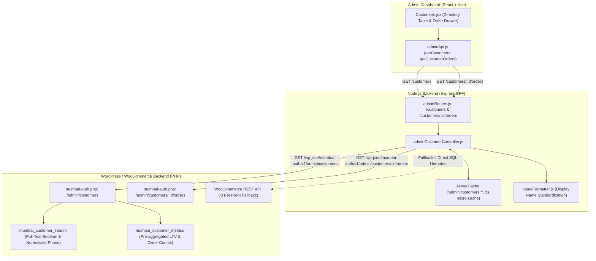
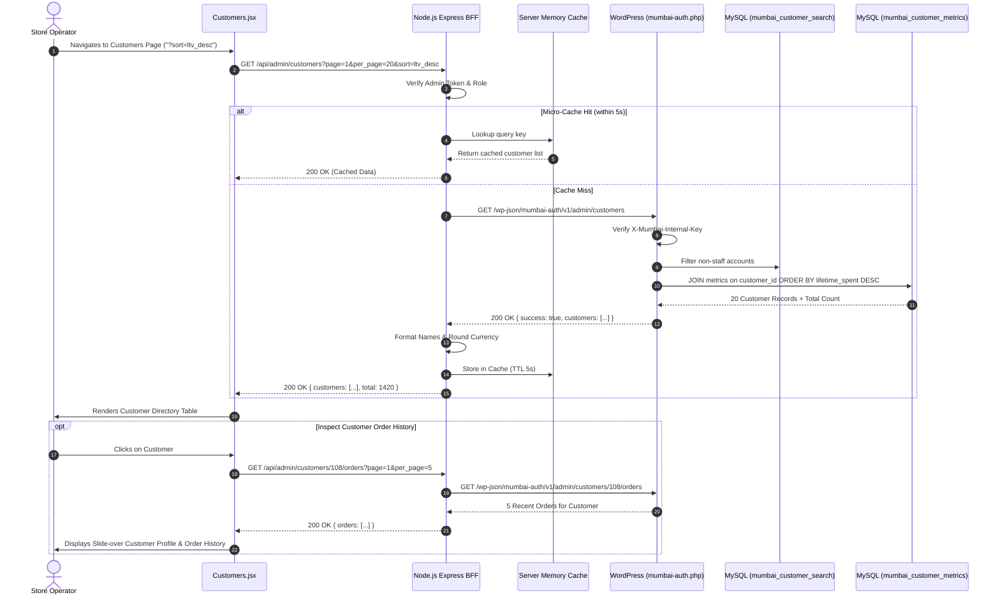

# Admin Audit: Feature 03 — Customer Directory & LTV Analytics

> **Feature Scope**: Customer Intelligence, Pre-Calculated LTV Aggregations, MySQL Boolean Full-Text Search & Paginated Order History  
> **Target Audience**: Technical Architects, Backend Developers, and System Auditors  
> **Authoritative Baseline**: WordPress HPOS, MySQL User Meta & Node.js BFF  
> **Date**: November 2026

---

## 1. High-Level Architecture & System Role

The **Customer Directory** (`/customers`) delivers deep customer intelligence for store operators. Rather than relying on standard WooCommerce user tables which choke under high transaction volumes, it incorporates dedicated indexed search and pre-aggregated customer metrics tables (`mumbai_customer_metrics` and `mumbai_customer_search`), enabling instantaneous sorting by Lifetime Value (LTV), order frequency, registration recency, and geographical location.



---

## 2. Frontend Layer (React + Tailwind CSS)

### 2.1 File Map & Responsibilities
- **Page Component**: [`apps/admin-dashboard/src/pages/Customers.jsx`](file:///c:/Users/asus/Desktop/Mumbai%20Collection/apps/admin-dashboard/src/pages/Customers.jsx) (889 lines)
- **API Client**: [`apps/admin-dashboard/src/services/adminApi.js`](file:///c:/Users/asus/Desktop/Mumbai%20Collection/apps/admin-dashboard/src/services/adminApi.js#L80-L93)

### 2.2 Deep Logic & Implementation Details

#### A. Multi-Parameter State & Search Debouncing (Lines 79–120)
- **Search Query Debounce (400ms)**: Keystroke search accepts names, email addresses, and phone numbers.
- **Sorting Options**:
  - `ltv_desc` (Highest Spenders first — Default)
  - `ltv_asc` (Lowest Spenders first)
  - `orders_desc` (Most Orders)
  - `orders_asc` (Least Orders)
  - `name_asc` (Alphabetical A–Z)
  - `date_desc` (Newest Customers)
  - `date_asc` (Oldest Customers)
- **Location Filter**: Dynamic city selector based on registered billing/shipping cities (e.g. `Vasai`, `Virar`, `Mumbai`).

#### B. Responsive Layout Modes (Lines 468–660)
- **Mobile View (<768px)**: Compact customer cards displaying avatar initials, formatted phone number with direct dial (`tel:`), lifetime spent in INR, order count, and last active date.
- **Desktop View (>=768px)**: Full administrative table featuring customer identity, contact information, city badge, orders count, total spent, and quick action buttons.

#### C. Customer Details Slide-over Drawer & Order History (Lines 680–870)
- Clicking a customer opens a slide-over modal drawer displaying:
  - Account information (ID, Registration Date, Role).
  - Primary contact details and complete billing address.
  - **Paginated Order Stream**: Invokes `getCustomerOrders(customerId, { page, per_page: 5 })` to inspect all historical purchases without truncating or overloading the main customer directory query.
  - **Direct Suspension Deep Link**: Includes an action button directing the admin to `/customer-suspension?email=...` with the customer's email pre-populated.

---

## 3. Node.js BFF (Backend For Frontend) Layer

### 3.1 File Map & Responsibilities
- **Router**: [`apps/backend/src/routes/adminRoutes.js`](file:///c:/Users/asus/Desktop/Mumbai%20Collection/apps/backend/src/routes/adminRoutes.js#L182-L198)
- **Controller**: [`apps/backend/src/controllers/adminCustomerController.js`](file:///c:/Users/asus/Desktop/Mumbai%20Collection/apps/backend/src/controllers/adminCustomerController.js)

### 3.2 Deep Logic & Implementation Details

#### A. RBAC Protection & Pagination Validation (Lines 182–198)
- Secured with `requireAuth("admin")` and `requireRole(["administrator"])`.
- Query parameters validated via Joi schema: `page` (min 1), `per_page` (1–100), `search`, `location`, `sort`.

#### B. 5-Second Micro-Cache with Forced Invalidation (Lines 24–30)
- Normal browsing utilizes a 5-second in-memory cache keyed by slice:
  `admin:customers:p{page}:l{limit}:s{sort}:loc{location}:q{search}`
- If the operator taps the manual Refresh button (`refresh=true` or `refresh=1`):
  `serverCache.invalidatePrefix("admin:customers")` executes, ensuring zero cross-instance staleness and retrieving live database figures.

#### C. Customer Name Standardization (Lines 48–54)
- Formats names using `formatCustomerDisplayName(c.first_name, c.last_name, c.name)`:
  - Handles missing first/last names by falling back to username or guest identifier.
  - Ensures integer rounding on currency amounts (`Math.round(c.lifetimeSpent)`).

#### D. Two-Tier Resilient Order History Fetching (Lines 93–145)
To retrieve a customer's orders in `getAdminCustomerOrders()`:
1. **Tier 1 (Fast Path)**: Queries internal WordPress endpoint `/wp-json/mumbai-auth/v1/admin/customers/:id/orders` which runs direct SQL against HPOS tables.
2. **Tier 2 (Fallback)**: If internal SQL fails or encounters an unrouted proxy condition, it automatically falls back to the WooCommerce REST API (`api.get("orders", { customer: customerId })`), guaranteeing zero downtime for store operators.

---

## 4. WordPress / WooCommerce Core & PHP Layer

### 4.1 File Map & Responsibilities
- **REST Endpoints**: `/wp-json/mumbai-auth/v1/admin/customers` & `/orders` in [`mumbai-auth.php:620–639`](file:///c:/Users/asus/Desktop/Mumbai%20Collection/mumbai-auth.php#L620-L639)
- **Controller Callback**: `mumbai_admin_get_customers()` in [`mumbai-auth.php:5419–5580`](file:///c:/Users/asus/Desktop/Mumbai%20Collection/mumbai-auth.php#L5419-L5580)

### 4.2 Deep Logic & Implementation Details

#### A. Internal Server-to-Server Security Gate (Lines 620–624)
- Enforces `mumbai_internal_server_permission`: verifies the `X-Mumbai-Internal-Key` secret header. Public or unauthorized attempts are rejected with HTTP 403.

#### B. Exclusion of Staff and Administrators (Lines 5447–5460)
The directory filters out non-customer accounts at the database query level:
```sql
NOT EXISTS (
    SELECT 1 FROM {$table_usermeta} cap_not 
    WHERE cap_not.user_id = u.ID 
      AND cap_not.meta_key = 'wp_capabilities' 
      AND (cap_not.meta_value LIKE '%administrator%' OR cap_not.meta_value LIKE '%employee%')
)
```

#### C. Full-Text Boolean & Indian Phone Number Search Index (Lines 5463–5497)
When searching by customer name, email, or mobile number:
1. **Phone Normalization**: Strips non-digits; removes leading Indian country codes (`91`) and zero-prefixes (`0`) to normalize queries down to standard 10-digit mobile numbers.
2. **Full-Text Boolean Match**:
   ```sql
   MATCH(search_text) AGAINST ('+rajesh* +patel*' IN BOOLEAN MODE) 
   OR phone_digits LIKE '9820012345%'
   ```
   Uses MySQL indexed Full-Text search across `mumbai_customer_search`, returning matches in milliseconds without table-scanning `wp_users` and `wp_usermeta`.

#### D. Pre-Calculated Customer Metrics Table (`mumbai_customer_metrics`)
- Instead of computing `SUM(total_amount)` and `COUNT(id)` across millions of order rows during table pagination, customer spend totals are stored in `mumbai_customer_metrics`.
- Sorts on `ltv_desc` and `orders_desc` execute as simple indexed B-tree index scans.

---

## 5. End-to-End Sequence Diagram



---

## 6. Deep Logic Code & Line Reference Index

| Layer | File Path | Line Range | Core Purpose & Logic |
| :--- | :--- | :--- | :--- |
| **Frontend** | `apps/admin-dashboard/src/pages/Customers.jsx` | [L100–120](file:///c:/Users/asus/Desktop/Mumbai%20Collection/apps/admin-dashboard/src/pages/Customers.jsx#L100-L120) | Multi-criteria state hooks (search, sort, location, pagination). |
| **Frontend** | `apps/admin-dashboard/src/pages/Customers.jsx` | [L150–190](file:///c:/Users/asus/Desktop/Mumbai%20Collection/apps/admin-dashboard/src/pages/Customers.jsx#L150-L190) | Fetch customer directory with `AbortController` request racing protection. |
| **Frontend** | `apps/admin-dashboard/src/pages/Customers.jsx` | [L680–870](file:///c:/Users/asus/Desktop/Mumbai%20Collection/apps/admin-dashboard/src/pages/Customers.jsx#L680-L870) | Customer detail slide-over drawer with paginated order stream. |
| **BFF** | `apps/backend/src/routes/adminRoutes.js` | [L182–198](file:///c:/Users/asus/Desktop/Mumbai%20Collection/apps/backend/src/routes/adminRoutes.js#L182-L198) | Admin routes with RBAC verification and Joi pagination schemas. |
| **BFF** | `apps/backend/src/controllers/adminCustomerController.js` | [L24–28](file:///c:/Users/asus/Desktop/Mumbai%20Collection/apps/backend/src/controllers/adminCustomerController.js#L24-L28) | 5-second micro-caching with manual refresh invalidation. |
| **BFF** | `apps/backend/src/controllers/adminCustomerController.js` | [L48–54](file:///c:/Users/asus/Desktop/Mumbai%20Collection/apps/backend/src/controllers/adminCustomerController.js#L48-L54) | Display name formatting and financial integer rounding. |
| **BFF** | `apps/backend/src/controllers/adminCustomerController.js` | [L104–140](file:///c:/Users/asus/Desktop/Mumbai%20Collection/apps/backend/src/controllers/adminCustomerController.js#L104-L140) | Two-tier order history fetch (Internal SQL -> WooCommerce REST fallback). |
| **WordPress PHP** | `mumbai-auth.php` | [L620–639](file:///c:/Users/asus/Desktop/Mumbai%20Collection/mumbai-auth.php#L620-L639) | REST endpoint registration for internal customer directory and orders. |
| **WordPress PHP** | `mumbai-auth.php` | [L5447–5460](file:///c:/Users/asus/Desktop/Mumbai%20Collection/mumbai-auth.php#L5447-L5460) | SQL exclusion of administrator and employee roles from customer lists. |
| **WordPress PHP** | `mumbai-auth.php` | [L5463–5497](file:///c:/Users/asus/Desktop/Mumbai%20Collection/mumbai-auth.php#L5463-L5497) | Full-text boolean search + Indian phone number sanitization (`91`/`0` stripping). |
