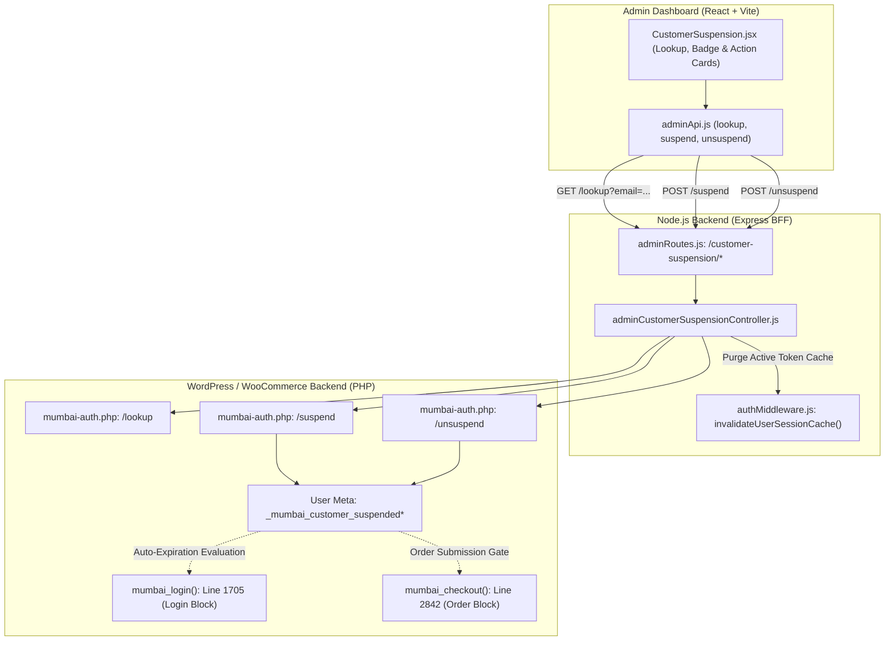
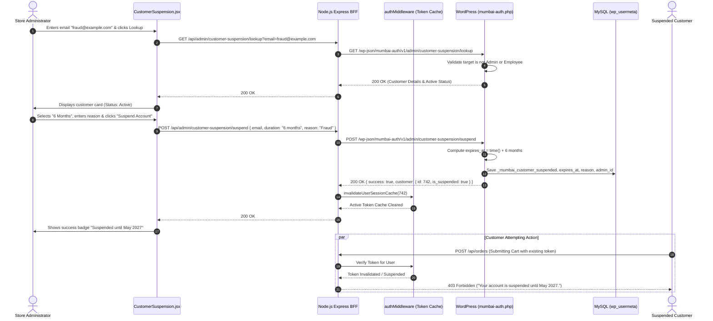

# Admin Audit: Feature 04 — Customer Suspension & Account Enforcement

> **Feature Scope**: Customer Account Moderation, Timed & Permanent Suspensions, Privilege Escalation Defense, and Real-Time Session Invalidation  
> **Target Audience**: Technical Architects, Security Auditors, and Backend Developers  
> **Authoritative Baseline**: WordPress User Meta, Node.js JWT Session Revocation & Mumbai Auth Core  
> **Date**: November 2026

---

## 1. High-Level Architecture & System Role

The **Customer Suspension** module (`/customer-suspension`) provides administrative mechanisms to restrict abusive, fraudulent, or policy-violating customers. It supports both **temporary timed suspensions** (3 months, 6 months) with automatic timestamp expiration, as well as **permanent suspensions**. Crucially, it incorporates role-hierarchy immunity (preventing accidental or malicious suspension of staff/administrators) and triggers immediate real-time session invalidation across active mobile and web clients.



---

## 2. Frontend Layer (React + Tailwind CSS)

### 2.1 File Map & Responsibilities
- **Page Component**: [`apps/admin-dashboard/src/pages/CustomerSuspension.jsx`](file:///c:/Users/asus/Desktop/Mumbai%20Collection/apps/admin-dashboard/src/pages/CustomerSuspension.jsx) (310 lines)
- **API Client**: [`apps/admin-dashboard/src/services/adminApi.js`](file:///c:/Users/asus/Desktop/Mumbai%20Collection/apps/admin-dashboard/src/services/adminApi.js#L151-L167)

### 2.2 Deep Logic & Implementation Details

#### A. Query Param Pre-population & Email Lookup (Lines 40–75)
- Inspects URL query params on mount (`useSearchParams`). If navigated from the Customer Directory or an order card via `?email=customer@example.com`, the form automatically executes `lookupCustomerSuspension(email)`.
- Input is sanitized via `.trim().toLowerCase()`.

#### B. Dynamic Profile State & Status Badging (Lines 80–120)
- Displays customer profile details:
  - Initials Avatar and Display Name
  - Masked / Formatted Phone Number and Registered Date
  - **Active State Badge**:
    - **Active (Green)**: "Active Account — No Restrictions"
    - **Suspended (Red)**: Displays duration pill (`3 Months`, `6 Months`, or `Permanent`) and expiry date.

#### C. Suspension Controls & Duration Presets (Lines 100–140)
- When account is active:
  - Form requires duration selection (`3 months`, `6 months`, `Permanent`).
  - Form accepts an optional administrative reason (e.g. "Repeated fake COD order cancellations").
  - On submit, invokes `suspendCustomer({ email, duration, reason })`.
- When account is already suspended:
  - Form swaps to an unsuspension panel detailing the active suspension reason, time remaining, and admin who enacted it.
  - Clicking "Remove Suspension" triggers `unsuspendCustomer({ email })`.

---

## 3. Node.js BFF (Backend For Frontend) Layer

### 3.1 File Map & Responsibilities
- **Router**: [`apps/backend/src/routes/adminRoutes.js`](file:///c:/Users/asus/Desktop/Mumbai%20Collection/apps/backend/src/routes/adminRoutes.js#L314-L337)
- **Controller**: [`apps/backend/src/controllers/adminCustomerSuspensionController.js`](file:///c:/Users/asus/Desktop/Mumbai%20Collection/apps/backend/src/controllers/adminCustomerSuspensionController.js)
- **Session Purge Middleware**: [`apps/backend/src/middlewares/authMiddleware.js`](file:///c:/Users/asus/Desktop/Mumbai%20Collection/apps/backend/src/middlewares/authMiddleware.js)

### 3.2 Deep Logic & Implementation Details

#### A. RBAC & Joi Request Validation (Lines 314–337, `adminRoutes.js`)
- Enforces `requireAuth("admin")` and `requireRole(["administrator"])`.
- Validates that email conforms to standard RFC 5322 format and duration is one of the supported enum variants.

#### B. Real-Time Token Session Invalidation (Lines 81–85, 129–133)
```javascript
const customerId = response.data?.customer?.id;
if (customerId) {
  invalidateUserSessionCache(customerId);
}
```
- In conventional monolithic WordPress setups, user meta updates do not terminate stateless JWT tokens or active HTTP sessions.
- Here, the BFF intercepts the successful WordPress suspension response and immediately calls `invalidateUserSessionCache(customerId)`.
- Any subsequent API request bearing the customer's JWT token is immediately rejected by `authMiddleware`, cutting off active unauthorized sessions within milliseconds.

---

## 4. WordPress / WooCommerce Core & PHP Layer

### 4.1 File Map & Responsibilities
- **Endpoint Registration**: [`mumbai-auth.php:682–696`](file:///c:/Users/asus/Desktop/Mumbai%20Collection/mumbai-auth.php#L682-L696)
- **Lookup Callback**: `mumbai_admin_customer_suspension_lookup()` in [`mumbai-auth.php:6832–6886`](file:///c:/Users/asus/Desktop/Mumbai%20Collection/mumbai-auth.php#L6832-L6886)
- **Suspend Callback**: `mumbai_admin_customer_suspension_suspend()` in [`mumbai-auth.php:6891–6966`](file:///c:/Users/asus/Desktop/Mumbai%20Collection/mumbai-auth.php#L6891-L6966)
- **Unsuspend Callback**: `mumbai_admin_customer_suspension_unsuspend()` in [`mumbai-auth.php:6971–7000`](file:///c:/Users/asus/Desktop/Mumbai%20Collection/mumbai-auth.php#L6971-L7000)
- **Evaluation Engine**: `mumbai_is_customer_suspended()` in [`mumbai-auth.php:6772–6790`](file:///c:/Users/asus/Desktop/Mumbai%20Collection/mumbai-auth.php#L6772-L6790)

### 4.2 Deep Logic & Implementation Details

#### A. Role-Immunity & Privilege Escalation Defense (Lines 6843–6854, 6906–6917)
```php
$roles = (array) $user->roles;
if (in_array('administrator', $roles, true)) {
    return new WP_Error('invalid_target', 'Administrator accounts cannot be suspended.', ['status' => 400]);
}
if (in_array('employee', $roles, true)) {
    return new WP_Error('invalid_target', 'Employee accounts cannot be suspended.', ['status' => 400]);
}
$is_customer = in_array('customer', $roles, true) || in_array('subscriber', $roles, true);
if (!$is_customer) {
    return new WP_Error('invalid_target', 'Only registered customer accounts can be suspended.', ['status' => 400]);
}
```
- Admins and employees are strictly immune from customer suspension endpoints. This prevents privilege escalation or automated denial-of-service against staff accounts.

#### B. Timestamp-Based Expiration Evaluation (Lines 6772–6790)
Rather than requiring a recurring cron job to un-suspend users when their suspension period ends, `mumbai_is_customer_suspended()` calculates status on-the-fly:
```php
function mumbai_is_customer_suspended($user_id) {
    $user_id = absint($user_id);
    if (!$user_id) return false;

    $is_suspended = get_user_meta($user_id, '_mumbai_customer_suspended', true);
    if ($is_suspended !== 'yes' && $is_suspended !== '1' && $is_suspended !== true) return false;

    $expires_at = (int) get_user_meta($user_id, '_mumbai_customer_suspension_expires_at', true);
    // If expires_at > 0 and time() >= expires_at, temporary suspension has expired
    if ($expires_at > 0 && time() >= $expires_at) {
        return false;
    }
    return true;
}
```
- For permanent suspensions, `expires_at` is set to `0`, causing it to remain suspended indefinitely until manually unsuspended.
- For temporary suspensions (`+3 months` or `+6 months`), access is automatically and safely restored the exact second `time() >= expires_at`.

#### C. Comprehensive Audit Trail (Lines 6941–6947, 6985–6992)
Every suspension and unsuspension action records an audit trail in user meta:
- `_mumbai_customer_suspended`: `'yes'`
- `_mumbai_customer_suspension_expires_at`: Unix timestamp
- `_mumbai_customer_suspension_reason`: Sanitized string explanation
- `_mumbai_customer_suspension_duration`: `'3_months'`, `'6_months'`, or `'permanent'`
- `_mumbai_customer_suspended_at`: Timestamp of action
- `_mumbai_customer_suspended_by`: Admin WordPress user ID
- `_mumbai_customer_unsuspended_at` & `_by`: Recorded on reinstatement

#### D. Store Enforcement Gates
- **Login Block (Line 1705)**: Evaluated during customer authentication. Suspended accounts receive `HTTP 403 Account Suspended` with the expiration date and reason.
- **Checkout Block (Line 2842)**: Evaluated before order submission. Suspended accounts attempting to bypass login via cached sessions are prevented from creating orders.

---

## 5. End-to-End Sequence Diagram



---

## 6. Deep Logic Code & Line Reference Index

| Layer | File Path | Line Range | Core Purpose & Logic |
| :--- | :--- | :--- | :--- |
| **Frontend** | `apps/admin-dashboard/src/pages/CustomerSuspension.jsx` | [L40–75](file:///c:/Users/asus/Desktop/Mumbai%20Collection/apps/admin-dashboard/src/pages/CustomerSuspension.jsx#L40-L75) | Auto-lookup via URL search params and query normalization. |
| **Frontend** | `apps/admin-dashboard/src/pages/CustomerSuspension.jsx` | [L100–140](file:///c:/Users/asus/Desktop/Mumbai%20Collection/apps/admin-dashboard/src/pages/CustomerSuspension.jsx#L100-L140) | Suspend & Unsuspend submission handlers with live feedback. |
| **BFF** | `apps/backend/src/routes/adminRoutes.js` | [L314–337](file:///c:/Users/asus/Desktop/Mumbai%20Collection/apps/backend/src/routes/adminRoutes.js#L314-L337) | Suspension endpoints with Joi validation and admin authorization. |
| **BFF** | `apps/backend/src/controllers/adminCustomerSuspensionController.js` | [L81–85](file:///c:/Users/asus/Desktop/Mumbai%20Collection/apps/backend/src/controllers/adminCustomerSuspensionController.js#L81-L85) | Real-time session invalidation on suspension via `invalidateUserSessionCache`. |
| **BFF** | `apps/backend/src/controllers/adminCustomerSuspensionController.js` | [L129–133](file:///c:/Users/asus/Desktop/Mumbai%20Collection/apps/backend/src/controllers/adminCustomerSuspensionController.js#L129-L133) | Real-time session invalidation on unsuspension. |
| **WordPress PHP** | `mumbai-auth.php` | [L682–696](file:///c:/Users/asus/Desktop/Mumbai%20Collection/mumbai-auth.php#L682-L696) | REST endpoint registrations for lookup, suspend, and unsuspend. |
| **WordPress PHP** | `mumbai-auth.php` | [L6772–6790](file:///c:/Users/asus/Desktop/Mumbai%20Collection/mumbai-auth.php#L6772-L6790) | Zero-cron timestamp-based suspension expiration logic (`time() >= expires_at`). |
| **WordPress PHP** | `mumbai-auth.php` | [L6843–6854](file:///c:/Users/asus/Desktop/Mumbai%20Collection/mumbai-auth.php#L6843-L6854) | Role-immunity check: blocks suspension of admin and employee accounts. |
| **WordPress PHP** | `mumbai-auth.php` | [L6940–6947](file:///c:/Users/asus/Desktop/Mumbai%20Collection/mumbai-auth.php#L6940-L6947) | Audit trail storage in usermeta (duration, reason, admin ID, timestamps). |
| **WordPress PHP** | `mumbai-auth.php` | [L1705, L2842](file:///c:/Users/asus/Desktop/Mumbai%20Collection/mumbai-auth.php#L1705) | Enforcement gates: blocks login and rejects checkout attempts for suspended users. |
