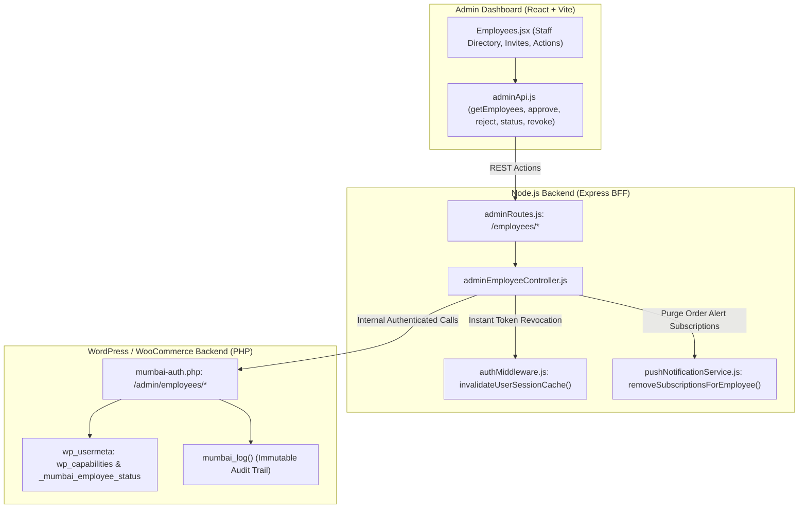
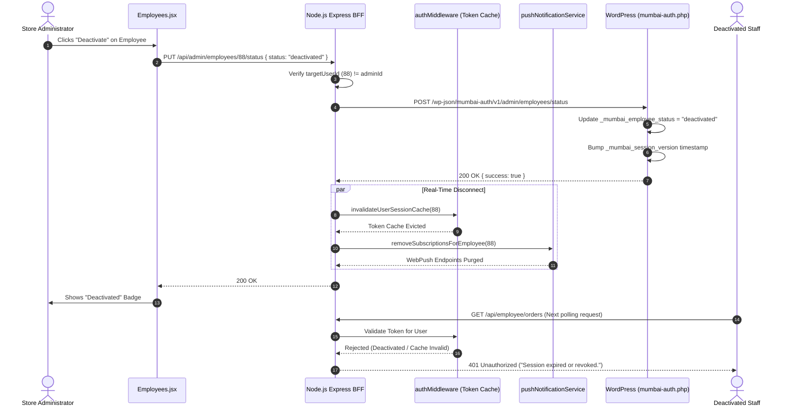

# Admin Audit: Feature 05 — Employee Access & Staff Governance

> **Feature Scope**: Staff Onboarding, Access Approvals, Status Governance, Emergency Session Kill Switches & Push Subscription Purging  
> **Target Audience**: Technical Architects, Security Auditors, and System Administrators  
> **Authoritative Baseline**: WordPress Roles (`employee`), JWT Invalidation Cache & WebPush Notification Engine  
> **Date**: November 2026

---

## 1. High-Level Architecture & System Role

The **Employee Access** module (`/employees`) manages internal store operator credentials. Mumbai Collection distinguishes strictly between store administrators and warehouse/fulfillment employees. This module governs the lifecycle of employee accounts—from initial invite/access request, to administrative approval, temporary deactivation, and immediate session termination.



---

## 2. Frontend Layer (React + Tailwind CSS)

### 2.1 File Map & Responsibilities
- **Page Component**: [`apps/admin-dashboard/src/pages/Employees.jsx`](file:///c:/Users/asus/Desktop/Mumbai%20Collection/apps/admin-dashboard/src/pages/Employees.jsx) (720 lines)
- **API Client**: [`apps/admin-dashboard/src/services/adminApi.js`](file:///c:/Users/asus/Desktop/Mumbai%20Collection/apps/admin-dashboard/src/services/adminApi.js#L101-L148)

### 2.2 Deep Logic & Implementation Details

#### A. Staff Directory & Lifecycle Status Filter (Lines 30–80)
- Fetches all staff members via `getEmployees({ search, status })`.
- Status buckets:
  - `active`: Fully authorized staff operating the employee panel (`/employee`).
  - `pending`: Prospective staff awaiting administrator approval.
  - `deactivated`: Suspended staff barred from dashboard entry.

#### B. Access Request & Invite Modal (Lines 85–130)
- Store managers input a target corporate email and optional onboarding notes.
- Submits via `createEmployeeAccess({ email, role: "employee", notes })`.
- Validates standard email structure via regex before network dispatch.

#### C. Approval & Rejection Workflows (Lines 140–210)
- **Approve**: Promotes a user to active status with the `'employee'` capability.
- **Reject**: Prompts for an optional reason, terminates any pending request, and revokes login privileges.

#### D. Emergency Session Kill Switch (Lines 220–260)
- For compromised or terminated staff, the operator clicks **"Revoke All Sessions"**.
- Displays confirmation modal warning that all active desktop and mobile sessions will be immediately severed.
- Invokes `revokeEmployeeSessions(employeeId)`.

---

## 3. Node.js BFF (Backend For Frontend) Layer

### 3.1 File Map & Responsibilities
- **Router**: [`apps/backend/src/routes/adminRoutes.js`](file:///c:/Users/asus/Desktop/Mumbai%20Collection/apps/backend/src/routes/adminRoutes.js#L242-L290)
- **Controller**: [`apps/backend/src/controllers/adminEmployeeController.js`](file:///c:/Users/asus/Desktop/Mumbai%20Collection/apps/backend/src/controllers/adminEmployeeController.js)
- **Session Purge Middleware**: [`apps/backend/src/middlewares/authMiddleware.js`](file:///c:/Users/asus/Desktop/Mumbai%20Collection/apps/backend/src/middlewares/authMiddleware.js)
- **Push Notification Service**: [`apps/backend/src/services/pushNotificationService.js`](file:///c:/Users/asus/Desktop/Mumbai%20Collection/apps/backend/src/services/pushNotificationService.js)

### 3.2 Deep Logic & Implementation Details

#### A. Self-Action Lockout Defense (Lines 103–108, 161–166, 215–220, 277–282)
The controller strictly prevents administrators from accidentally or maliciously locking themselves out:
```javascript
if (Number(req.wpUserId) === targetUserId || Number(req.user?.id) === targetUserId) {
  return res.status(400).json({
    success: false,
    message: "Administrators cannot deactivate or revoke their own account via employee management.",
  });
}
```

#### B. Strict Role Whitelisting (Lines 6, 52–57, 110–115)
- Only the explicit role `'employee'` can be requested or approved (`ALLOWED_EMPLOYEE_ROLES = ["employee"]`).
- Any attempt to pass `'administrator'` or arbitrary custom roles is rejected at the API boundary, defeating privilege escalation attempts.

#### C. Real-Time Token Invalidation & Session Termination (Lines 132, 182, 243, 296)
```javascript
invalidateUserSessionCache(targetUserId);
```
- In conventional JWT implementations, tokens remain valid until expiration. Mumbai Collection’s BFF verifies the token's `user.id` against an in-memory revocation cache on every authenticated request.
- Deactivating an employee or revoking their sessions immediately evicts their authorization cache, cutting off access on their next request.

#### D. Push Notification Cleanup (Lines 183–188, 245–250, 297–302)
```javascript
await removeSubscriptionsForEmployee(targetUserId);
```
- Deactivated or rejected employees must not continue receiving confidential live order sound chimes or push notifications.
- The BFF invokes `removeSubscriptionsForEmployee(targetUserId)` to purge all WebPush subscription endpoints from the database.

---

## 4. WordPress / WooCommerce Core & PHP Layer

### 4.1 File Map & Responsibilities
- **Endpoint Registrations**: [`mumbai-auth.php:600–618`](file:///c:/Users/asus/Desktop/Mumbai%20Collection/mumbai-auth.php#L600-L618)
- **Controller Handlers**: `mumbai_admin_*` in [`mumbai-auth.php:5100–5415`](file:///c:/Users/asus/Desktop/Mumbai%20Collection/mumbai-auth.php#L5100-L5415)

### 4.2 Deep Logic & Implementation Details

#### A. Internal Server-to-Server Security Gate
- Enforces `mumbai_internal_server_permission`: validates `X-Mumbai-Internal-Key` with `hash_equals()`.

#### B. Role Separation & Capabilities Assignment
- WordPress natively uses the `wp_capabilities` user meta key.
- Upon approval, the user's role is set strictly to `employee`:
  ```php
  $user->set_role('employee');
  update_user_meta($user_id, '_mumbai_employee_status', 'active');
  update_user_meta($user_id, '_mumbai_employee_approved_at', time());
  update_user_meta($user_id, '_mumbai_employee_approved_by', $admin_id);
  ```

#### C. Session Invalidation Seed (`_mumbai_session_version`)
- When sessions are revoked or status is deactivated:
  ```php
  update_user_meta($user_id, '_mumbai_session_version', time());
  delete_user_meta($user_id, '_mumbai_auth_tokens');
  ```
  Any older JWTs minted with an earlier timestamp or version tag are rejected during authentication checks in `mumbai-auth.php:1680`.

---

## 5. End-to-End Sequence Diagram



---

## 6. Deep Logic Code & Line Reference Index

| Layer | File Path | Line Range | Core Purpose & Logic |
| :--- | :--- | :--- | :--- |
| **Frontend** | `apps/admin-dashboard/src/pages/Employees.jsx` | [L60–80](file:///c:/Users/asus/Desktop/Mumbai%20Collection/apps/admin-dashboard/src/pages/Employees.jsx#L60-L80) | Fetches staff list with status and search filters. |
| **Frontend** | `apps/admin-dashboard/src/pages/Employees.jsx` | [L220–260](file:///c:/Users/asus/Desktop/Mumbai%20Collection/apps/admin-dashboard/src/pages/Employees.jsx#L220-L260) | Emergency session revocation action trigger with confirmation modal. |
| **BFF** | `apps/backend/src/routes/adminRoutes.js` | [L242–290](file:///c:/Users/asus/Desktop/Mumbai%20Collection/apps/backend/src/routes/adminRoutes.js#L242-L290) | Staff governance endpoints with RBAC administrator checks. |
| **BFF** | `apps/backend/src/controllers/adminEmployeeController.js` | [L103–108](file:///c:/Users/asus/Desktop/Mumbai%20Collection/apps/backend/src/controllers/adminEmployeeController.js#L103-L108) | Self-action lockout defense preventing admins from deactivating themselves. |
| **BFF** | `apps/backend/src/controllers/adminEmployeeController.js` | [L132, L243](file:///c:/Users/asus/Desktop/Mumbai%20Collection/apps/backend/src/controllers/adminEmployeeController.js#L132) | Real-time session invalidation via `invalidateUserSessionCache`. |
| **BFF** | `apps/backend/src/controllers/adminEmployeeController.js` | [L183–188](file:///c:/Users/asus/Desktop/Mumbai%20Collection/apps/backend/src/controllers/adminEmployeeController.js#L183-L188) | Purges live WebPush notification endpoints for terminated staff. |
| **WordPress PHP** | `mumbai-auth.php` | [L600–618](file:///c:/Users/asus/Desktop/Mumbai%20Collection/mumbai-auth.php#L600-L618) | Internal staff administration REST endpoint registrations. |
| **WordPress PHP** | `mumbai-auth.php` | [L5200–5250](file:///c:/Users/asus/Desktop/Mumbai%20Collection/mumbai-auth.php#L5200-L5250) | Role assignment and `_mumbai_session_version` invalidation timestamps. |
