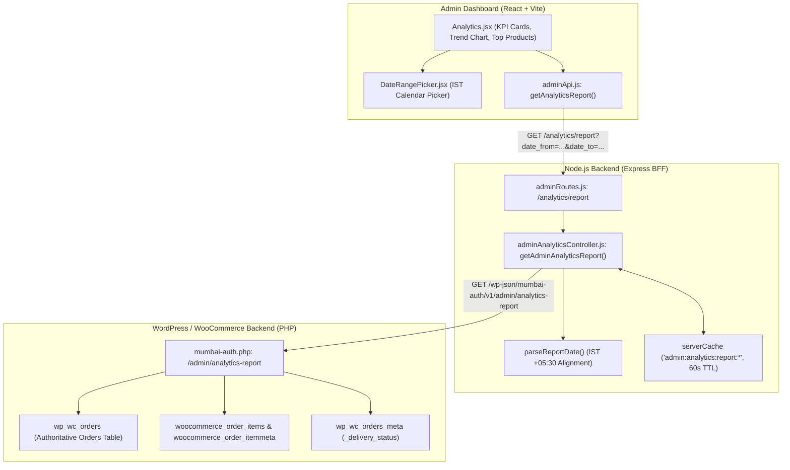
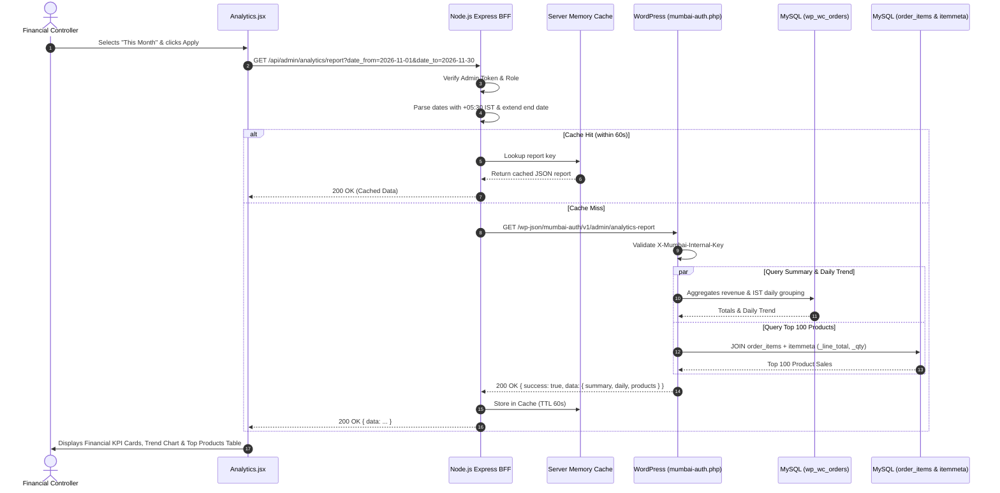

# Admin Audit: Feature 06 — Sales Analytics & Deep Reporting

> **Feature Scope**: Financial Reporting, HPOS Date-Range Queries, Product-Specific Sales Performance, and Clean Revenue Accounting  
> **Target Audience**: Financial Controllers, System Architects, and Data Engineers  
> **Authoritative Baseline**: WordPress HPOS (`wp_wc_orders`), Line Item Meta (`_line_total`, `_qty`) & Node.js BFF  
> **Date**: November 2026

---

## 1. High-Level Architecture & System Role

The **Sales Analytics** module (`/analytics`) delivers deep commercial intelligence. Unlike standard analytics tools that mix uncaptured or abandoned carts into gross revenue, Mumbai Collection enforces strict **clean-revenue accounting**. Operators can filter reports across arbitrary calendar dates or quick presets (Today, Yesterday, Last 7 Days, Last 30 Days, This Month), and isolate sales for a single specific product.



---

## 2. Frontend Layer (React + Tailwind CSS)

### 2.1 File Map & Responsibilities
- **Page Component**: [`apps/admin-dashboard/src/pages/Analytics.jsx`](file:///c:/Users/asus/Desktop/Mumbai%20Collection/apps/admin-dashboard/src/pages/Analytics.jsx) (397 lines)
- **Date Selector**: [`apps/admin-dashboard/src/components/common/DateRangePicker.jsx`](file:///c:/Users/asus/Desktop/Mumbai%20Collection/apps/admin-dashboard/src/components/common/DateRangePicker.jsx)
- **API Client**: [`apps/admin-dashboard/src/services/adminApi.js`](file:///c:/Users/asus/Desktop/Mumbai%20Collection/apps/admin-dashboard/src/services/adminApi.js#L90-L98)

### 2.2 Deep Logic & Implementation Details

#### A. Preset & Custom Date Selection (Lines 45–95)
- Supports one-click temporal presets:
  - **Today** (`today`)
  - **Yesterday** (`yesterday`)
  - **Last 7 Days** (`7days`)
  - **Last 30 Days** (`30days`)
  - **This Month** (`month`)
  - **Custom Range**: Custom start and end date pickers.
- All date values are normalized to `YYYY-MM-DD` strings adhering to Indian Standard Time.

#### B. Single-Product Isolation Dropdown (Lines 60–75, 110–130)
- Stores an optional `selectedProduct` state.
- Operators can evaluate store-wide sales or select an individual product from the catalog (e.g. "Timex watch") to view only that product's units sold, order count, and dedicated revenue trend.

#### C. Executive Summary KPI Cards (Lines 200–250)
1. **Total Sales**: Clean gross revenue from valid orders formatted in INR.
2. **Total Orders**: Distinct count of placed orders within the selected window.
3. **Average Order Value (AOV)**: Derived via `Math.round(revenue / orders_count)`.
4. **Fulfilled Revenue**: Revenue strictly from orders with status `completed` (delivered).

#### D. Top-Selling Products Performance Table (Lines 310–390)
- Lists the top 100 revenue-generating products in the selected timeframe.
- Columns: Product Name, Units Sold (`units_sold`), Orders Containing Item (`orders_count`), and Total Product Revenue (`product_revenue`).

---

## 3. Node.js BFF (Backend For Frontend) Layer

### 3.1 File Map & Responsibilities
- **Router**: [`apps/backend/src/routes/adminRoutes.js`](file:///c:/Users/asus/Desktop/Mumbai%20Collection/apps/backend/src/routes/adminRoutes.js#L233-L240)
- **Controller**: [`apps/backend/src/controllers/adminAnalyticsController.js`](file:///c:/Users/asus/Desktop/Mumbai%20Collection/apps/backend/src/controllers/adminAnalyticsController.js#L363-L422)

### 3.2 Deep Logic & Implementation Details

#### A. Date Parsing & Calendar Integrity (`parseReportDate`, Lines 363–373)
```javascript
const parseReportDate = (value) => {
  if (!/^\d{4}-\d{2}-\d{2}$/.test(String(value || ""))) return null;
  const [year, month, day] = value.split("-").map(Number);
  const calendarDate = new Date(Date.UTC(year, month - 1, day));
  if (
    calendarDate.getUTCFullYear() !== year ||
    calendarDate.getUTCMonth() !== month - 1 ||
    calendarDate.getUTCDate() !== day
  ) return null;
  return Date.parse(`${value}T00:00:00+05:30`);
};
```
- Rejects non-existent calendar dates (e.g. `2026-02-30`).
- Parses strings strictly with `+05:30` IST offset, preventing UTC conversion errors.

#### B. Exclusive Boundary Extension (Line 398)
```javascript
const endExclusive = end + 24 * 60 * 60 * 1000;
```
- When an operator requests sales from `2026-11-01` to `2026-11-04`, the query must include all orders placed up to `23:59:59` on November 4th. The BFF extends the boundary to `2026-11-05T00:00:00+05:30` and uses `< date_before`.

#### C. Query-Specific Cache Keys (Lines 389–396)
- Cache key: `admin:analytics:report:${dateFrom}:${dateTo}:${productId || "all"}`
- TTL: 60 seconds.
- Bypassed if `refresh=true` or `refresh=1` is passed in query parameters.

---

## 4. WordPress / WooCommerce Core & PHP Layer

### 4.1 File Map & Responsibilities
- **Endpoint Registration**: [`mumbai-auth.php:675–679`](file:///c:/Users/asus/Desktop/Mumbai%20Collection/mumbai-auth.php#L675-L679)
- **Report Handler**: `mumbai_admin_get_analytics_report()` in [`mumbai-auth.php:6200–6320`](file:///c:/Users/asus/Desktop/Mumbai%20Collection/mumbai-auth.php#L6200-L6320)

### 4.2 Deep Logic & Implementation Details

#### A. Authoritative HPOS Availability Check (Lines 6205–6208)
- Requires WooCommerce High-Performance Order Storage (`wp_wc_orders`). If missing or disabled, aborts early with HTTP 503.

#### B. Single-Product Subquery CTE (Lines 6219–6229)
When a product filter is applied (`$product_id > 0`), the orders query source is dynamically swapped for an optimized subquery that calculates product totals on line items before joining orders:
```sql
SELECT sale.id, sale.status, sale.date_created_gmt, totals.total_amount
FROM {$reporting_source} sale 
INNER JOIN (
    SELECT item.order_id, SUM(CAST(line.meta_value AS DECIMAL(20,6))) AS total_amount
    FROM {$items_table} item 
    JOIN {$itemmeta_source} product ON product.order_item_id = item.order_item_id AND product.meta_key = '_product_id'
    JOIN {$itemmeta_source} line ON line.order_item_id = item.order_item_id AND line.meta_key = '_line_total'
    WHERE item.order_item_type = 'line_item' AND CAST(product.meta_value AS UNSIGNED) = %d
    GROUP BY item.order_id
) totals ON totals.order_id = sale.id
```

#### C. Clean Revenue Status Enforcer (Lines 6232–6240)
```sql
WHERE REPLACE(LOWER(TRIM(o.status)), 'wc-', '') IN ('processing', 'completed')
```
- Restricts revenue counting exclusively to paid orders. Unpaid drafts, cancelled, failed, and refunded orders are strictly excluded from financial calculations.

#### D. Indian Standard Time Trend Grouping (Lines 6255–6268)
Daily sales grouping executes in MySQL using `INTERVAL 330 MINUTE`:
```sql
SELECT DATE(DATE_ADD(o.date_created_gmt, INTERVAL 330 MINUTE)) AS report_date,
       COUNT(DISTINCT o.id) AS orders_count,
       COALESCE(SUM(o.total_amount), 0) AS revenue
FROM {$reporting_source} o
{$join_status}
WHERE o.date_created_gmt >= %s AND o.date_created_gmt < %s
  AND {$valid_status}
GROUP BY report_date
ORDER BY report_date ASC
```

#### E. Top Products Ingestion (Lines 6282–6300)
Joins `woocommerce_order_items` and item meta (`_product_id`, `_qty`, `_line_total`) to aggregate revenue and units sold per product, returning the top 100 items ordered by total revenue.

---

## 5. End-to-End Sequence Diagram



---

## 6. Deep Logic Code & Line Reference Index

| Layer | File Path | Line Range | Core Purpose & Logic |
| :--- | :--- | :--- | :--- |
| **Frontend** | `apps/admin-dashboard/src/pages/Analytics.jsx` | [L45–95](file:///c:/Users/asus/Desktop/Mumbai%20Collection/apps/admin-dashboard/src/pages/Analytics.jsx#L45-L95) | Date preset resolution (Today, Yesterday, 7 Days, Month, Custom). |
| **Frontend** | `apps/admin-dashboard/src/pages/Analytics.jsx` | [L60–75](file:///c:/Users/asus/Desktop/Mumbai%20Collection/apps/admin-dashboard/src/pages/Analytics.jsx#L60-L75) | Optional single-product isolation filter. |
| **BFF** | `apps/backend/src/routes/adminRoutes.js` | [L233–240](file:///c:/Users/asus/Desktop/Mumbai%20Collection/apps/backend/src/routes/adminRoutes.js#L233-L240) | Report route definition with Joi schema validation. |
| **BFF** | `apps/backend/src/controllers/adminAnalyticsController.js` | [L363–373](file:///c:/Users/asus/Desktop/Mumbai%20Collection/apps/backend/src/controllers/adminAnalyticsController.js#L363-L373) | Calendar date validator and IST timezone parser (`parseReportDate`). |
| **BFF** | `apps/backend/src/controllers/adminAnalyticsController.js` | [L398](file:///c:/Users/asus/Desktop/Mumbai%20Collection/apps/backend/src/controllers/adminAnalyticsController.js#L398) | Adds 24h to `dateTo` to create an exclusive end boundary covering the full day. |
| **WordPress PHP** | `mumbai-auth.php` | [L675–679](file:///c:/Users/asus/Desktop/Mumbai%20Collection/mumbai-auth.php#L675-L679) | REST route registration for `/admin/analytics-report`. |
| **WordPress PHP** | `mumbai-auth.php` | [L6219–6229](file:///c:/Users/asus/Desktop/Mumbai%20Collection/mumbai-auth.php#L6219-L6229) | Dynamic subquery isolating single-product line item sales. |
| **WordPress PHP** | `mumbai-auth.php` | [L6234–6240](file:///c:/Users/asus/Desktop/Mumbai%20Collection/mumbai-auth.php#L6234-L6240) | Strict clean revenue status filtering (`processing`, `completed`). |
| **WordPress PHP** | `mumbai-auth.php` | [L6255–6268](file:///c:/Users/asus/Desktop/Mumbai%20Collection/mumbai-auth.php#L6255-L6268) | MySQL IST grouping: `DATE(DATE_ADD(o.date_created_gmt, INTERVAL 330 MINUTE))`. |
| **WordPress PHP** | `mumbai-auth.php` | [L6282–6300](file:///c:/Users/asus/Desktop/Mumbai%20Collection/mumbai-auth.php#L6282-L6300) | Top 100 revenue products query joining `woocommerce_order_items` and meta. |
