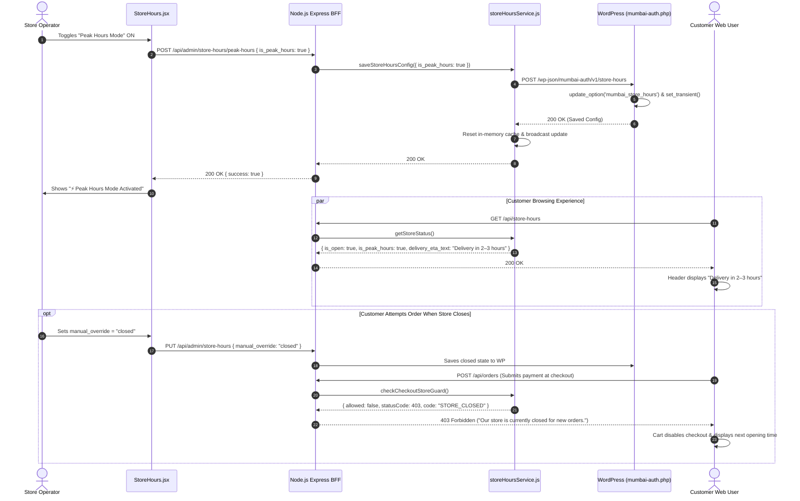

# Admin Audit: Feature 07 — Store Operating Hours & Real-Time Checkout Guards

> **Feature Scope**: Store Scheduling, Overnight Shift Evaluation, Peak-Hours Traffic Controls, Emergency Overrides, and Fail-Closed Checkout Guards  
> **Target Audience**: Technical Architects, Store Operations Managers, and Reliability Engineers  
> **Authoritative Baseline**: WordPress Options / Transients, Node.js Memory Fallback Cache & Order Intake Guard  
> **Date**: November 2026

---

## 1. High-Level Architecture & System Role

The **Store Hours** module (`/store-hours`) governs customer intake and operational readiness. In a quick-commerce retail environment like Mumbai Collection (dispatching from the Vasai physical store), store hours cannot be treated merely as a static display label. This system functions as an **authoritative traffic and checkout gatekeeper**:
1. Dynamically calculates open/closed states in Asia/Kolkata (IST, UTC+05:30).
2. Manages overnight shift spillovers across midnight boundaries.
3. Provides an instant **Peak Hours Mode** switch (adjusting customer ETA from `60–90 mins` to `2–3 hours`).
4. Enforces an atomic checkout guard (`checkCheckoutStoreGuard`) across cart, checkout, and Razorpay payment intent creation.

```mermaid
flowchart TD
    subgraph FrontendAdmin["Admin Dashboard (React + Vite)"]
        UI["StoreHours.jsx (Schedule Matrix, Peak Toggle, Overrides)"]
        ClientAPI["adminApi.js: updateStoreHours(), togglePeakHours()"]
        UI --> ClientAPI
    end

    subgraph BFF["Node.js Backend (Express BFF)"]
        Router["adminRoutes.js: /store-hours"]
        PublicRouter["storeHoursRoutes.js: /api/store-hours"]
        StoreService["storeHoursService.js (IST Time Evaluation Engine)"]
        Guard["checkCheckoutStoreGuard() (Checkout Interceptor)"]
        MemCache["In-Memory Cache (60s TTL, 5m Fallback Grace)"]

        ClientAPI --> Router
        PublicRouter --> StoreService
        Router --> StoreService
        StoreService <--> MemCache
        OrderIntake["ordersController.js / paymentController.js"] --> Guard
        Guard --> StoreService
    end

    subgraph CustomerApp["Customer Web App (Shoppers)"]
        Cart["Cart.jsx (Store Closed Banner & Polling)"]
        Header["Header.jsx (Delivery ETA Capsule)"]
        PublicRouter -.-> Cart
        PublicRouter -.-> Header
    end

    subgraph WordPress["WordPress Backend (PHP)"]
        WPEndpoints["mumbai-auth.php: /store-hours"]
        Options["wp_options ('mumbai_store_hours')"]
        Transients["wp_transients ('mumbai_store_hours', 24h)"]

        StoreService -->|PUT /store-hours (Internal Key)| WPEndpoints
        WPEndpoints --> Options
        WPEndpoints --> Transients
    end
```

---

## 2. Frontend Layer (React + Tailwind CSS)

### 2.1 File Map & Responsibilities
- **Page Component**: [`apps/admin-dashboard/src/pages/StoreHours.jsx`](file:///c:/Users/asus/Desktop/Mumbai%20Collection/apps/admin-dashboard/src/pages/StoreHours.jsx) (908 lines)
- **API Client**: [`apps/admin-dashboard/src/services/adminApi.js`](file:///c:/Users/asus/Desktop/Mumbai%20Collection/apps/admin-dashboard/src/services/adminApi.js#L132-L148)

### 2.2 Deep Logic & Implementation Details

#### A. Real-Time IST Clock & Live Preview (Lines 180–210)
- Ticks every second in Indian Standard Time (`Asia/Kolkata`), comparing live wall-clock time against configured day schedules.
- Renders an executive banner showing:
  - Current IST Date & Time (e.g. `11:45 AM IST, Wednesday`).
  - Evaluated status badge (**STORE OPEN** in green vs. **STORE CLOSED** in red).
  - Calculated next opening time (e.g. `Opens tomorrow at 9:00 AM IST`).

#### B. Peak Hours Fast-Action Switch (Lines 265–315)
- During high-demand spikes or bad weather:
  - Admins flip the **Peak Hours Mode** toggle.
  - Automatically updates customer-facing ETA across the website from `normal_delivery_text` ("Delivery in 60–90 mins") to `peak_delivery_text` ("Delivery in 2–3 hours").
  - Displays a high-visibility warning banner in the customer web app.

#### C. Manual Override Toggles (Lines 320–360)
- **Auto (Schedule Driven)**: Standard operational mode adhering to the 7-day schedule.
- **Force Open**: Manually opens the store immediately, overriding closed schedule windows.
- **Force Closed (Emergency)**: Manually closes the store immediately (e.g. for inventory counting or unexpected outages), displaying the customized `closed_message`.

#### D. 7-Day Operating Schedule Matrix (Lines 370–500)
- Interactive daily matrix for each day (`monday` through `sunday`).
- Fields per day:
  - Toggle Enabled/Disabled (`is_enabled`).
  - Open Time (`open`, 24h format `HH:MM`).
  - Close Time (`close`, 24h format `HH:MM`).
- Supports regular shifts (`09:00` to `22:00`), 24-hour operation (`00:00` to `00:00`), and overnight shifts (`18:00` to `02:00`).

---

## 3. Node.js BFF (Backend For Frontend) Layer

### 3.1 File Map & Responsibilities
- **Admin Router**: [`apps/backend/src/routes/adminRoutes.js`](file:///c:/Users/asus/Desktop/Mumbai%20Collection/apps/backend/src/routes/adminRoutes.js#L292-L312)
- **Public Router**: [`apps/backend/src/routes/storeHoursRoutes.js`](file:///c:/Users/asus/Desktop/Mumbai%20Collection/apps/backend/src/routes/storeHoursRoutes.js)
- **Core Service Engine**: [`apps/backend/src/services/storeHoursService.js`](file:///c:/Users/asus/Desktop/Mumbai%20Collection/apps/backend/src/services/storeHoursService.js)
- **Admin Controller**: [`apps/backend/src/controllers/adminStoreHoursController.js`](file:///c:/Users/asus/Desktop/Mumbai%20Collection/apps/backend/src/controllers/adminStoreHoursController.js)

### 3.2 Deep Logic & Implementation Details

#### A. IST Time Component Extraction (`getISTTimeComponents`, Lines 162–206)
- Evaluates reference dates strictly in `Asia/Kolkata` using `Intl.DateTimeFormat`:
  ```javascript
  const formatter = new Intl.DateTimeFormat("en-US", {
    timeZone: "Asia/Kolkata",
    weekday: "long",
    hour: "2-digit",
    minute: "2-digit",
    hour12: false,
  });
  ```
- Normalizes hour `24` to `0` and computes total minutes elapsed since midnight (`hour * 60 + minute`).

#### B. Overnight Shift Spillover Algorithm (`evaluateStoreStatus`, Lines 267–282)
When evaluating whether the store is open past midnight (e.g. at 01:30 AM on Tuesday morning):
```javascript
// Check if yesterday had an overnight shift that is still active past midnight today
if (yesterdaySchedule && yesterdaySchedule.is_enabled) {
  const yOpenM = timeToMinutes(yesterdaySchedule.open);
  const yCloseM = timeToMinutes(yesterdaySchedule.close);

  // Overnight shift condition: open > close (e.g. 18:00 to 02:00)
  if (yOpenM > yCloseM && ist.currentMinutes < yCloseM) {
    isOpen = true;
    activeShift = { day: yesterdayName, open: yesterdaySchedule.open, close: yesterdaySchedule.close, is_spillover: true };
  }
}
```
If current minutes (`90`) are less than yesterday's close minutes (`120`), the engine identifies an active overnight shift spillover and keeps the store open.

#### C. Two-Tier Caching & Fallback Resilience (Lines 35–45, 414–506)
- **Primary Cache**: In-memory cache with 60-second TTL (`CACHE_TTL_MS`).
- **Last-Known-Good Fallback (`lastKnownGoodConfig`)**: If the upstream WordPress instance is temporarily restarting or uncontactable, the service falls back to `lastKnownGoodConfig` for up to 5 minutes (`MAX_FALLBACK_CONFIG_AGE_MS = 300,000ms`).
- **Fail-Closed Protection**: If the outage exceeds 5 minutes without a verified configuration, the service transitions to fail-closed state (`503 STORE_HOURS_UNAVAILABLE`), preventing unauthorized or unfulfillable order intake.

#### D. Authoritative Checkout Guard (`checkCheckoutStoreGuard`, Lines 580–650)
Every order creation and payment authorization flow invokes `checkCheckoutStoreGuard()` before charging credit cards or creating pending orders:
```javascript
if (!storeStatus.is_open) {
  return {
    allowed: false,
    statusCode: 403,
    payload: {
      code: "STORE_CLOSED",
      message: storeStatus.closed_message || "Our store is currently closed for new orders.",
      next_opening: storeStatus.next_opening,
    },
  };
}
```
Shoppers cannot bypass store closures by scripting API calls or holding open cart checkout tabs past closing time.

---

## 4. WordPress / WooCommerce Core & PHP Layer

### 4.1 File Map & Responsibilities
- **REST Endpoints**: `/wp-json/mumbai-auth/v1/store-hours` registered in [`mumbai-auth.php:500–519`](file:///c:/Users/asus/Desktop/Mumbai%20Collection/mumbai-auth.php#L500-L519)
- **Storage Callbacks**: `mumbai_get_store_hours()` & `mumbai_save_store_hours()` in [`mumbai-auth.php:4943–4969`](file:///c:/Users/asus/Desktop/Mumbai%20Collection/mumbai-auth.php#L4943-L4969)

### 4.2 Deep Logic & Implementation Details

#### A. Fast Read via WordPress Transients (Lines 4943–4952)
```php
function mumbai_get_store_hours() {
    $hours = get_transient('mumbai_store_hours');
    if ($hours === false || $hours === null) {
        $hours = get_option('mumbai_store_hours', null);
    }
    return rest_ensure_response([
        'success'     => true,
        'store_hours' => $hours,
    ]);
}
```
- Store configuration is cached in MySQL object transients (`mumbai_store_hours`) for 24 hours, eliminating repeated disk / table scans on `wp_options`.

#### B. Atomic Persistence & Transient Invalidation (Lines 4957–4969)
```php
function mumbai_save_store_hours(WP_REST_Request $request) {
    $config = $request->get_param('store_hours');
    if (!is_array($config)) {
        return new WP_Error('invalid_config', 'store_hours must be an array/object.', ['status' => 400]);
    }
    update_option('mumbai_store_hours', $config, false); // Autoload false prevents bloat
    set_transient('mumbai_store_hours', $config, DAY_IN_SECONDS);
    return rest_ensure_response([
        'success'     => true,
        'message'     => 'Store hours updated successfully.',
        'store_hours' => $config,
    ]);
}
```
- Sets `autoload = false` to keep the standard WordPress `alloptions` payload light.
- Sets the transient atomically upon save, immediately synchronizing all PHP worker threads.

---

## 5. End-to-End Sequence Diagram



---

## 6. Deep Logic Code & Line Reference Index

| Layer | File Path | Line Range | Core Purpose & Logic |
| :--- | :--- | :--- | :--- |
| **Frontend** | `apps/admin-dashboard/src/pages/StoreHours.jsx` | [L180–210](file:///c:/Users/asus/Desktop/Mumbai%20Collection/apps/admin-dashboard/src/pages/StoreHours.jsx#L180-L210) | Live 1-second IST clock ticking against configured open schedules. |
| **Frontend** | `apps/admin-dashboard/src/pages/StoreHours.jsx` | [L265–315](file:///c:/Users/asus/Desktop/Mumbai%20Collection/apps/admin-dashboard/src/pages/StoreHours.jsx#L265-L315) | Peak Hours fast toggle switch updating store-wide delivery ETAs. |
| **Frontend** | `apps/admin-dashboard/src/pages/StoreHours.jsx` | [L370–500](file:///c:/Users/asus/Desktop/Mumbai%20Collection/apps/admin-dashboard/src/pages/StoreHours.jsx#L370-L500) | 7-day schedule configuration matrix with open/close time pickers. |
| **BFF** | `apps/backend/src/routes/adminRoutes.js` | [L292–312](file:///c:/Users/asus/Desktop/Mumbai%20Collection/apps/backend/src/routes/adminRoutes.js#L292-L312) | Admin store hours GET, PUT, and peak toggle endpoints with Joi validation. |
| **BFF** | `apps/backend/src/services/storeHoursService.js` | [L162–206](file:///c:/Users/asus/Desktop/Mumbai%20Collection/apps/backend/src/services/storeHoursService.js#L162-L206) | Extraction of IST time components (`Asia/Kolkata`) and 24h normalization. |
| **BFF** | `apps/backend/src/services/storeHoursService.js` | [L228–256](file:///c:/Users/asus/Desktop/Mumbai%20Collection/apps/backend/src/services/storeHoursService.js#L228-L256) | Manual override resolution (`open` vs. `closed`) taking highest precedence. |
| **BFF** | `apps/backend/src/services/storeHoursService.js` | [L267–282](file:///c:/Users/asus/Desktop/Mumbai%20Collection/apps/backend/src/services/storeHoursService.js#L267-L282) | Overnight shift spillover algorithm evaluating shifts past midnight. |
| **BFF** | `apps/backend/src/services/storeHoursService.js` | [L543–555](file:///c:/Users/asus/Desktop/Mumbai%20Collection/apps/backend/src/services/storeHoursService.js#L543-L555) | In-memory cache reset and cross-worker broadcast on config save. |
| **BFF** | `apps/backend/src/services/storeHoursService.js` | [L580–650](file:///c:/Users/asus/Desktop/Mumbai%20Collection/apps/backend/src/services/storeHoursService.js#L580-L650) | `checkCheckoutStoreGuard()`: Authoritative fail-closed checkout gatekeeper. |
| **WordPress PHP** | `mumbai-auth.php` | [L500–519](file:///c:/Users/asus/Desktop/Mumbai%20Collection/mumbai-auth.php#L500-L519) | REST endpoint registrations for public read and internal write. |
| **WordPress PHP** | `mumbai-auth.php` | [L4943–4969](file:///c:/Users/asus/Desktop/Mumbai%20Collection/mumbai-auth.php#L4943-L4969) | Fast transient lookup and `autoload = false` `wp_options` storage. |
