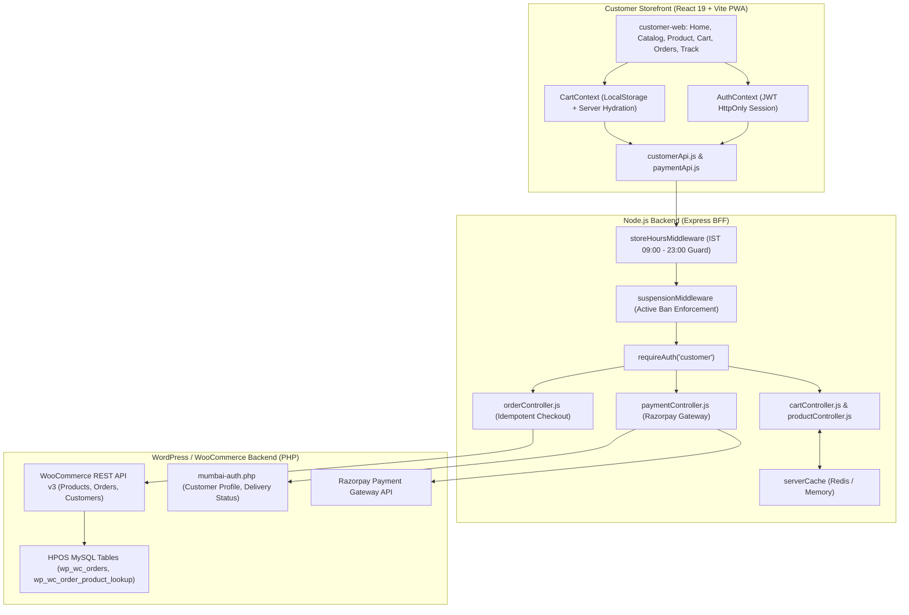

# Mumbai Collection: Customer Panel (Storefront) Technical Audit

> **Scope**: End-to-End Architectural, Frontend, Backend, and Database Audits of the Customer Storefront (`customer-web`)  
> **Repository Baseline**: Monorepo (`apps/customer-web`, `apps/backend`, `mumbai-auth.php`)  
> **Target Audience**: Core Engineering Team, Solutions Architects, and Security Auditors  
> **Date**: November 2026

---

## Audit Index & Feature Modules

| Module # | Feature Name | Primary Route | Audit File | Status |
| :---: | :--- | :--- | :--- | :---: |
| **01** | **Storefront Home & Discovery** | `/` | [`Customer panel audit/01_Storefront_Home_and_Discovery.md`](file:///c:/Users/asus/Desktop/Mumbai%20Collection/Customer%20panel%20audit/01_Storefront_Home_and_Discovery.md) | **Completed** |
| **02** | **Catalog & Category Browsing** | `/categories`, `/category/:id` | [`Customer panel audit/02_Catalog_and_Category_Browsing.md`](file:///c:/Users/asus/Desktop/Mumbai%20Collection/Customer%20panel%20audit/02_Catalog_and_Category_Browsing.md) | **Completed** |
| **03** | **Product Details & Availability** | `/product/:id` | [`Customer panel audit/03_Product_Details_and_Availability.md`](file:///c:/Users/asus/Desktop/Mumbai%20Collection/Customer%20panel%20audit/03_Product_Details_and_Availability.md) | **Completed** |
| **04** | **Cart & LocalStorage Sync** | `/cart` | [`Customer panel audit/04_Cart_and_LocalStorage_Sync.md`](file:///c:/Users/asus/Desktop/Mumbai%20Collection/Customer%20panel%20audit/04_Cart_and_LocalStorage_Sync.md) | **Completed** |
| **05** | **Checkout & Razorpay Payments** | `/cart`, `/order-success` | *Pending* | Planned |
| **06** | **Customer Address Book & Zones** | `/account/addresses` | [`06_Customer_Address_Book_and_Zones.md`](file:///c:/Users/asus/Desktop/Mumbai%20Collection/Customer%20panel%20audit/06_Customer_Address_Book_and_Zones.md) | **Completed** |
| **07** | **Order History & Invoices** | `/orders`, `/account/orders` | [`07_Order_History_and_Invoices.md`](file:///c:/Users/asus/Desktop/Mumbai%20Collection/Customer%20panel%20audit/07_Order_History_and_Invoices.md) | **Completed** |
| **08** | **Live Order Tracking** | `/orders/:id/track` | [`08_Live_Order_Tracking.md`](file:///c:/Users/asus/Desktop/Mumbai%20Collection/Customer%20panel%20audit/08_Live_Order_Tracking.md) | **Completed** |
| **09** | **Customer Auth & Onboarding** | `/login`, `/register`, `/profile-setup` | [`09_Customer_Auth_and_Onboarding.md`](file:///c:/Users/asus/Desktop/Mumbai%20Collection/Customer%20panel%20audit/09_Customer_Auth_and_Onboarding.md) | **Completed** |
| **10** | **Account, Profile & Wishlist** | `/account`, `/account/profile`, `/favorites` | [`10_Account_Profile_and_Wishlist.md`](file:///c:/Users/asus/Desktop/Mumbai%20Collection/Customer%20panel%20audit/10_Account_Profile_and_Wishlist.md) | **Completed** |

---

## High-Level System Architecture

---

## Audit Index & Feature Modules

| Module # | Feature Name | Primary Route | Audit File | Status |
| :---: | :--- | :--- | :--- | :---: |
| **01** | **Storefront Home & Discovery** | `/` | [`01_Storefront_Home_and_Discovery.md`](file:///c:/Users/asus/Desktop/Mumbai%20Collection/Customer%20panel%20audit/01_Storefront_Home_and_Discovery.md) | **Completed** |
| **02** | **Catalog & Category Browsing** | `/categories`, `/category/:id` | [`02_Catalog_and_Category_Browsing.md`](file:///c:/Users/asus/Desktop/Mumbai%20Collection/Customer%20panel%20audit/02_Catalog_and_Category_Browsing.md) | **Completed** |
| **03** | **Product Details & Availability** | `/product/:id` | [`03_Product_Details_and_Availability.md`](file:///c:/Users/asus/Desktop/Mumbai%20Collection/Customer%20panel%20audit/03_Product_Details_and_Availability.md) | **Completed** |
| **04** | **Cart & LocalStorage Sync** | `/cart` | [`04_Cart_and_LocalStorage_Sync.md`](file:///c:/Users/asus/Desktop/Mumbai%20Collection/Customer%20panel%20audit/04_Cart_and_LocalStorage_Sync.md) | **Completed** |
| **05** | **Checkout & Razorpay Payments** | `/cart`, `/order-success` | [`05_Checkout_and_Razorpay_Payments.md`](file:///c:/Users/asus/Desktop/Mumbai%20Collection/Customer%20panel%20audit/05_Checkout_and_Razorpay_Payments.md) | **Completed** |
| **06** | **Customer Address Book & Zones** | `/account/addresses` | [`06_Customer_Address_Book_and_Zones.md`](file:///c:/Users/asus/Desktop/Mumbai%20Collection/Customer%20panel%20audit/06_Customer_Address_Book_and_Zones.md) | **Completed** |
| **07** | **Order History & Invoices** | `/orders`, `/account/orders` | [`07_Order_History_and_Invoices.md`](file:///c:/Users/asus/Desktop/Mumbai%20Collection/Customer%20panel%20audit/07_Order_History_and_Invoices.md) | **Completed** |
| **08** | **Live Order Tracking** | `/orders/:id/track` | [`08_Live_Order_Tracking.md`](file:///c:/Users/asus/Desktop/Mumbai%20Collection/Customer%20panel%20audit/08_Live_Order_Tracking.md) | **Completed** |
| **09** | **Customer Auth & Onboarding** | `/login`, `/register`, `/profile-setup` | [`09_Customer_Auth_and_Onboarding.md`](file:///c:/Users/asus/Desktop/Mumbai%20Collection/Customer%20panel%20audit/09_Customer_Auth_and_Onboarding.md) | **Completed** |
| **10** | **Account, Profile & Wishlist** | `/account`, `/account/profile`, `/favorites` | [`10_Account_Profile_and_Wishlist.md`](file:///c:/Users/asus/Desktop/Mumbai%20Collection/Customer%20panel%20audit/10_Account_Profile_and_Wishlist.md) | **Completed** |

---

*Detailed audits are located under [`Customer panel audit/`](file:///c:/Users/asus/Desktop/Mumbai%20Collection/Customer%20panel%20audit).*
