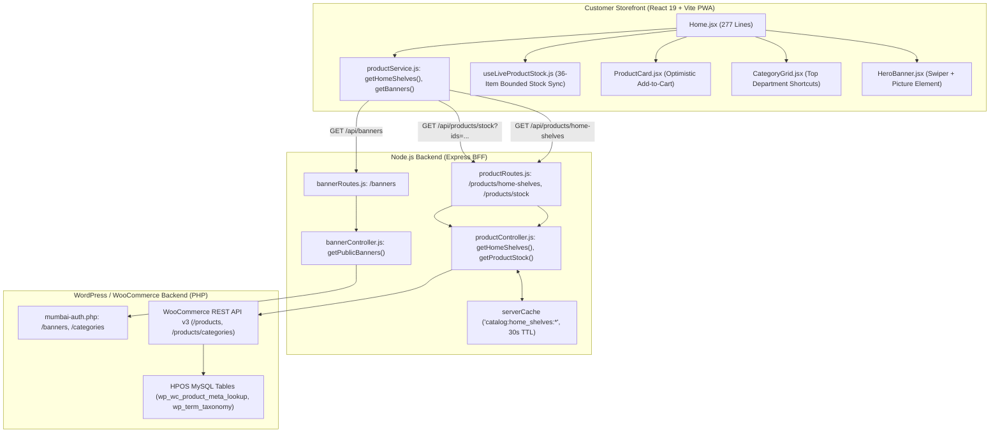
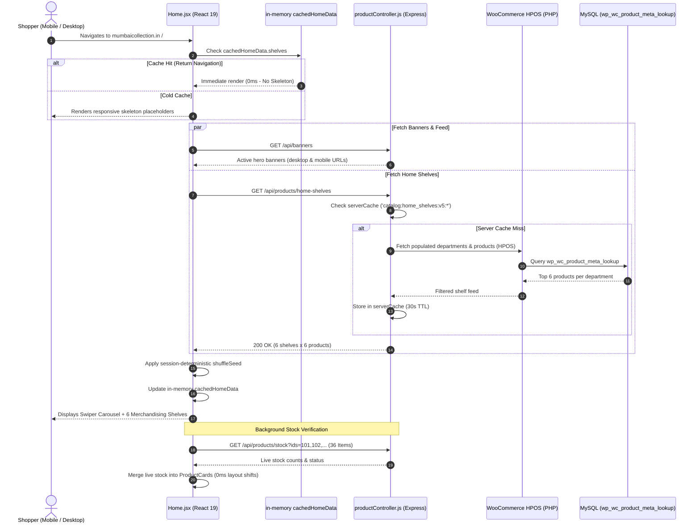

# Customer Panel Audit: Feature 01 — Storefront Home & Discovery

> **Feature Scope**: Quick-Commerce Homepage, Stale-While-Revalidate Catalog Feeds, Responsive Hero Banners, and Live Stock Sync  
> **Target Audience**: Technical Architects, Frontend Engineers, and System Auditors  
> **Authoritative Baseline**: React 19 Client Hydration, Express BFF Shelf Aggregator, and WooCommerce HPOS  
> **Date**: November 2026

---

## 1. High-Level Architecture & System Role

The **Storefront Home & Discovery** feature (`/`) is the high-conversion storefront landing page of the Mumbai Collection quick-commerce application. 

It is engineered for sub-second visual rendering on mobile networks in the Vasai-Virar region, incorporating an in-memory **Stale-While-Revalidate (SWR)** catalog snapshot cache, a responsive **Hero Banner Carousel** with dual-viewport picture elements, **Department Merchandising Shelves** honoring employee panel sorting order, session-seeded product shuffling, and a lightweight live-stock polling loop that caps background inventory validation to the 36 visible items.



---

## 2. Frontend Layer (React 19 + Tailwind CSS)

### 2.1 File Map & Responsibilities
- **Landing Page Component**: [`apps/customer-web/src/pages/Home.jsx`](file:///c:/Users/asus/Desktop/Mumbai%20Collection/apps/customer-web/src/pages/Home.jsx) *(277 lines)*
- **Hero Promotional Carousel**: [`apps/customer-web/src/components/home/HeroBanner.jsx`](file:///c:/Users/asus/Desktop/Mumbai%20Collection/apps/customer-web/src/components/home/HeroBanner.jsx)
- **Category Navigation Grid**: [`apps/customer-web/src/components/category/CategoryGrid.jsx`](file:///c:/Users/asus/Desktop/Mumbai%20Collection/apps/customer-web/src/components/category/CategoryGrid.jsx)
- **Product Card Component**: [`apps/customer-web/src/components/product/ProductCard.jsx`](file:///c:/Users/asus/Desktop/Mumbai%20Collection/apps/customer-web/src/components/product/ProductCard.jsx)
- **Live Stock Poller Hook**: [`apps/customer-web/src/hooks/useLiveProductStock.js`](file:///c:/Users/asus/Desktop/Mumbai%20Collection/apps/customer-web/src/hooks/useLiveProductStock.js)
- **Session Seed Shuffler**: [`apps/customer-web/src/utils/productUtils.js`](file:///c:/Users/asus/Desktop/Mumbai%20Collection/apps/customer-web/src/utils/productUtils.js)
- **Catalog Service**: [`apps/customer-web/src/services/productService.js`](file:///c:/Users/asus/Desktop/Mumbai%20Collection/apps/customer-web/src/services/productService.js)

---

### 2.2 Deep Logic & Implementation Details

#### A. Stale-While-Revalidate (SWR) In-Memory Module Cache
In [`Home.jsx`](file:///c:/Users/asus/Desktop/Mumbai%20Collection/apps/customer-web/src/pages/Home.jsx#L11-L28, #L61-L123):
When customers navigate between the homepage and product detail screens, remounting the homepage must never trigger jarring full-screen loading spinners.
- **Module-Level Storage (`cachedHomeData`)**: Retains `products`, `categories`, and `shelves` in memory outside the React component lifecycle.
- **Instant Hydration (Line 35)**: Initializes `loading` to `false` if `cachedHomeData.shelves` is populated, rendering the catalog instantly.
- **Background Revalidation**:
  - Automatically fetches fresh snapshots in the background.
  - **Cooldown Watchdog (`HOME_RESUME_REFRESH_COOLDOWN_MS = 15_000`)**: If staff or customers rapidly switch tabs or lock/unlock their phone within 15 seconds, redundant network requests are throttled.
  - Listens to both `visibilitychange` (`document.visibilityState === "visible"`) and `pageshow` (safari BFCache restoration) to catch up seamlessly.

#### B. Session-Deterministic Catalog Shuffling
In [`Home.jsx`](file:///c:/Users/asus/Desktop/Mumbai%20Collection/apps/customer-web/src/pages/Home.jsx#L41-L43, #L127-L140):
- **Seed Persistence (`getSessionProductOrderSeed`)**: Generates or retrieves a random seed stored in `sessionStorage`.
- **Stable Shuffle (`orderProductsForSession`)**:
  - Shuffles the products within each department shelf so returning visitors discover different merchandise on every session.
  - Maintains consistent ordering during the active browsing session: As stock or price background queries complete, items remain fixed in their current grid positions, preventing disorienting layout shifts while customers are reading product titles.

#### C. Bounded Live Stock Synchronization (`useLiveProductStock`)
In [`Home.jsx`](file:///c:/Users/asus/Desktop/Mumbai%20Collection/apps/customer-web/src/pages/Home.jsx#L142-L148):
- The homepage bounds visible items to **6 shelves x 6 products = 36 total products**.
- Extracts `visibleHomeProducts` and registers them with `useLiveProductStock`:
  - Queries `/api/products/stock?ids=...` in a single combined batch.
  - Sets `skipTimeoutRetry: true` to prevent network amplification if the server is under high checkout load.
  - If a product sells out, its stock status (`outofstock`) updates immediately on the card, disabling the Add-to-Cart button in real time.

#### D. Adaptive Responsive Layout: Mobile Snap Carousel vs Desktop Grid
In [`Home.jsx`](file:///c:/Users/asus/Desktop/Mumbai%20Collection/apps/customer-web/src/pages/Home.jsx#L239-L248):
- **Mobile Viewport (`< md`)**: Renders a horizontal flex scroll container with native CSS scroll-snap (`snap-x snap-proximity gap-3 sm:gap-3.5`). Cards measure `w-[178px] sm:w-[195px] shrink-0`, allowing quick horizontal swiping with zero JavaScript carousel overhead.
- **Desktop Viewport (`>= md`)**: Seamlessly transitions to a clean 6-column CSS grid (`md:grid md:grid-cols-6 md:gap-3.5 lg:gap-4 md:overflow-visible`).

#### E. Responsive Hero Carousel with Native `<picture>` Assets
In [`HeroBanner.jsx`](file:///c:/Users/asus/Desktop/Mumbai%20Collection/apps/customer-web/src/components/home/HeroBanner.jsx#L88-L105):
- Implements an automated Swiper carousel with 5-second slide duration and 700ms ease transition.
- **Dual-Asset Resolution**:
  ```html
  <picture className="block w-full">
    <source media="(max-width: 639px)" srcSet={mobileSrc} />
    <source media="(min-width: 640px)" srcSet={desktopSrc} />
    
  </picture>
  ```
  Ensures mobile devices download lightweight vertical creatives while desktops load crisp widescreen banners.
- **Single-Banner Degrade**: If only 1 banner exists, Swiper disables loop, pagination, and autoplay, turning the slide into a static hero billboard.

---

## 3. Node.js BFF (Backend For Frontend) Layer

### 3.1 File Map & Responsibilities
- **Routes Configuration**: [`apps/backend/src/routes/productRoutes.js`](file:///c:/Users/asus/Desktop/Mumbai%20Collection/apps/backend/src/routes/productRoutes.js)
- **Catalog Controller**: [`apps/backend/src/controllers/productController.js`](file:///c:/Users/asus/Desktop/Mumbai%20Collection/apps/backend/src/controllers/productController.js#L447-L530)
- **Public Banner Controller**: [`apps/backend/src/controllers/bannerController.js`](file:///c:/Users/asus/Desktop/Mumbai%20Collection/apps/backend/src/controllers/bannerController.js#L12-L30)
- **In-Memory Cache**: [`apps/backend/src/utils/memoryCache.js`](file:///c:/Users/asus/Desktop/Mumbai%20Collection/apps/backend/src/utils/memoryCache.js)

---

### 3.2 Deep Logic & Implementation Details

#### A. Department Shelf Hierarchy Traversal (`getHomeShelves`)
In [`productController.js`](file:///c:/Users/asus/Desktop/Mumbai%20Collection/apps/backend/src/controllers/productController.js#L447-L506):
A naive category query often renders empty departments or breaks when subcategories hold products but root categories show count = 0.
1. **Ancestry Population Map (Lines 464–478)**: Traverses all categories and marks a root department as populated if *either* the department or any of its descendant subcategories contain products (`Number(category.count) > 0`).
2. **Merchandising Sort Order (Lines 491–495)**: Sorts departments by `menu_order` (configured via Employee Panel Feature 05), placing staff-curated promotional departments at the top of the feed.
3. **Empty Shelf Elimination (Lines 481–486)**: Filters out `uncategorized` and empty departments so customers never encounter zero-product sections.

#### B. Controlled Concurrency Worker Pool
In [`productController.js`](file:///c:/Users/asus/Desktop/Mumbai%20Collection/apps/backend/src/controllers/productController.js#L508-L530):
To prevent cold-cache traffic spikes from exhausting WooCommerce connection pools:
- Fetches products for each home department in parallel using a worker pool.
- Caches each department shelf independently under `catalog:home_shelf:p6:<department_id>` and the full home feed under `catalog:home_shelves:v5:offset:...`.

---

## 4. WordPress & WooCommerce Backend Layer (PHP)

### 4.1 File Map & Responsibilities
- **WooCommerce Product Catalog**: `WC_REST_Products_Controller`
- **Database Tables**:
  - `wp_wc_product_meta_lookup`: Rapid retrieval of prices, stock status, and taxonomies without heavy postmeta joins.
  - `wp_term_taxonomy`: Department definitions and `menu_order` values.
  - `wp_options`: `mumbai_homepage_banners` (Source of truth for hero slides).

---

## 5. End-to-End Homepage Load Sequence Diagram



---

## 6. Deep Logic Code Index

| Component | File Path | Line Range | Functional Responsibility |
| :--- | :--- | :--- | :--- |
| **SWR Module Cache** | [`Home.jsx`](file:///c:/Users/asus/Desktop/Mumbai%20Collection/apps/customer-web/src/pages/Home.jsx#L11-L28) | `L11-L28` | Stale-while-revalidate in-memory cache and request deduplication |
| **Visibility Throttle** | [`Home.jsx`](file:///c:/Users/asus/Desktop/Mumbai%20Collection/apps/customer-web/src/pages/Home.jsx#L61-L123) | `L61-L123` | 15s cooldown timer for tab resume and safari BFCache restoration |
| **Session Shuffling** | [`Home.jsx`](file:///c:/Users/asus/Desktop/Mumbai%20Collection/apps/customer-web/src/pages/Home.jsx#L127-L140) | `L127-L140` | Session-seeded randomizer preserving grid stability during live stock updates |
| **Bounded Stock Poller** | [`Home.jsx`](file:///c:/Users/asus/Desktop/Mumbai%20Collection/apps/customer-web/src/pages/Home.jsx#L142-L148) | `L142-L148` | Caps live stock polling strictly to the 36 visible items |
| **Dual Viewport Banner** | [`HeroBanner.jsx`](file:///c:/Users/asus/Desktop/Mumbai%20Collection/apps/customer-web/src/components/home/HeroBanner.jsx#L88-L105) | `L88-L105` | Native `<picture>` tag switching between mobile and desktop assets |
| **Department Traversal** | [`productController.js`](file:///c:/Users/asus/Desktop/Mumbai%20Collection/apps/backend/src/controllers/productController.js#L464-L478) | `L464-L478` | Resolves subcategory products up to root departments (`populatedDepartmentIds`) |
| **Merchandising Sort** | [`productController.js`](file:///c:/Users/asus/Desktop/Mumbai%20Collection/apps/backend/src/controllers/productController.js#L491-L495) | `L491-L495` | Sorts home departments by staff-curated `menu_order` property |
| **Worker Pool Fan-Out** | [`productController.js`](file:///c:/Users/asus/Desktop/Mumbai%20Collection/apps/backend/src/controllers/productController.js#L508-L530) | `L508-L530` | Bounded parallel worker pool querying products per department without timeouts |
