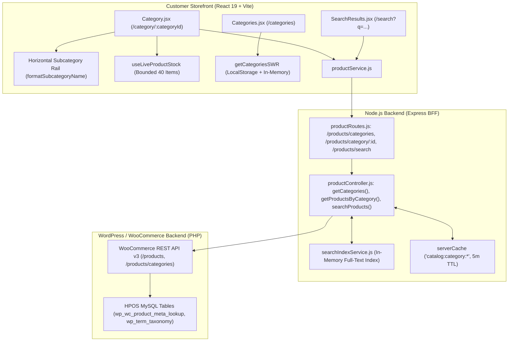
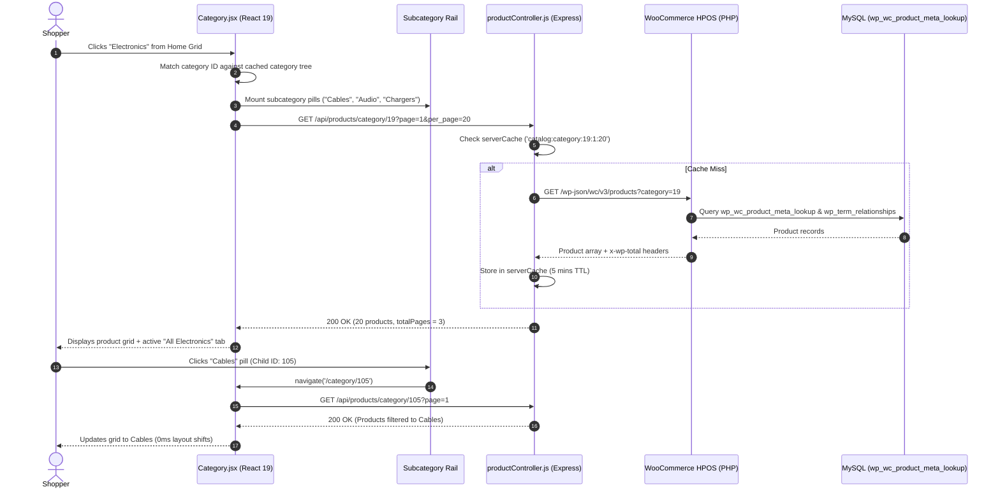

# Customer Panel Audit: Feature 02 — Catalog & Category Browsing

> **Feature Scope**: Multi-Level Department Navigation, Subcategory Rails, Fast Search Autocomplete, and HPOS Category Queries  
> **Target Audience**: Technical Architects, Frontend Engineers, and System Auditors  
> **Authoritative Baseline**: React Router 7 Dynamic Matching, SWR Category Caching, and In-Memory Search Indexing  
> **Date**: November 2026

---

## 1. High-Level Architecture & System Role

The **Catalog & Category Browsing** system forms the primary discovery engine of Mumbai Collection, spanning three interconnected user workflows:
1. **Department Directory (`/categories`)**: High-level visual cards for all non-empty root departments with custom merchandising subtitles and product counts.
2. **Category & Subcategory Explorer (`/category/:categoryId`)**: Deep-dive browsing screen featuring a horizontal subcategory navigation rail, automated parent-child taxonomy deduction, infinite scrolling pagination, and bounded live-stock polling.
3. **Storewide Instant Search (`/search?q=...`)**: Real-time product search with query normalization, in-flight `AbortController` deduplication, and index reconciliation guards.



---

## 2. Frontend Layer (React 19 + Tailwind CSS)

### 2.1 File Map & Responsibilities
- **Department Directory**: [`apps/customer-web/src/pages/Categories.jsx`](file:///c:/Users/asus/Desktop/Mumbai%20Collection/apps/customer-web/src/pages/Categories.jsx) *(294 lines)*
- **Category & Subcategory Explorer**: [`apps/customer-web/src/pages/Category.jsx`](file:///c:/Users/asus/Desktop/Mumbai%20Collection/apps/customer-web/src/pages/Category.jsx) *(895 lines)*
- **Search Results Screen**: [`apps/customer-web/src/pages/SearchResults.jsx`](file:///c:/Users/asus/Desktop/Mumbai%20Collection/apps/customer-web/src/pages/SearchResults.jsx) *(155 lines)*
- **Subcategory Formatter**: [`apps/customer-web/src/utils/productUtils.js`](file:///c:/Users/asus/Desktop/Mumbai%20Collection/apps/customer-web/src/utils/productUtils.js)
- **Live Stock Sync Hook**: [`apps/customer-web/src/hooks/useLiveProductStock.js`](file:///c:/Users/asus/Desktop/Mumbai%20Collection/apps/customer-web/src/hooks/useLiveProductStock.js)
- **Catalog Client**: [`apps/customer-web/src/services/productService.js`](file:///c:/Users/asus/Desktop/Mumbai%20Collection/apps/customer-web/src/services/productService.js)

---

### 2.2 Deep Logic & Implementation Details

#### A. Department Directory Filtering & Populated Root Deduction (`Categories.jsx`)
In [`Categories.jsx`](file:///c:/Users/asus/Desktop/Mumbai%20Collection/apps/customer-web/src/pages/Categories.jsx#L72-L105):
- Many root departments in WooCommerce register `count = 0` because products are filed under child subcategories.
- **Ancestry Bubble-Up (Lines 76–93)**: Iterates over the cached taxonomy; if any subcategory has products (`count > 0`), its root parent ID is added to `populatedRootIds`.
- **System Exclusion (Lines 98–100)**: Filters out `uncategorized`, child categories (`parent > 0`), and empty departments.
- **SWR Instant Render (Line 20)**: Hydrates directly from `getCachedCategories()`. Returning visitors view the category directory in 0ms with zero network skeleton delay.

#### B. Dynamic Parent-Child Deduction & Subcategory Rail (`Category.jsx`)
In [`Category.jsx`](file:///c:/Users/asus/Desktop/Mumbai%20Collection/apps/customer-web/src/pages/Category.jsx#L86-L135):
When a user accesses `/category/:categoryId`:
1. **Bidirectional Route Resolution**:
   - If the URL references a root department (e.g. *Footwear*), it loads products from that department and populates the horizontal rail with all child subcategories (*Sneakers*, *Sandals*, *Formals*).
   - If the URL references a child subcategory (e.g. *Sneakers*), the logic identifies its parent department (*Footwear*), marks *Sneakers* as the active rail pill, and provides a direct "All Footwear" return button.
2. **Subcategory Title Cleanup (`formatSubcategoryName`)**:
   Uses regex stripping to convert repetitive titles like `"Footwear - Sneakers"` or `"Footwear / Loafers"` into clean, readable pill labels (`"Sneakers"`).

#### C. Bounded Live Stock Hook on Appended Pages
In [`Category.jsx`](file:///c:/Users/asus/Desktop/Mumbai%20Collection/apps/customer-web/src/pages/Category.jsx#L41-L45):
```javascript
// Keep polling bounded as more pages are appended via infinite scroll.
const liveProducts = useMemo(() => products.slice(-40), [products]);
useLiveProductStock(liveProducts, setProducts);
```
- When customers scroll through pages of products (e.g., 100+ loaded items), the hook limits background inventory polling strictly to the **most recent 40 items**.
- Eliminates heavy network queries and prevents WooCommerce API thread saturation while maintaining real-time out-of-stock badges.

#### D. Search Cancellation & In-Flight AbortController (`SearchResults.jsx`)
In [`SearchResults.jsx`](file:///c:/Users/asus/Desktop/Mumbai%20Collection/apps/customer-web/src/pages/SearchResults.jsx#L21-L57):
- **Minimum Query Guard (Line 23)**: Queries under 2 characters immediately reset results and abort in-flight requests.
- **Race Condition Immunity**: Binds an `AbortController` to each keystroke. If the customer types `"sho"` and then quickly `"shoes"`, the first request is cancelled immediately before the response can overwrite newer data.

---

## 3. Node.js BFF (Backend For Frontend) Layer

### 3.1 File Map & Responsibilities
- **Routes Configuration**: [`apps/backend/src/routes/productRoutes.js`](file:///c:/Users/asus/Desktop/Mumbai%20Collection/apps/backend/src/routes/productRoutes.js)
- **Controller Implementation**: [`apps/backend/src/controllers/productController.js`](file:///c:/Users/asus/Desktop/Mumbai%20Collection/apps/backend/src/controllers/productController.js#L275-L355)
- **In-Memory Search Index**: [`apps/backend/src/services/searchIndexService.js`](file:///c:/Users/asus/Desktop/Mumbai%20Collection/apps/backend/src/services/searchIndexService.js)
- **Cache Engine**: [`apps/backend/src/utils/memoryCache.js`](file:///c:/Users/asus/Desktop/Mumbai%20Collection/apps/backend/src/utils/memoryCache.js)

---

### 3.2 Deep Logic & Implementation Details

#### A. Category Product Caching (`getProductsByCategory`)
In [`productController.js`](file:///c:/Users/asus/Desktop/Mumbai%20Collection/apps/backend/src/controllers/productController.js#L335-L355):
- Cache Key: `catalog:category:${categoryId}:${page}:${perPage}` with a **5-minute TTL** (300,000 ms).
- Automatically includes child subcategory products when a parent department ID is supplied, querying WooCommerce HPOS with `category: categoryId`.
- Response payloads pass through `transformMediaUrls` to ensure product images resolve to the client's accessible host.

#### B. Search Index Reconciliation Guard (`searchProducts`)
In [`productController.js`](file:///c:/Users/asus/Desktop/Mumbai%20Collection/apps/backend/src/controllers/productController.js#L301-L310):
```javascript
const r = await searchProducts(normalizedQuery, { page, per_page: perPage });
// Reject caching: non-empty total with zero products means index is reconciling
if (r && Array.isArray(r.products) && r.products.length === 0 && r.total > 0) {
  const reconcileErr = new Error("Search index reconciling - not caching empty result");
  reconcileErr.code = "SEARCH_PAGE_RECONCILING";
  reconcileErr.status = 503;
  throw reconcileErr;
}
return r;
```
- Protects against caching empty search results: If the background in-memory search index is re-indexing during a catalog rebuild (`total > 0`, but `products = []`), caching is deliberately aborted with HTTP 503, ensuring stale empty arrays never get frozen into Redis.

---

## 4. WordPress & WooCommerce Backend Layer (PHP)

### 4.1 File Map & Responsibilities
- **Product Lookups**: `WC_REST_Products_Controller` (`/wp-json/wc/v3/products`)
- **Category Taxonomies**: `WC_REST_Product_Categories_Controller` (`/wp-json/wc/v3/products/categories`)
- **Database Tables**:
  - `wp_wc_product_meta_lookup`: Stock, price, rating, and taxonomy index table.
  - `wp_term_relationships`: Fast indexed taxonomy mappings.

---

## 5. End-to-End Category Navigation Sequence Diagram



---

## 6. Deep Logic Code Index

| Component | File Path | Line Range | Functional Responsibility |
| :--- | :--- | :--- | :--- |
| **Directory Bubble-Up** | [`Categories.jsx`](file:///c:/Users/asus/Desktop/Mumbai%20Collection/apps/customer-web/src/pages/Categories.jsx#L72-L105) | `L72-L105` | Traverses category tree to include departments with active child products |
| **Taxonomy Resolver** | [`Category.jsx`](file:///c:/Users/asus/Desktop/Mumbai%20Collection/apps/customer-web/src/pages/Category.jsx#L86-L135) | `L86-L135` | Dynamically deduces department vs subcategory from route params |
| **Prefix Formatter** | [`productUtils.js`](file:///c:/Users/asus/Desktop/Mumbai%20Collection/apps/customer-web/src/utils/productUtils.js#L1-L30) | `L1-L30` | Strips redundant parent department prefixes from subcategory labels |
| **Bounded Stock Poller** | [`Category.jsx`](file:///c:/Users/asus/Desktop/Mumbai%20Collection/apps/customer-web/src/pages/Category.jsx#L41-L45) | `L41-L45` | Binds live inventory polling strictly to the 40 most recently loaded items |
| **Search Controller** | [`SearchResults.jsx`](file:///c:/Users/asus/Desktop/Mumbai%20Collection/apps/customer-web/src/pages/SearchResults.jsx#L21-L57) | `L21-L57` | Minimum 2-character guard and `AbortController` cancellation |
| **Category Cache** | [`productController.js`](file:///c:/Users/asus/Desktop/Mumbai%20Collection/apps/backend/src/controllers/productController.js#L335-L355) | `L335-L355` | 5-minute TTL caching for category product pages |
| **Reconciliation Guard**| [`productController.js`](file:///c:/Users/asus/Desktop/Mumbai%20Collection/apps/backend/src/controllers/productController.js#L301-L310) | `L301-L310` | Blocks caching of empty search results while search index is reconciling |
