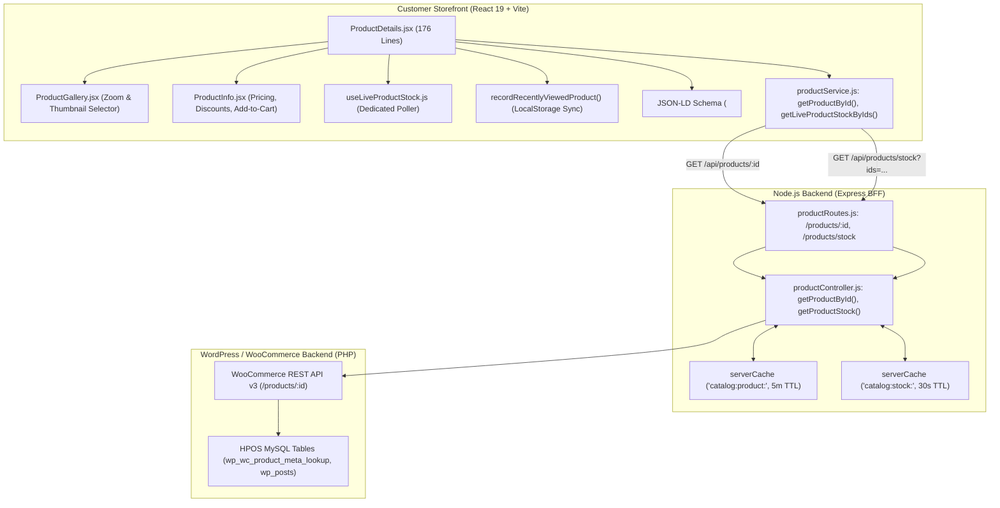
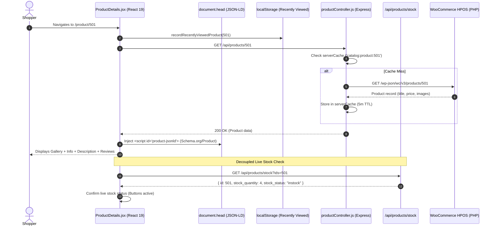

# Customer Panel Audit: Feature 03 — Product Details & Availability

> **Feature Scope**: Product Page (PDP), JSON-LD Structured SEO Schema, Live Stock Sync, and Recently Viewed Tracking  
> **Target Audience**: Technical Architects, Frontend Engineers, and System Auditors  
> **Authoritative Baseline**: React 19 Client Hydration, Google Product Rich Snippets (Schema.org), and Express 5m Caching  
> **Date**: November 2026

---

## 1. High-Level Architecture & System Role

The **Product Details & Availability** feature (`/product/:id`) is the conversion focal point of Mumbai Collection. 

It delivers an interactive product detail experience featuring high-resolution image galleries with thumbnail navigation, dynamic MRP vs discount pricing calculations, live stock availability hooks, automated SEO structured data injection (`schema.org/Product`), client-side recently viewed tracking, and category-linked related merchandise recommendations.



---

## 2. Frontend Layer (React 19 + Tailwind CSS)

### 2.1 File Map & Responsibilities
- **Primary Page Component**: [`apps/customer-web/src/pages/ProductDetails.jsx`](file:///c:/Users/asus/Desktop/Mumbai%20Collection/apps/customer-web/src/pages/ProductDetails.jsx) *(176 lines)*
- **Product Gallery**: [`apps/customer-web/src/components/product/ProductGallery.jsx`](file:///c:/Users/asus/Desktop/Mumbai%20Collection/apps/customer-web/src/components/product/ProductGallery.jsx)
- **Product Information Deck**: [`apps/customer-web/src/components/product/ProductInfo.jsx`](file:///c:/Users/asus/Desktop/Mumbai%20Collection/apps/customer-web/src/components/product/ProductInfo.jsx)
- **Product Description**: [`apps/customer-web/src/components/product/ProductDescription.jsx`](file:///c:/Users/asus/Desktop/Mumbai%20Collection/apps/customer-web/src/components/product/ProductDescription.jsx)
- **Product Reviews**: [`apps/customer-web/src/components/product/ProductReviews.jsx`](file:///c:/Users/asus/Desktop/Mumbai%20Collection/apps/customer-web/src/components/product/ProductReviews.jsx)
- **Related Products**: [`apps/customer-web/src/components/product/RelatedProducts.jsx`](file:///c:/Users/asus/Desktop/Mumbai%20Collection/apps/customer-web/src/components/product/RelatedProducts.jsx)
- **Recently Viewed Tracker**: [`apps/customer-web/src/utils/recentlyViewedProducts.js`](file:///c:/Users/asus/Desktop/Mumbai%20Collection/apps/customer-web/src/utils/recentlyViewedProducts.js)

---

### 2.2 Deep Logic & Implementation Details

#### A. In-Flight Request Cancellation & ID Guard
In [`ProductDetails.jsx`](file:///c:/Users/asus/Desktop/Mumbai%20Collection/apps/customer-web/src/pages/ProductDetails.jsx#L20-L52):
When users rapidly click from one related product to another:
- `abortControllerRef.current?.abort()`: Immediately halts any pending HTTP request for the previous product.
- `activeIdRef.current = id`: Stores the active route ID. Even if a cancelled network request somehow resolves before cleanup, the response is discarded if `activeIdRef.current !== currentId`, preventing cross-product data contamination.

#### B. Dynamic Schema.org JSON-LD Structured SEO Injection
In [`ProductDetails.jsx`](file:///c:/Users/asus/Desktop/Mumbai%20Collection/apps/customer-web/src/pages/ProductDetails.jsx#L83-L125):
Directly injects Google Search Rich Snippet metadata into `document.head`:
```javascript
const schema = {
  "@context": "https://schema.org/",
  "@type": "Product",
  name: product.name,
  image: product.images?.[0]?.src || product.image || "",
  description: product.short_description
    ? product.short_description.replace(/<[^>]+>/g, "").trim()
    : product.name,
  sku: product.sku || String(product.id),
  offers: {
    "@type": "Offer",
    priceCurrency: "INR",
    price: product.price || product.regular_price || "0",
    availability: product.in_stock !== false
      ? "https://schema.org/InStock"
      : "https://schema.org/OutOfStock",
    seller: { "@type": "Organization", name: "Mumbai Collection" },
  },
};
```
- Eliminates stale crawler indexes: As product availability shifts from in-stock to out-of-stock, the JSON-LD schema updates dynamically.
- Automatically cleans up the `<script id="product-jsonld">` element when the user unmounts the page.

#### C. Real-Time Inventory Decoupling (`useLiveProductStock`)
In [`ProductDetails.jsx`](file:///c:/Users/asus/Desktop/Mumbai%20Collection/apps/customer-web/src/pages/ProductDetails.jsx#L18):
- The static product metadata (title, description, gallery images) is cached on the Node.js BFF for 5 minutes.
- To prevent selling sold-out items without sacrificing cache speed, `useLiveProductStock(product, setProduct)` polls the lightweight `/api/products/stock?ids=:id` endpoint in the background.
- If a store counter clerk decrements stock to 0 in the Employee Panel, the "Add to Cart" button turns into a disabled "Out of Stock" button in real time on the customer's screen.

#### D. Local Client Recently Viewed Synchronization
In [`ProductDetails.jsx`](file:///c:/Users/asus/Desktop/Mumbai%20Collection/apps/customer-web/src/pages/ProductDetails.jsx#L54-L56):
- Calls `recordRecentlyViewedProduct(product.id)`:
  - Stores a bounded list of the last 20 viewed product IDs in `localStorage`.
  - Powers the personalized "Recently Viewed" rail accessible from the mobile account menu.

---

## 3. Node.js BFF (Backend For Frontend) Layer

### 3.1 File Map & Responsibilities
- **Routes Configuration**: [`apps/backend/src/routes/productRoutes.js`](file:///c:/Users/asus/Desktop/Mumbai%20Collection/apps/backend/src/routes/productRoutes.js)
- **Controller Implementation**: [`apps/backend/src/controllers/productController.js`](file:///c:/Users/asus/Desktop/Mumbai%20Collection/apps/backend/src/controllers/productController.js#L174-L210)
- **Cache Engine**: [`apps/backend/src/utils/memoryCache.js`](file:///c:/Users/asus/Desktop/Mumbai%20Collection/apps/backend/src/utils/memoryCache.js)

---

### 3.2 Deep Logic & Implementation Details

#### A. Shared Catalog Caching vs Stock Decoupling
In [`productController.js`](file:///c:/Users/asus/Desktop/Mumbai%20Collection/apps/backend/src/controllers/productController.js#L174-L185):
```javascript
export const getProductById = async (req, res) => {
  const productId = req.params.id;
  const cacheKey = `catalog:product:${productId}`;
  // Product details stay behind the shared cache. Fresh inventory checks use
  // the bounded /stock endpoint instead of allowing public cache bypasses.
  const product = await serverCache.getOrFetch(
    cacheKey,
    () => fetchProductById(productId),
    300000 // 5 minutes TTL
  );
  res.json(transformMediaUrls(product, req));
};
```
- Completely protects the backend and WooCommerce from traffic spikes during marketing campaigns.
- Decouples heavy product payloads (rich descriptions, gallery image arrays, review summaries) from volatile live inventory checks.

---

## 4. WordPress & WooCommerce Backend Layer (PHP)

### 4.1 File Map & Responsibilities
- **Core Controller**: `WC_REST_Products_Controller`
- **Database Tables**:
  - `wp_wc_product_meta_lookup`: Stock status, regular price, sale price.
  - `wp_posts`: Attachment records for product gallery images.

---

## 5. End-to-End Product View Sequence Diagram



---

## 6. Deep Logic Code Index

| Component | File Path | Line Range | Functional Responsibility |
| :--- | :--- | :--- | :--- |
| **Request Abort Guard** | [`ProductDetails.jsx`](file:///c:/Users/asus/Desktop/Mumbai%20Collection/apps/customer-web/src/pages/ProductDetails.jsx#L20-L52) | `L20-L52` | `AbortController` cancellation and route ID race-condition guard |
| **Recently Viewed Sync** | [`ProductDetails.jsx`](file:///c:/Users/asus/Desktop/Mumbai%20Collection/apps/customer-web/src/pages/ProductDetails.jsx#L54-L56) | `L54-L56` | Syncs current product to client-side recently viewed array |
| **SEO Meta Injector** | [`ProductDetails.jsx`](file:///c:/Users/asus/Desktop/Mumbai%20Collection/apps/customer-web/src/pages/ProductDetails.jsx#L58-L81) | `L58-L81` | Dynamic `document.title` and `<meta name="description">` injection |
| **JSON-LD Schema** | [`ProductDetails.jsx`](file:///c:/Users/asus/Desktop/Mumbai%20Collection/apps/customer-web/src/pages/ProductDetails.jsx#L83-L125) | `L83-L125` | Schema.org Product structured data for Google Search rich snippets |
| **Live Stock Poller** | [`ProductDetails.jsx`](file:///c:/Users/asus/Desktop/Mumbai%20Collection/apps/customer-web/src/pages/ProductDetails.jsx#L18) | `L18` | Bounded live stock synchronization via `useLiveProductStock` |
| **PDP Caching** | [`productController.js`](file:///c:/Users/asus/Desktop/Mumbai%20Collection/apps/backend/src/controllers/productController.js#L174-L210) | `L174-L210` | 5-minute server-side product payload caching |
