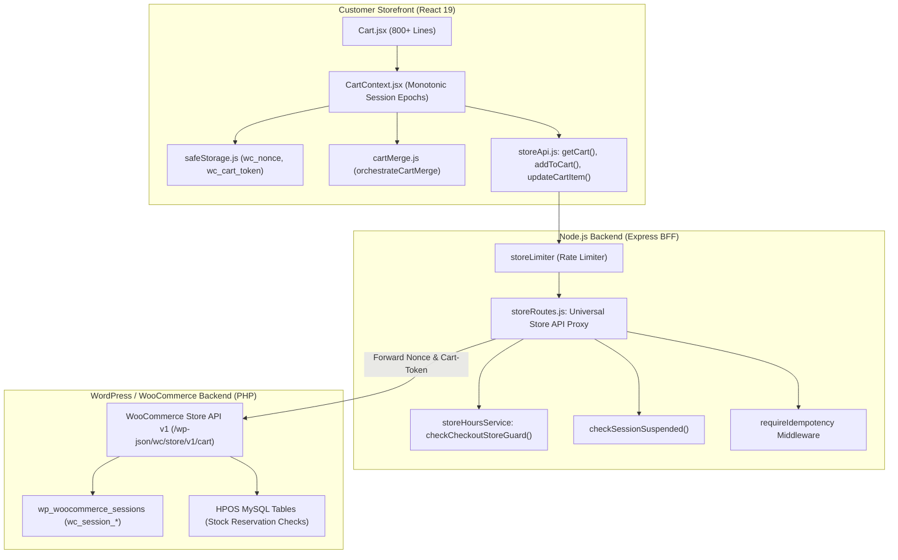
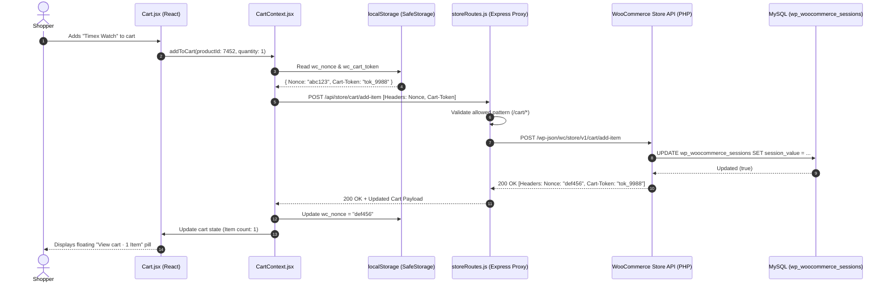

# Customer Panel Audit: Feature 04 — Cart & LocalStorage Sync

> **Feature Scope**: Client-Side Cart Hydration, WooCommerce Store API Nonce/Token Proxy, Store Hours Blocker, and Guest-to-Customer Merge  
> **Target Audience**: Technical Architects, Frontend Engineers, and System Auditors  
> **Authoritative Baseline**: WooCommerce Store API v1, SafeStorage Local Persistence, and Monotonic Session Epochs  
> **Date**: November 2026

---

## 1. High-Level Architecture & System Role

The **Cart & LocalStorage Sync** engine (`/cart`) manages the active shopping cart state across Mumbai Collection. 

It delivers zero-latency cart interactions by combining persistent client-side storage (`safeStorage`), WooCommerce Store API token negotiation (`Nonce` and `Cart-Token`), automatic guest-to-customer cart orchestration upon login, account isolation purges on logout, real-time store-hours validation that blocks checkout during store closure, and delivery fee calculation based on Vasai-Virar zone tiers.



---

## 2. Frontend Layer (React 19 + Tailwind CSS)

### 2.1 File Map & Responsibilities
- **Cart Screen**: [`apps/customer-web/src/pages/Cart.jsx`](file:///c:/Users/asus/Desktop/Mumbai%20Collection/apps/customer-web/src/pages/Cart.jsx) *(800+ lines)*
- **Cart Context Provider**: [`apps/customer-web/src/context/CartContext.jsx`](file:///c:/Users/asus/Desktop/Mumbai%20Collection/apps/customer-web/src/context/CartContext.jsx) *(219 lines)*
- **Store API Client**: [`apps/customer-web/src/services/storeApi.js`](file:///c:/Users/asus/Desktop/Mumbai%20Collection/apps/customer-web/src/services/storeApi.js) *(230 lines)*
- **Guest-to-Customer Merge Engine**: [`apps/customer-web/src/utils/cartMerge.js`](file:///c:/Users/asus/Desktop/Mumbai%20Collection/apps/customer-web/src/utils/cartMerge.js)
- **Safe Storage Wrapper**: [`apps/customer-web/src/utils/safeStorage.js`](file:///c:/Users/asus/Desktop/Mumbai%20Collection/apps/customer-web/src/utils/safeStorage.js)

---

### 2.2 Deep Logic & Implementation Details

#### A. Monotonic Session Epoch Counter (`CartContext.jsx`)
In [`CartContext.jsx`](file:///c:/Users/asus/Desktop/Mumbai%20Collection/apps/customer-web/src/context/CartContext.jsx#L15-L50, #L76-L100):
To prevent race conditions when a customer switches accounts or logs out while a cart HTTP request is in-flight:
```javascript
const sessionEpochRef = useRef(0);

const refreshCart = useCallback(async () => {
  const requestEpoch = sessionEpochRef.current;
  try {
    const data = await getCart();
    // If user session changed while this request was in flight, discard response
    if (sessionEpochRef.current !== requestEpoch) return null;
    setCart(data);
    return data;
  } catch (err) {
    if (sessionEpochRef.current !== requestEpoch) return null;
    throw err;
  }
}, []);
```
- When a user logs in, logs out, or switches accounts, `sessionEpochRef.current += 1` increments immediately.
- Stale responses originating from the previous session epoch are discarded at the boundary, ensuring User A's cart items never bleed into User B's interface.

#### B. Account Isolation & Guest-to-Customer Merge
In [`CartContext.jsx`](file:///c:/Users/asus/Desktop/Mumbai%20Collection/apps/customer-web/src/context/CartContext.jsx#L66-L120):
1. **Logout (`User -> null`)**:
   Calls `clearCartSession()`, purging `wc_nonce` and `wc_cart_token` from `localStorage`, setting `cart = null`.
2. **Account Switch (`User A -> User B`)**:
   Full purge. Destroys the cart session token and fetches User B's independent server-side cart.
3. **Guest Login (`null -> User`)**:
   Invokes `orchestrateCartMerge`:
   - Inspects guest items accumulated before login.
   - Merges guest items into the authenticated customer's account on the server without overwriting existing quantities.
   - Displays a brief toast notice: *"Your guest cart items were saved to your account."*

#### C. Store API Token Lifecycle (`storeApi.js`)
In [`storeApi.js`](file:///c:/Users/asus/Desktop/Mumbai%20Collection/apps/customer-web/src/services/storeApi.js#L11-L40):
WooCommerce Store API requires two specific headers for cart state persistence:
- `Nonce`: A CSRF token bound to the active session.
- `Cart-Token`: An opaque token referencing the active session in `wp_woocommerce_sessions`.
- The Axios interceptor automatically captures these headers on every response:
  ```javascript
  const updateTokens = (response) => {
    const hNonce = getHeader(response.headers, "nonce");
    if (hNonce) safeStorage.setItem("wc_nonce", hNonce);
    const hToken = getHeader(response.headers, "cart-token");
    if (hToken) safeStorage.setItem("wc_cart_token", hToken);
  };
  ```
  Every subsequent request forwards `Nonce` and `Cart-Token`, guaranteeing seamless cart continuity across page reloads.

#### D. Store Operating Hours Guard (`Cart.jsx`)
In [`Cart.jsx`](file:///c:/Users/asus/Desktop/Mumbai%20Collection/apps/customer-web/src/pages/Cart.jsx#L63-L71, #L796-L808):
- Queries `/api/store-hours` on mount.
- If the current time falls outside 09:00 AM – 11:00 PM IST:
  - Displays a high-contrast amber banner: *"Store is currently closed for dispatch. Opens at 09:00 AM IST."*
  - Disables the "Proceed to Checkout" button (`disabled={storeHours?.is_open === false}`).

---

## 3. Node.js BFF (Backend For Frontend) Layer

### 3.1 File Map & Responsibilities
- **Universal Store Gateway**: [`apps/backend/src/routes/storeRoutes.js`](file:///c:/Users/asus/Desktop/Mumbai%20Collection/apps/backend/src/routes/storeRoutes.js) *(674 lines)*
- **Store Hours Service**: [`apps/backend/src/services/storeHoursService.js`](file:///c:/Users/asus/Desktop/Mumbai%20Collection/apps/backend/src/services/storeHoursService.js)
- **Suspension Middleware**: [`apps/backend/src/middlewares/authMiddleware.js`](file:///c:/Users/asus/Desktop/Mumbai%20Collection/apps/backend/src/middlewares/authMiddleware.js)

---

### 3.2 Deep Logic & Implementation Details

#### A. Strict Path & Pattern Allow-List (`proxyStoreApi`)
In [`storeRoutes.js`](file:///c:/Users/asus/Desktop/Mumbai%20Collection/apps/backend/src/routes/storeRoutes.js#L28-L64):
To prevent malicious proxy abuse:
1. **Path Traversal Defense**: Rejects requests containing `..`, `\`, `%2e`, or `%2E` with HTTP 403 `INVALID_PATH`.
2. **Endpoint Pattern Whitelist**: Strictly restricts proxying to authorized patterns:
   - `/cart(\/.*)?`
   - `/checkout(\/.*)?`
   - `/products(\/.*)?`
   Any other WooCommerce REST or internal paths are blocked with HTTP 403 `ENDPOINT_NOT_ALLOWED`.

#### B. Authoritative Backend Store Hours Guard
In [`storeRoutes.js`](file:///c:/Users/asus/Desktop/Mumbai%20Collection/apps/backend/src/routes/storeRoutes.js#L82-L89):
Even if a user bypasses frontend UI buttons (e.g., via direct curl or Postman):
- Checkout requests (`POST /checkout`) execute `storeHoursService.checkCheckoutStoreGuard`.
- If the store is closed, the request fails with HTTP 403 `STORE_CLOSED`, completely eliminating after-hours checkout leakage.

#### C. Suspension Enforcement at Cart Boundary
In [`storeRoutes.js`](file:///c:/Users/asus/Desktop/Mumbai%20Collection/apps/backend/src/routes/storeRoutes.js#L91-L100):
- Intercepts checkout requests and verifies the customer's suspension status in the database (`checkSessionSuspended`).
- If suspended, terminates the session immediately with HTTP 403 `ACCOUNT_SUSPENDED`.

---

## 4. WordPress & WooCommerce Backend Layer (PHP)

### 4.1 File Map & Responsibilities
- **Store API Engine**: WooCommerce Core Store API v1 (`/wp-json/wc/store/v1/cart`)
- **Database Tables**:
  - `wp_woocommerce_sessions`: Ephemeral server-side cart items, quantities, and expiration timestamps.
  - `wp_wc_product_meta_lookup`: Real-time stock status validation when cart items are updated.

---

## 5. End-to-End Cart Synchronization Flow



---

## 6. Deep Logic Code Index

| Component | File Path | Line Range | Functional Responsibility |
| :--- | :--- | :--- | :--- |
| **Monotonic Epoch Counter** | [`CartContext.jsx`](file:///c:/Users/asus/Desktop/Mumbai%20Collection/apps/customer-web/src/context/CartContext.jsx#L15-L50) | `L15-L50` | Discards stale in-flight responses across session and user switches |
| **Account Isolation Purge** | [`CartContext.jsx`](file:///c:/Users/asus/Desktop/Mumbai%20Collection/apps/customer-web/src/context/CartContext.jsx#L66-L120) | `L66-L120` | Full cart purge on logout and account switch; merges guest carts on login |
| **Store Token Capture** | [`storeApi.js`](file:///c:/Users/asus/Desktop/Mumbai%20Collection/apps/customer-web/src/services/storeApi.js#L26-L53) | `L26-L53` | Intercepts `Nonce` and `Cart-Token` headers for continuous session persistence |
| **Store Hours UI Blocker** | [`Cart.jsx`](file:///c:/Users/asus/Desktop/Mumbai%20Collection/apps/customer-web/src/pages/Cart.jsx#L63-L71) | `L63-L71` | Fetches live store status and disables checkout button when closed |
| **Store API Allow-List** | [`storeRoutes.js`](file:///c:/Users/asus/Desktop/Mumbai%20Collection/apps/backend/src/routes/storeRoutes.js#L28-L64) | `L28-L64` | Path traversal defense and strict regex allow-list proxy gate |
| **Backend Store Hours Guard**| [`storeRoutes.js`](file:///c:/Users/asus/Desktop/Mumbai%20Collection/apps/backend/src/routes/storeRoutes.js#L82-L89) | `L82-L89` | Authoritative server-side checkout blockage during store closure |
