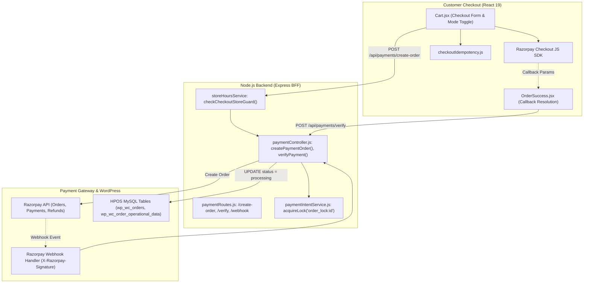
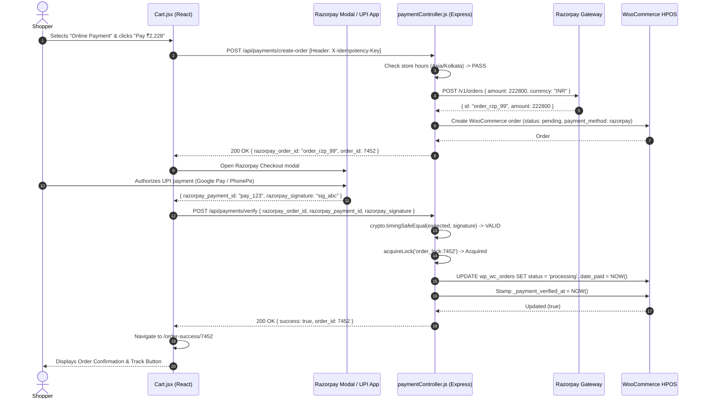

# Customer Panel Audit: Feature 05 — Checkout & Razorpay Payments

> **Feature Scope**: Dual-Mode Checkout (COD & Online), Razorpay Gateway Integration, Webhook Reconciliation, and Idempotent Order Creation  
> **Target Audience**: Technical Architects, Payment Engineers, and System Auditors  
> **Authoritative Baseline**: Razorpay SDK v1, HMAC-SHA256 Signature Verification, and Distributed Row Locking  
> **Date**: November 2026

---

## 1. High-Level Architecture & System Role

The **Checkout & Razorpay Payments** module handles financial transactions across Mumbai Collection. 

It provides customers with dual payment modes:
1. **Cash on Delivery (COD)**: With phone-verified order confirmation and immediate transition to `processing`.
2. **Online UPI / Cards / NetBanking (Razorpay)**: Two-legged checkout flow orchestrating server-side order generation, client SDK modal display or UPI intent app redirection, cryptographic HMAC-SHA256 signature verification, and asynchronous webhook reconciliation for interrupted browser sessions.



---

## 2. Frontend Layer (React 19 + Tailwind CSS)

### 2.1 File Map & Responsibilities
- **Checkout Form**: [`apps/customer-web/src/pages/Cart.jsx`](file:///c:/Users/asus/Desktop/Mumbai%20Collection/apps/customer-web/src/pages/Cart.jsx)
- **Order Success & Callback Resolver**: [`apps/customer-web/src/pages/OrderSuccess.jsx`](file:///c:/Users/asus/Desktop/Mumbai%20Collection/apps/customer-web/src/pages/OrderSuccess.jsx) *(480 lines)*
- **Payment Client**: [`apps/customer-web/src/services/paymentService.js`](file:///c:/Users/asus/Desktop/Mumbai%20Collection/apps/customer-web/src/services/paymentService.js)
- **Idempotency Key Utility**: [`apps/customer-web/src/utils/checkoutIdempotency.js`](file:///c:/Users/asus/Desktop/Mumbai%20Collection/apps/customer-web/src/utils/checkoutIdempotency.js)

---

### 2.2 Deep Logic & Implementation Details

#### A. Dual-Mode Flow Handling (COD vs Razorpay)
In [`Cart.jsx`](file:///c:/Users/asus/Desktop/Mumbai%20Collection/apps/customer-web/src/pages/Cart.jsx):
- **Cash on Delivery (COD)**:
  - Validates delivery address and phone number verification.
  - Submits directly to `/api/store/checkout` with `payment_method: "cod"`.
  - Clears cart and navigates to `/order-success/:id`.
- **Online Payment (Razorpay)**:
  1. Calls `/api/payments/create-order`, passing cart contents, address, and `X-Idempotency-Key`.
  2. Receives `{ razorpay_order_id, amount, currency, order_id }`.
  3. Launches Razorpay modal with customer phone and email prefilled.
  4. On successful completion, submits `{ razorpay_order_id, razorpay_payment_id, razorpay_signature }` to `/api/payments/verify`.

#### B. Cross-Browser & Mobile UPI Redirect Handling (`OrderSuccess.jsx`)
In [`OrderSuccess.jsx`](file:///c:/Users/asus/Desktop/Mumbai%20Collection/apps/customer-web/src/pages/OrderSuccess.jsx#L27-L105):
When paying with external UPI apps (Google Pay, PhonePe, Paytm) on mobile, the browser may be killed by the OS or redirected to a callback URL:
- Extracts `razorpay_order_id`, `razorpay_payment_id`, and `razorpay_signature` from URL search parameters.
- If signature exists, immediately executes `verifyPayment` in the background.
- If signature is absent (user closed modal early), calls `checkPaymentStatus(rzpOrderId)` to verify if the payment succeeded asynchronously.
- Clears local storage payment intent markers (`clearPendingPayment()`).

#### C. Privacy Defense: `noindex, nofollow` Meta Tag
In [`OrderSuccess.jsx`](file:///c:/Users/asus/Desktop/Mumbai%20Collection/apps/customer-web/src/pages/OrderSuccess.jsx#L50-L70):
Dynamically injects `<meta name="robots" content="noindex, nofollow">` into `document.head` during mount, ensuring customer order confirmations and delivery addresses are never indexed by web crawlers.

---

## 3. Node.js BFF (Backend For Frontend) Layer

### 3.1 File Map & Responsibilities
- **Payment Routes**: [`apps/backend/src/routes/paymentRoutes.js`](file:///c:/Users/asus/Desktop/Mumbai%20Collection/apps/backend/src/routes/paymentRoutes.js#L33-L95)
- **Payment Controller**: [`apps/backend/src/controllers/paymentController.js`](file:///c:/Users/asus/Desktop/Mumbai%20Collection/apps/backend/src/controllers/paymentController.js) *(76,600 bytes)*
- **Distributed Lock Service**: [`apps/backend/src/services/paymentIntentService.js`](file:///c:/Users/asus/Desktop/Mumbai%20Collection/apps/backend/src/services/paymentIntentService.js)
- **Razorpay SDK Client**: [`apps/backend/src/config/razorpay.js`](file:///c:/Users/asus/Desktop/Mumbai%20Collection/apps/backend/src/config/razorpay.js)

---

### 3.2 Deep Logic & Implementation Details

#### A. Cryptographic Signature Verification (`verifyPayment`)
In [`paymentController.js`](file:///c:/Users/asus/Desktop/Mumbai%20Collection/apps/backend/src/controllers/paymentController.js):
To prevent payment spoofing:
```javascript
const body = `${razorpay_order_id}|${razorpay_payment_id}`;
const expectedSignature = crypto
  .createHmac("sha256", process.env.RAZORPAY_KEY_SECRET)
  .update(body.toString())
  .digest("hex");

const isAuthentic = crypto.timingSafeEqual(
  Buffer.from(expectedSignature),
  Buffer.from(razorpay_signature)
);
```
- Computes HMAC-SHA256 of the combined Razorpay order ID and payment ID using the store's private secret.
- Uses `crypto.timingSafeEqual` to eliminate timing-attack vulnerabilities.

#### B. Distributed Mutex & Concurrency Locking
In [`paymentController.js`](file:///c:/Users/asus/Desktop/Mumbai%20Collection/apps/backend/src/controllers/paymentController.js):
Both the user's browser (via `/verify`) and Razorpay's webhook servers (via `/webhook`) may report payment confirmation simultaneously.
- Acquires an in-memory or Redis distributed lock: `acquireLock('order_lock:' + orderId, workerId, 10000)`.
- Verifies if the order has already been transitioned to `processing` or marked paid.
- If already confirmed, the second caller exits gracefully, preventing duplicate stock deductions or duplicate email alerts.

#### C. Webhook Signature Verification (`handleWebhook`)
In [`paymentRoutes.js`](file:///c:/Users/asus/Desktop/Mumbai%20Collection/apps/backend/src/routes/paymentRoutes.js#L82-L85):
- Validates the `X-Razorpay-Signature` header across raw request bytes using `RAZORPAY_WEBHOOK_SECRET`.
- Handles asynchronous events:
  - `payment.captured`: Transitions order to `processing` if the customer closed their browser before `/verify` completed.
  - `payment.failed`: Marks order `failed` and notifies staff.
  - `refund.processed`: Stamps `_refund_verified_at` metadata.

---

## 4. WordPress & WooCommerce Backend Layer (PHP)

### 4.1 File Map & Responsibilities
- **WooCommerce HPOS Integration**: Direct updates to `wp_wc_orders` and `wp_wc_order_operational_data`.
- **Payment Verification Stamping**:
  - Sets `_payment_method = 'razorpay'`.
  - Sets `_transaction_id = razorpay_payment_id`.
  - Sets `_payment_verified_at = current_timestamp`.
  - Marks core status `processing` and stamps `date_paid`.

---

## 5. End-to-End Online Checkout Sequence Diagram



---

## 6. Deep Logic Code Index

| Component | File Path | Line Range | Functional Responsibility |
| :--- | :--- | :--- | :--- |
| **Payment Routes** | [`paymentRoutes.js`](file:///c:/Users/asus/Desktop/Mumbai%20Collection/apps/backend/src/routes/paymentRoutes.js#L33-L95) | `L33-L95` | Endpoints for `/create-order`, `/verify`, `/callback`, and `/webhook` |
| **Signature Verification** | [`paymentController.js`](file:///c:/Users/asus/Desktop/Mumbai%20Collection/apps/backend/src/controllers/paymentController.js) | — | HMAC-SHA256 signature verification via `crypto.timingSafeEqual` |
| **Distributed Mutex Lock** | [`paymentIntentService.js`](file:///c:/Users/asus/Desktop/Mumbai%20Collection/apps/backend/src/services/paymentIntentService.js) | — | Concurrency lock preventing dual verification race conditions |
| **Callback Resolver** | [`OrderSuccess.jsx`](file:///c:/Users/asus/Desktop/Mumbai%20Collection/apps/customer-web/src/pages/OrderSuccess.jsx#L27-L105) | `L27-L105` | Resolves cross-browser UPI redirect params and polls status |
| **SEO Privacy Shield** | [`OrderSuccess.jsx`](file:///c:/Users/asus/Desktop/Mumbai%20Collection/apps/customer-web/src/pages/OrderSuccess.jsx#L50-L70) | `L50-L70` | Injects `<meta name="robots" content="noindex, nofollow">` to protect customer data |
| **Idempotency Cleaner** | [`OrderSuccess.jsx`](file:///c:/Users/asus/Desktop/Mumbai%20Collection/apps/customer-web/src/pages/OrderSuccess.jsx#L88-L89) | `L88-L89` | Clears local pending payment tokens upon successful verification |
