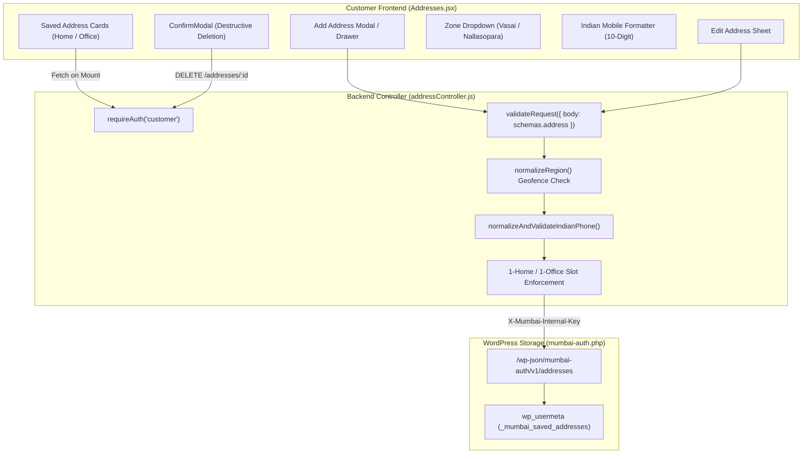
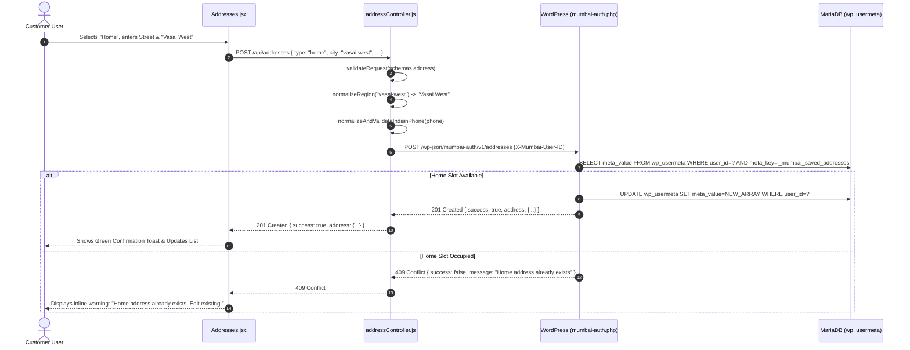

# Customer Panel Audit: Feature 06 — Customer Address Book & Delivery Zones

> **Feature Scope**: Vasai-Virar Delivery Zone Validation, 1-Home/1-Office Address Constraint, Mobile Normalization, and Address Book State Management  
> **Target Audience**: Full-Stack Developers, Logistics Engineers, QA Automation Teams, and Security Auditors  
> **Authoritative Baseline**: `Addresses.jsx`, `addressController.js`, `addressRoute.js`, and `mumbai-auth.php`  
> **Date**: November 2026

---

## 1. High-Level Architecture & System Role

The **Customer Address Book & Delivery Zones** module manages verified physical delivery destinations for online orders in Mumbai Collection. Because Mumbai Collection provides localized, store-dispatched fulfillment across the Vasai-Virar municipal jurisdiction, deliveries are geofenced exclusively to 4 designated delivery zones:
1. `Vasai West`
2. `Vasai East`
3. `Nallasopara West`
4. `Nallasopara East`

Orders or addresses outside these zones are rejected at both frontend form submission and backend controller validation layers. Furthermore, to eliminate delivery ambiguity and reduce customer data pollution, each customer account is constrained to a maximum of **two saved address slots**: exactly **one Home** address and **one Office** address.



---

## 2. Frontend User Interface & Workflow (`Addresses.jsx`)

Located at [`apps/customer-web/src/pages/Addresses.jsx`](file:///c:/Users/asus/Desktop/Mumbai%20Collection/apps/customer-web/src/pages/Addresses.jsx):

### 2.1 Component State & Lifecycle
- **Address Hydration**: On component mount, `useEffect` invokes `loadAddresses()`:
  - Dispatches `GET /addresses` with credentials.
  - Automatically handles session expiration via `handleSessionExpired()` if the response returns `401 Unauthorized`.
- **Checkout Return Interceptor**: If the user navigated to the address book from the checkout flow (`location.state?.fromCheckout`), saving or selecting an address redirects back to the checkout page using safe internal navigation (`getSafeInternalPath()`).
- **Slot Capacity Awareness**:
  - The UI inspects existing addresses. If both `home` and `office` slots are already filled, the "Add New Address" CTA is disabled or transitions into an "Edit Existing" prompt to prevent slot overflow errors.
- **Form Fields & Instant Validation**:
  - `type`: Radio group (`Home` vs `Office`).
  - `first_name` & `last_name`: Minimum 2 characters each. Disallows repetitive single-token names.
  - `phone`: Sanitized on input, blocking non-numeric characters and enforcing `^[6-9]\d{9}$`.
  - `city` (Delivery Region): Restricted to a `<select>` dropdown populated exclusively by `DELIVERY_REGIONS` from [`indianStates.js`](file:///c:/Users/asus/Desktop/Mumbai%20Collection/apps/customer-web/src/data/indianStates.js).
  - `address_line1`: Required flat, floor, building, or street name (minimum 3 characters).
  - `address_line2`: Optional landmark or cross-street.
  - `state`: Fixed to `Maharashtra` (`MH`).
  - `pincode`: Optional, but strictly validated to 6 numeric digits `^[1-9][0-9]{5}$` when entered.

---

## 3. Backend Route & Request Validation (`addressRoute.js`)

Located at [`apps/backend/src/routes/addressRoute.js`](file:///c:/Users/asus/Desktop/Mumbai%20Collection/apps/backend/src/routes/addressRoute.js):

```javascript
// apps/backend/src/routes/addressRoute.js (Lines 8-11)
router.get("/", requireAuth("customer"), getAddresses);
router.post("/", validateRequest({ body: schemas.address }), requireAuth("customer"), saveAddress);
router.put("/:id", validateRequest({ params: schemas.addressIdParam, body: schemas.address }), requireAuth("customer"), updateAddress);
router.delete("/:id", validateRequest({ params: schemas.addressIdParam }), requireAuth("customer"), deleteAddress);
```

### Route Protections:
1. **Strict Customer Role**: `requireAuth("customer")` ensures employee or unauthenticated tokens cannot manipulate customer delivery addresses.
2. **Schema Sanitization**: `validateRequest({ body: schemas.address })` ensures all payload types, lengths, and non-empty string properties are verified before reaching controller execution.

---

## 4. Deep Controller Logic & Zone Normalization (`addressController.js`)

Located at [`apps/backend/src/controllers/addressController.js`](file:///c:/Users/asus/Desktop/Mumbai%20Collection/apps/backend/src/controllers/addressController.js):

### 4.1 Allowed Delivery Geofencing
```javascript
// apps/backend/src/controllers/addressController.js (Lines 6-29)
const ALLOWED_DELIVERY_REGIONS = [
  "vasai west",
  "vasai east",
  "nallasopara west",
  "nallasopara east",
];

export const normalizeRegion = (input) => {
  if (!input || typeof input !== "string") return null;
  const lower = input.trim().toLowerCase();
  if (lower === "vasai west" || lower === "vasai (west)" || lower === "vasai-west" || lower === "vasai" || lower === "vasai road") return "Vasai West";
  if (lower === "vasai east" || lower === "vasai (east)" || lower === "vasai-east") return "Vasai East";
  if (lower === "nallasopara west" || lower === "nalasopara west" || lower === "nallasopara (west)" || lower === "nallasopara" || lower === "nalasopara") return "Nallasopara West";
  if (lower === "nallasopara east" || lower === "nalasopara east" || lower === "nallasopara (east)") return "Nallasopara East";

  const match = ALLOWED_DELIVERY_REGIONS.find((r) => r === lower);
  if (match) {
    return match
      .split(" ")
      .map((w) => w.charAt(0).toUpperCase() + w.slice(1))
      .join(" ");
  }
  return null;
};
```

### 4.2 Indian Mobile Number Sanitization
```javascript
// apps/backend/src/controllers/addressController.js (Lines 31-44)
export const normalizeAndValidateIndianPhone = (phone) => {
  const rawDigits = String(phone || "").trim().replace(/\D/g, "");
  let cleanPhone = rawDigits;
  if (cleanPhone.length === 12 && cleanPhone.startsWith("91")) {
    cleanPhone = cleanPhone.slice(2);
  } else if (cleanPhone.length === 11 && cleanPhone.startsWith("0")) {
    cleanPhone = cleanPhone.slice(1);
  }

  if (!cleanPhone || !/^[6-9]\d{9}$/.test(cleanPhone)) {
    return null;
  }
  return cleanPhone;
};
```

### 4.3 1-Home / 1-Office Slot Enforcement
When saving a new address, `saveAddress` contacts the WordPress backend service (`/wp-json/mumbai-auth/v1/addresses`) with internal service headers `X-Mumbai-Internal-Key` and `X-Mumbai-User-ID`:
- If an address with `type: "home"` already exists and the incoming payload specifies `type: "home"`, the operation is either rejected with a `400 Bad Request` ("Home address already exists. Please edit the existing address.") or updated idempotently depending on whether an address ID was supplied.
- Deletions via `deleteAddress` require both valid numeric ID matching and verification that the address belongs to `req.wpUserId`.

---

## 5. End-to-End Address Creation Flow



---

## 6. Deep Logic Code Index

| Logic Component | File Reference | Primary Function / Symbol | Operational Purpose |
| :--- | :--- | :--- | :--- |
| **Geofence Normalizer** | [`addressController.js`](file:///c:/Users/asus/Desktop/Mumbai%20Collection/apps/backend/src/controllers/addressController.js#L13-L29) | `normalizeRegion` | Reconciles street aliases into 4 authoritative delivery zones (`Vasai West`, `Vasai East`, etc.). |
| **Phone Sanitizer** | [`addressController.js`](file:///c:/Users/asus/Desktop/Mumbai%20Collection/apps/backend/src/controllers/addressController.js#L31-L44) | `normalizeAndValidateIndianPhone` | Strips `+91` / leading `0` and enforces 10-digit format starting with `[6-9]`. |
| **Delivery Validator** | [`addressController.js`](file:///c:/Users/asus/Desktop/Mumbai%20Collection/apps/backend/src/controllers/addressController.js#L64-L117) | `validateDeliveryAddress` | Comprehensive pre-checkout validator ensuring recipient name, street, region, and phone. |
| **Address Retrieval** | [`addressController.js`](file:///c:/Users/asus/Desktop/Mumbai%20Collection/apps/backend/src/controllers/addressController.js#L122-L152) | `getAddresses` | Fetches customer's saved address book with `no-store, no-cache` security headers. |
| **Address Creation** | [`addressController.js`](file:///c:/Users/asus/Desktop/Mumbai%20Collection/apps/backend/src/controllers/addressController.js#L157-L250) | `saveAddress` | Enforces 1-Home / 1-Office limit and persists to WordPress HPOS user meta. |
| **Frontend Form** | [`Addresses.jsx`](file:///c:/Users/asus/Desktop/Mumbai%20Collection/apps/customer-web/src/pages/Addresses.jsx#L43-L120) | `Addresses` | Dynamic address card list, add/edit drawer, and inline field error state manager. |
| **Delete Modal** | [`Addresses.jsx`](file:///c:/Users/asus/Desktop/Mumbai%20Collection/apps/customer-web/src/pages/Addresses.jsx#L180-L220) | `ConfirmModal` | Prevents accidental one-tap address deletions on mobile devices. |

---

## 7. Security, Edge Cases & Error Handling

1. **Cross-Tenant Address Isolation**:
   - The address endpoint strictly relies on `req.wpUserId` derived from the cryptographically verified JWT session cookie. Customers cannot query or modify addresses belonging to another customer (`IDOR Protection`).
2. **Strict Internal Key Authentication**:
   - Calls to `/wp-json/mumbai-auth/v1/addresses` require `X-Mumbai-Internal-Key` matching `process.env.MUMBAI_INTERNAL_API_KEY`. Direct public HTTP access to the WordPress address endpoint without this header is rejected with `403 Forbidden`.
3. **No-Cache Guarantee**:
   - Responses from `getAddresses` explicitly send `Cache-Control: no-store, no-cache, must-revalidate, private` to prevent shared proxy or browser history caching of sensitive home/office physical locations.
4. **Resilient Checkout Fallback**:
   - If a customer deletes their default address during an active checkout session, the checkout page detects missing address tokens and forces an inline address prompt before payment initiation can proceed.
