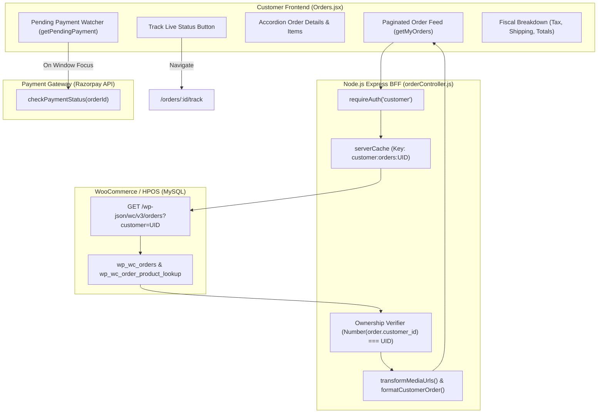
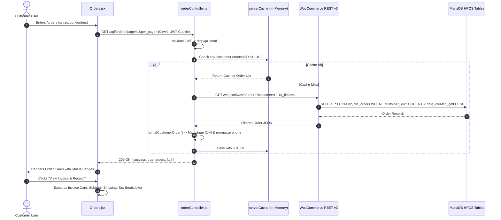

# Customer Panel Audit: Feature 07 — Order History & Invoices

> **Feature Scope**: Customer Order History Listing, Pending Payment Auto-Reconciliation, Detailed Line-Item Invoicing, and Order Lifecycle Progression  
> **Target Audience**: Full-Stack Engineers, Payment Operations Teams, QA Automation Engineers, and Technical Auditors  
> **Authoritative Baseline**: `Orders.jsx`, `orderService.js`, `orderRoutes.js`, and `orderController.js`  
> **Date**: November 2026

---

## 1. High-Level Architecture & System Role

The **Order History & Invoices** module provides customers with a centralized, auditable record of their purchase history in Mumbai Collection. 

Key architectural responsibilities include:
1. **Ownership-Locked Order Queries**: Fetching paginated orders restricted exclusively to the authenticated customer's WordPress User ID (`customer_id`), with strict IDOR protections.
2. **Pending Payment Interception & Self-Healing**: Automatically detecting in-flight Razorpay orders from `localStorage` upon page focus or return from external banking apps, querying the gateway, and auto-resolving to success or refund.
3. **Transparent Fiscal Breakdowns**: Displaying itemized pricing, discounts, shipping fees, tax subtotals, and delivery destination metadata.
4. **Direct Seamless Handoff to Tracking**: Linking every active order to the dedicated live fulfillment tracker (`/orders/:orderId/track`).



---

## 2. Frontend Architecture & Self-Healing Payments (`Orders.jsx`)

Located at [`apps/customer-web/src/pages/Orders.jsx`](file:///c:/Users/asus/Desktop/Mumbai%20Collection/apps/customer-web/src/pages/Orders.jsx):

### 2.1 Self-Healing Pending Payment Watcher
When a customer is redirected to external UPI apps (Google Pay, PhonePe, Paytm) or banking 3D-Secure verification, browser tabs may be detached. On returning to `/orders`, `Orders.jsx` checks:
```javascript
// apps/customer-web/src/pages/Orders.jsx (Lines 124-137)
useEffect(() => {
  const checkStoredPending = () => {
    const stored = getPendingPayment();
    if (stored?.razorpay_order_id && Date.now() - (stored.timestamp || 0) < 30 * 60 * 1000) {
      setPendingPayment(stored);
    } else {
      setPendingPayment(null);
    }
  };

  checkStoredPending();
  window.addEventListener("focus", checkStoredPending);
  return () => window.removeEventListener("focus", checkStoredPending);
}, []);
```
If a pending transaction is found:
- An interactive banner appears at the top of the screen: *"Verifying your recent payment..."*
- Clicking "Check Status" invokes `checkPaymentStatus()`. If the backend reports success, the idempotency locks are cleared and the user is redirected to `/order-success/:orderId`.

### 2.2 Paginated Data Fetching & Concurrency Guard
- Orders are requested in chunks of 10 (`per_page: 10`).
- An `AbortController` (`abortControllerRef`) cancels in-flight network requests if the user navigates away or refreshes before completion, preventing state leaks.
- De-duplication: When appending additional pages (`isLoadMore = true`), a `Set` of existing order IDs prevents duplicate items caused by concurrent store insertions.

---

## 3. Backend Route & Ownership Verification (`orderController.js`)

Located at [`apps/backend/src/controllers/orderController.js`](file:///c:/Users/asus/Desktop/Mumbai%20Collection/apps/backend/src/controllers/orderController.js):

### 3.1 IDOR Prevention & Field Projection
When fetching customer orders, the backend strictly limits fields to avoid leaking internal operational notes or server logs:
```javascript
// apps/backend/src/controllers/orderController.js (Lines 132-158)
const CUSTOMER_ORDER_FIELDS = "id,customer_id,number,status,total,currency_symbol,payment_method,payment_method_title,date_created,date_completed,date_completed_gmt,date_modified,billing,shipping,line_items,meta_data,shipping_total,discount_total,total_tax";

const fetchCustomerOrderPage = async ({ userId, page, limit, after, before }) => {
  const query = {
    customer: userId,
    page,
    per_page: limit,
    orderby: "date",
    order: "desc",
    _fields: CUSTOMER_ORDER_FIELDS,
  };
  const response = await api.get("orders", query);
  ...
```

### 3.2 Single Order Access Control
When a customer requests details for a specific order ID (`/orders/:id`), the backend enforces that the order's `customer_id` strictly matches the token's `wpUserId`:
```javascript
// apps/backend/src/controllers/orderController.js (Lines 251-260)
// Orders from signed-in checkout are linked to the customer's WooCommerce
// ID. Do not authorize access by billing email alone; email addresses can
// be reused and must not grant access to another account's order history.
if (Number(order.customer_id || 0) !== Number(userId)) {
  return sendResult(res, {
    success: false,
    errorCode: "ORDER_NOT_FOUND",
    message: "Order not found.",
  });
}
```
> [!IMPORTANT]
> The controller returns a generic `ORDER_NOT_FOUND` (rather than `403 Forbidden`) to prevent enumeration attacks where an attacker could deduce whether a random order ID exists in the database.

---

## 4. End-to-End Sequence: Order History & Invoice Generation



---

## 5. Deep Logic Code Index

| Logic Component | File Reference | Primary Function / Symbol | Operational Purpose |
| :--- | :--- | :--- | :--- |
| **Order Formatter** | [`orderController.js`](file:///c:/Users/asus/Desktop/Mumbai%20Collection/apps/backend/src/controllers/orderController.js#L14-L127) | `formatCustomerOrder` | Maps raw WooCommerce metadata and `_delivery_status` into 4-stage tracking representation. |
| **List Orders Controller** | [`orderController.js`](file:///c:/Users/asus/Desktop/Mumbai%20Collection/apps/backend/src/controllers/orderController.js#L180-L220) | `getCustomerOrders` | Authenticated controller with 60s per-user caching and media URL rewriting. |
| **Single Order Controller** | [`orderController.js`](file:///c:/Users/asus/Desktop/Mumbai%20Collection/apps/backend/src/controllers/orderController.js#L225-L279) | `getOrderById` | IDOR-safe single order retriever rejecting cross-account email impersonation. |
| **Pending Payment Watcher** | [`Orders.jsx`](file:///c:/Users/asus/Desktop/Mumbai%20Collection/apps/customer-web/src/pages/Orders.jsx#L124-L170) | `handleCheckPending` | Reconciles dangling Razorpay payments when customers switch back from payment apps. |
| **Pagination Handler** | [`Orders.jsx`](file:///c:/Users/asus/Desktop/Mumbai%20Collection/apps/customer-web/src/pages/Orders.jsx#L52-L115) | `fetchOrders` | AbortController-protected incremental order loader with client-side deduplication. |
| **Status Badge Renderer** | [`Orders.jsx`](file:///c:/Users/asus/Desktop/Mumbai%20Collection/apps/customer-web/src/pages/Orders.jsx#L181-L245) | `getStatusBadge` | Color-coded status pills (`Delivered`, `Preparing & Packing`, `Out for Delivery`, `Cancelled`). |

---

## 6. Security, Edge Cases & Invoice Accuracy

1. **Anti-Leakage Field Masking**:
   - Internal employee packing notes (`_packing_staff_id`, `_inventory_batch_lock`) and admin private meta keys are strictly excluded via `CUSTOMER_ORDER_FIELDS`.
2. **Precision Rounding & Tax Line Items**:
   - Currency totals (`subtotal`, `shipping_total`, `discount_total`, `total_tax`, `total`) are rendered from validated string primitives to avoid floating-point rounding discrepancies.
3. **No-Index Metadata**:
   - `Orders.jsx` invokes `useNoIndex()`, dynamically injecting `<meta name="robots" content="noindex, nofollow" />` to prevent search crawlers from indexing private customer purchase logs.
