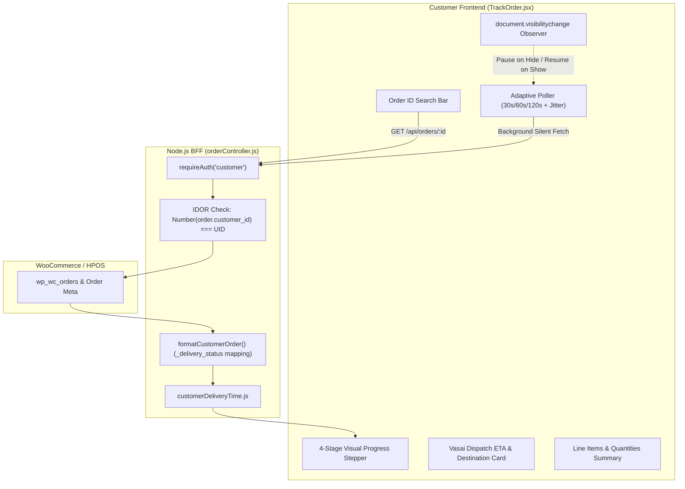
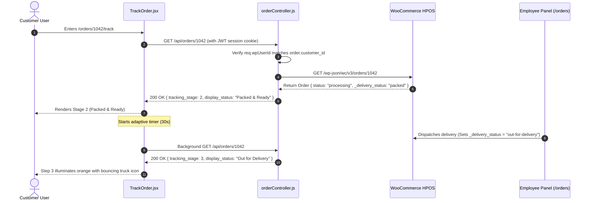

# Customer Panel Audit: Feature 08 — Live Order Tracking

> **Feature Scope**: Real-Time Fulfillment Tracking, Adaptive Polling with Jitter, Page Visibility Suspension, 4-Stage Visual Progress Stepper, and Vasai Dispatch ETA  
> **Target Audience**: Frontend Architects, Mobile Engineers, Operations Leads, and Performance Auditors  
> **Authoritative Baseline**: `TrackOrder.jsx`, `orderService.js`, `orderController.js`, and `customerDeliveryTime.js`  
> **Date**: November 2026

---

## 1. High-Level Architecture & System Role

The **Live Order Tracking** module (`/orders/:orderId/track`) provides customers with a live visual progression monitor for physical store orders. Because orders are fulfilled from the central Vasai store location and dispatched locally, tracking is designed around high-clarity status changes rather than opaque third-party shipping courier webhooks.

Key architectural responsibilities include:
1. **4-Stage Fulfillment Lifecycle**:
   - Stage 1: **Order Placed** (`pending` / `on-hold`)
   - Stage 2: **Preparing & Packing** (`processing` / `packed`)
   - Stage 3: **Out for Delivery** (`out-for-delivery` / `dispatched`)
   - Stage 4: **Delivered** (`completed`)
   - Terminal Exception: **Cancelled / Refunded / Failed**
2. **Adaptive Resource-Aware Polling**:
   - Progressive backoff polling (30s -> 60s -> 120s) with 0-5s randomized jitter to prevent server thundering herds.
   - Immediate freeze when the browser tab goes hidden (`document.hidden`), resuming instantly upon window refocus.
3. **Strict Session Verification**:
   - Requires active authentication matching the order's registered customer user ID to prevent unauthorized order sniffing.



---

## 2. Dynamic Adaptive Polling Architecture (`TrackOrder.jsx`)

Located at [`apps/customer-web/src/pages/TrackOrder.jsx`](file:///c:/Users/asus/Desktop/Mumbai%20Collection/apps/customer-web/src/pages/TrackOrder.jsx):

### 2.1 Polling Intervals & Random Jitter
To maintain responsive status updates for customers waiting for rapid store dispatches while preventing high-frequency polling from saturating backend servers, `TrackOrder.jsx` implements an **adaptive backoff schedule**:

```javascript
// apps/customer-web/src/pages/TrackOrder.jsx (Lines 157-175)
const scheduleNextPoll = () => {
  if (!pollTimerRef.current && !document.hidden) {
    pollCountRef.current += 1;
    // Adaptive polling interval: 30s initial, 60s medium, 120s long-stay
    const baseInterval =
      pollCountRef.current <= 3
        ? 30000
        : pollCountRef.current <= 10
        ? 60000
        : 120000;
    const jitterMs = Math.floor(Math.random() * 5000);
    pollTimerRef.current = setTimeout(async () => {
      pollTimerRef.current = null;
      if (document.hidden) return;
      await fetchOrder(activeOrderId, true);
      scheduleNextPoll();
    }, baseInterval + jitterMs);
  }
};
```

### 2.2 Visibility-State Management
When a user minimizes the browser or navigates to another app, background network traffic is terminated:
- **Tab Hidden (`document.hidden === true`)**: Active `setTimeout` timer is cleared; polling ceases.
- **Tab Visible (`document.hidden === false`)**: Reset `pollCountRef.current = 0`, trigger an immediate foreground fetch, and resume the 30-second cadence.

### 2.3 Terminal State Circuit Breaker
If the order transitions to `completed`, `cancelled`, `refunded`, or `failed`, the polling loop is permanently halted:
```javascript
// apps/customer-web/src/pages/TrackOrder.jsx (Lines 143-155)
const isTerminalState =
  currentOrder.status === "completed" ||
  currentOrder.status === "cancelled" ||
  currentOrder.status === "refunded" ||
  currentOrder.status === "failed";

if (isTerminalState) {
  if (pollTimerRef.current) {
    clearTimeout(pollTimerRef.current);
    pollTimerRef.current = null;
  }
  return;
}
```

---

## 3. Four-Stage Visual Progression Stepper

The UI renders a responsive vertical and horizontal progression stepper displaying status badges, animated icons, and localized IST timestamps:

| Stage # | System Status (`_delivery_status` / `status`) | Display Label | Badge Color | Icon Representation |
| :---: | :--- | :--- | :--- | :--- |
| **Stage 1** | `pending`, `on-hold` | Order Placed | Amber | `<Package size={18} />` |
| **Stage 2** | `processing`, `packed` | Preparing & Packing | Blue / Purple | `<Package size={18} className="animate-pulse" />` |
| **Stage 3** | `out-for-delivery`, `dispatched` | Out for Delivery | Orange | `<Truck size={18} className="animate-bounce" />` |
| **Stage 4** | `completed` | Delivered | Emerald | `<CheckCircle2 size={18} />` |
| **Exception** | `cancelled`, `failed`, `refunded` | Cancelled / Failed | Rose | `<AlertCircle size={18} />` |

---

## 4. End-to-End Tracking Sequence



---

## 5. Deep Logic Code Index

| Logic Component | File Reference | Primary Function / Symbol | Operational Purpose |
| :--- | :--- | :--- | :--- |
| **Adaptive Poller** | [`TrackOrder.jsx`](file:///c:/Users/asus/Desktop/Mumbai%20Collection/apps/customer-web/src/pages/TrackOrder.jsx#L157-L200) | `scheduleNextPoll` | Controls 30s/60s/120s backoff with 0-5s jitter and visibility suspension. |
| **Cancellation Guard** | [`TrackOrder.jsx`](file:///c:/Users/asus/Desktop/Mumbai%20Collection/apps/customer-web/src/pages/TrackOrder.jsx#L55-L113) | `fetchOrder` | Utilizes `AbortController` and request sequence tokens to prevent out-of-order race conditions. |
| **Stepper State Resolver** | [`TrackOrder.jsx`](file:///c:/Users/asus/Desktop/Mumbai%20Collection/apps/customer-web/src/pages/TrackOrder.jsx#L242-L260) | `getStepStatus` | Evaluates whether a progression step is `completed`, `active`, or `pending`. |
| **IST Timestamp Formatter** | [`TrackOrder.jsx`](file:///c:/Users/asus/Desktop/Mumbai%20Collection/apps/customer-web/src/pages/TrackOrder.jsx#L223-L240) | `formatDateTime` | Formats ISO dates into Indian Standard Time (`Asia/Kolkata`) with AM/PM indicators. |
| **Delivery Time Meta** | [`customerDeliveryTime.js`](file:///c:/Users/asus/Desktop/Mumbai%20Collection/apps/backend/src/utils/customerDeliveryTime.js) | `customerDeliveryTime` | Extracts authoritative delivery completion time from HPOS metadata. |

---

## 6. Security & Performance Verification

1. **Anti-Snooping Guard**:
   - Accessing `/orders/:id/track` for an order belonging to another customer responds with `403 Forbidden` / `ORDER_NOT_FOUND`, preventing competitors or malicious users from tracking third-party customer deliveries.
2. **Silent Background Refreshing**:
   - Background polling passes `isBackground = true` to `fetchOrder()`. In this mode, no full-screen loading spinners or layout shifts occur; the order details update seamlessly in-place.
3. **Haptic Feedback & Mobile Navigation**:
   - Back button uses a safe history check (`window.history.state.idx > 0`) to return to the previous page or falls back to `/account/orders` if accessed directly via URL or external bookmark.
