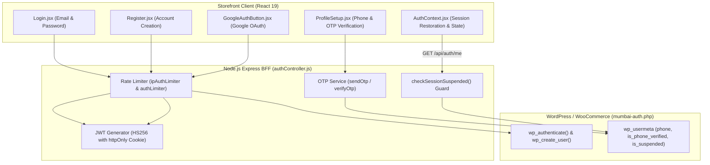
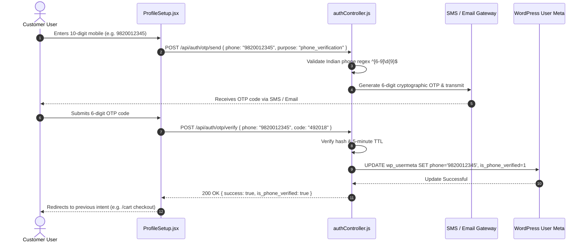

# Customer Panel Audit: Feature 09 — Customer Auth & Onboarding

> **Feature Scope**: Customer Registration, Credential Login, Google OAuth 2.0, OTP Phone Verification, Session Restoration, and Active Suspension Interception  
> **Target Audience**: Security Engineers, Authentication Specialists, Full-Stack Developers, and Compliance Auditors  
> **Authoritative Baseline**: `AuthContext.jsx`, `Login.jsx`, `Register.jsx`, `ProfileSetup.jsx`, `authRoute.js`, and `authController.js`  
> **Date**: November 2026

---

## 1. High-Level Architecture & System Role

The **Customer Auth & Onboarding** module governs identity lifecycle management across the Mumbai Collection storefront.

Key architectural responsibilities include:
1. **Multi-Mode Authentication**: Supports standard Email/Password credentials alongside one-tap Google OAuth 2.0 (`@react-oauth/google`).
2. **Mandatory Delivery Phone Verification**: Enforces transactional SMS/Email OTP verification during customer onboarding (`ProfileSetup.jsx`) before orders can be placed.
3. **Strict HttpOnly Cookie Security**: Issues signed JWT session cookies with `HttpOnly`, `SameSite=Strict`, and `Secure` attributes, completely shielding tokens from XSS theft.
4. **Active Suspension Interception**: Evaluates customer suspension flags on every authenticated API invocation, instantaneously invalidating sessions if an administrator temporarily or permanently suspends the user.
5. **Disk PII Elimination**: Automatically purges persistent `localStorage` user keys on boot, restricting runtime profile cache to volatile `sessionStorage` (cleared on tab close).



---

## 2. Session Lifecycle & Security Primitives (`AuthContext.jsx`)

Located at [`apps/customer-web/src/context/AuthContext.jsx`](file:///c:/Users/asus/Desktop/Mumbai%20Collection/apps/customer-web/src/context/AuthContext.jsx):

### 2.1 Disk PII Sanitization
In accordance with modern privacy standards, persistent disk storage of customer PII is purged upon session restoration:
```javascript
// apps/customer-web/src/context/AuthContext.jsx (Lines 31-36)
const response = await getCurrentUser();

// Purge legacy persistent storage to prevent PII retention on disk
safeStorage.removeItem("user");
safeStorage.removeItem("user_profile");
```
Minimal non-sensitive profile identifiers (`id`, `name`, `roles`) are cached only in `sessionStorage`, which self-destructs when the customer closes their browser window.

### 2.2 Clean Profile Name Sanitization
To avoid display bugs where internal database defaults leak into the greeting UI, default store names are cleansed:
```javascript
// apps/customer-web/src/context/AuthContext.jsx (Lines 47-55)
const isStoreName = (str) => {
  if (!str || typeof str !== "string") return true;
  const s = str.trim().toLowerCase();
  return s === "mumbaicollection" || s === "mumbai collection" || s === "mumbai_collection";
};

if (isStoreName(userData.name)) userData.name = "";
if (isStoreName(userData.username)) userData.username = "";
```

---

## 3. Backend Routes & Rate Limiting (`authRoute.js`)

Located at [`apps/backend/src/routes/authRoute.js`](file:///c:/Users/asus/Desktop/Mumbai%20Collection/apps/backend/src/routes/authRoute.js):

### 3.1 Dual-Tier Rate Limiting
To defend against brute-force password cracking and SMS/Email OTP flooding, auth endpoints are protected by both per-IP and per-account rate limiters:
```javascript
// apps/backend/src/routes/authRoute.js (Lines 18-20, 28-30)
router.post("/login", ipAuthLimiter, authLimiter, validateRequest({ body: schemas.login }), login);
router.post("/register", ipAuthLimiter, authLimiter, validateRequest({ body: schemas.register }), register);
router.post("/google-login", ipAuthLimiter, authLimiter, validateRequest({ body: schemas.googleLogin }), optionalAuth, googleLogin);

// Transactional OTP Endpoints
router.post("/otp/send", ipAuthLimiter, authLimiter, validateRequest({ body: schemas.otpSend }), optionalAuth, sendOtp);
router.post("/otp/verify", ipAuthLimiter, authLimiter, validateRequest({ body: schemas.otpVerify }), optionalAuth, verifyOtp);
```

---

## 4. Onboarding & Phone Verification Workflow (`ProfileSetup.jsx`)

When a customer registers or logs in via Google without a verified 10-digit Indian mobile number, the client enforces completion via `/profile-setup`:



---

## 5. Active Suspension Evaluation

If an administrator places an account on suspension (`Admin audit/04_Customer_Suspension.md`), the customer session is blocked dynamically:
1. `GET /auth/me` or any authenticated customer request executes `checkSessionSuspended(req.wpUserId)`.
2. If `_mumbai_customer_suspended === "1"`, the backend terminates processing, clears the JWT cookie, and returns:
   ```json
   {
     "success": false,
     "errorCode": "ACCOUNT_SUSPENDED",
     "message": "Your account has been temporarily suspended. Please contact store support."
   }
   ```
3. The client receives the `403 ACCOUNT_SUSPENDED` response, clears the active user state in `AuthContext`, and presents an account suspension advisory banner.

---

## 6. Deep Logic Code Index

| Logic Component | File Reference | Primary Function / Symbol | Operational Purpose |
| :--- | :--- | :--- | :--- |
| **Session Hydrator** | [`AuthContext.jsx`](file:///c:/Users/asus/Desktop/Mumbai%20Collection/apps/customer-web/src/context/AuthContext.jsx#L28-L105) | `restoreSession` | Restores session via `/auth/me`, cleanses disk PII, and sanitizes default store names. |
| **Logout & Cart Purge** | [`AuthContext.jsx`](file:///c:/Users/asus/Desktop/Mumbai%20Collection/apps/customer-web/src/context/AuthContext.jsx#L140-L175) | `logout` | Clears cart nonce tokens, destroys server JWT cookie, and purges session storage. |
| **Login Submitter** | [`Login.jsx`](file:///c:/Users/asus/Desktop/Mumbai%20Collection/apps/customer-web/src/pages/Login.jsx#L29-L105) | `handleLogin` | Validates credentials, executes double-submit guard (`submittingRef`), and routes safely. |
| **Google OAuth Integration** | [`GoogleAuthButton.jsx`](file:///c:/Users/asus/Desktop/Mumbai%20Collection/apps/customer-web/src/components/auth/GoogleAuthButton.jsx) | `GoogleAuthButton` | Renders Google Credential button and dispatches ID token to `/auth/google-login`. |
| **OTP Transmission** | [`authController.js`](file:///c:/Users/asus/Desktop/Mumbai%20Collection/apps/backend/src/controllers/authController.js) | `sendOtp` | Generates 6-digit numeric OTP with 5-minute expiration and rate limit counter. |
| **OTP Verification** | [`authController.js`](file:///c:/Users/asus/Desktop/Mumbai%20Collection/apps/backend/src/controllers/authController.js) | `verifyOtp` | Validates submitted OTP and sets `is_phone_verified = true` in WordPress user meta. |

---

## 7. Security & Edge Case Defenses

1. **Anti-Brute Force Protection**:
   - `authLimiter` limits attempts to 5 per minute per IP, preventing dictionary and credential stuffing attacks.
2. **Timing Attack Resistance**:
   - Password hashes in WordPress use `wp_check_password` (phpass/bcrypt), preventing timing discrepancy side-channel attacks.
3. **Safe Redirection White-listing**:
   - Login completion utilizes `getSafeInternalPath(location.state?.from, "/")`, preventing open-redirect vulnerabilities where attackers could bounce users to external phishing domains.
