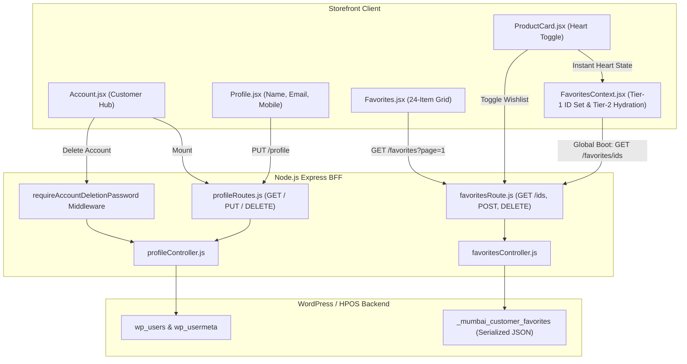
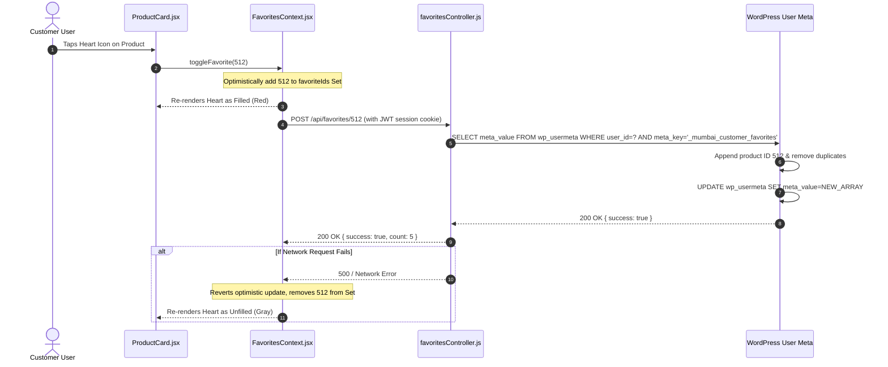

# Customer Panel Audit: Feature 10 — Account, Profile & Wishlist

> **Feature Scope**: Customer Hub Navigation, Profile Editing, Two-Tier Wishlist Architecture (Set-based ID Sync vs Full Hydration), and Secure Account Deletion  
> **Target Audience**: Frontend Architects, State Management Specialists, Full-Stack Developers, and Security Auditors  
> **Authoritative Baseline**: `Account.jsx`, `Profile.jsx`, `Favorites.jsx`, `FavoritesContext.jsx`, `profileRoutes.js`, and `favoritesRoute.js`  
> **Date**: November 2026

---

## 1. High-Level Architecture & System Role

The **Account, Profile & Wishlist** module serves as the personal management command center for customers of Mumbai Collection.

Key architectural responsibilities include:
1. **Centralized Customer Hub (`/account`)**:
   - Single-view access to Order History, Saved Addresses, Wishlist, Contact Support, and Account Settings.
   - Immediate zero-flash profile hydration from local storage cache combined with background SWR server reconciliation.
2. **Two-Tier Wishlist Hydration Architecture**:
   - **Tier 1 (Lightweight Global ID Sync)**: Dispatches `GET /favorites/ids` on boot, returning only numeric product IDs into a fast `Set<number>`. Allows any product card across the entire application (Home, Categories, Search) to instantaneously display filled/unfilled heart icons without fetching full product JSON payloads.
   - **Tier 2 (Full Catalog Details)**: Dispatched strictly when the customer navigates to the dedicated `/favorites` screen (`GET /favorites?page=1&perPage=24`).
3. **Optimistic Wishlist Toggling**:
   - Tapping the heart icon instantly updates the UI with haptic feedback, while asynchronously committing changes via `POST /favorites/:id` or `DELETE /favorites/:id`. Automatically reverts if the network request fails.
4. **Secure Profile Updates & Account Deletion**:
   - Supports updating name, email, and mobile contact.
   - Account deletion requires explicit current password verification (`requireAccountDeletionPassword`) before wiping user metadata and anonymizing past records.



---

## 2. Two-Tier Wishlist Architecture (`FavoritesContext.jsx`)

Located at [`apps/customer-web/src/context/FavoritesContext.jsx`](file:///c:/Users/asus/Desktop/Mumbai%20Collection/apps/customer-web/src/context/FavoritesContext.jsx):

### 2.1 Tier 1: Zero-Payload Global ID Sync
To achieve blazing-fast initial load times, Mumbai Collection does not fetch full product objects across global pages:
```javascript
// apps/customer-web/src/context/FavoritesContext.jsx (Lines 23-43)
const fetchFavorites = useCallback(async () => {
  if (!user) {
    setFavoriteIds(new Set());
    setFavorites([]);
    return;
  }

  try {
    const res = await getFavoriteIds();
    if (res?.success) {
      const ids = new Set((res.productIds || []).map(Number));
      setFavoriteIds(ids);
      setFavoriteTotal(Number(res.count) || ids.size);
    }
  } catch {
    // Graceful fallback
  }
}, [user]);
```
Any catalog card simply checks `favoriteIds.has(Number(product.id))` in $\mathcal{O}(1)$ time.

### 2.2 Tier 2: Dedicated Screen Full Hydration
When the user visits `/favorites`, `loadFullFavorites({ page, perPage: 24 })` executes, fetching rich product metadata (images, prices, stock statuses, discount tags):
```javascript
// apps/customer-web/src/context/FavoritesContext.jsx (Lines 46-73)
const loadFullFavorites = useCallback(async ({ page = 1, append = false } = {}) => {
  if (!user) return [];
  try {
    if (append) setLoadingMore(true);
    else setLoading(true);
    const res = await getFavorites({ page, perPage: 24 });
    if (res?.success) {
      const nextFavorites = res.favorites || [];
      setFavorites((current) => {
        if (!append) return nextFavorites;
        const byId = new Map(current.map((p) => [Number(p.id), p]));
        nextFavorites.forEach((p) => byId.set(Number(p.id), p));
        return [...byId.values()];
      });
      ...
```

---

## 3. Account Navigation & Instant Hydration (`Account.jsx`)

Located at [`apps/customer-web/src/pages/Account.jsx`](file:///c:/Users/asus/Desktop/Mumbai%20Collection/apps/customer-web/src/pages/Account.jsx):

### 3.1 Flash-Free Profile Hydration
To eliminate UI flickering (e.g. showing "Customer" before the user's actual name appears), `Account.jsx` synchronously initializes state from cache:
```javascript
// apps/customer-web/src/pages/Account.jsx (Lines 30-33)
const [profile, setProfile] = useState(() => {
  return safeStorage.getJSON("user_profile", null);
});
```
It immediately triggers a background `GET /profile` request to refresh any updates made across other devices.

### 3.2 Clean Display Fallback Hierarchy
Names are resolved through an unambiguous priority ladder, filtering out boilerplate system defaults:
```javascript
// apps/customer-web/src/pages/Account.jsx (Lines 68-74)
const displayName =
  (!isStoreName(profile?.full_name) ? profile?.full_name?.trim() : "") ||
  (!isStoreName(user?.full_name) ? user?.full_name?.trim() : "") ||
  (!isStoreName(user?.name) ? user?.name?.trim() : "") ||
  (!isStoreName(user?.username) ? user?.username?.trim() : "") ||
  "Customer";
```

---

## 4. Backend Route & Password-Guarded Account Deletion (`profileRoutes.js`)

Located at [`apps/backend/src/routes/profileRoutes.js`](file:///c:/Users/asus/Desktop/Mumbai%20Collection/apps/backend/src/routes/profileRoutes.js):

### 4.1 Strict Account Deletion Password Guard
Deleting an account is irreversible. The backend enforces that the customer's plaintext password (or a cryptographic 64-character reset token) is provided:
```javascript
// apps/backend/src/routes/profileRoutes.js (Lines 23-32)
const requireAccountDeletionPassword = (req, res, next) => {
  if (!(typeof req.body?.password === "string" && req.body.password.length > 0) &&
      !(typeof req.body?.reset_token === "string" && /^[A-Za-z0-9]{64}$/.test(req.body.reset_token))) {
    return res.status(400).json({
      success: false,
      message: "Your current password is required to delete your account.",
    });
  }
  return next();
};

router.delete("/", requireAuth("customer"), requireAccountDeletionPassword, deleteAccount);
```

---

## 5. End-to-End Sequence: Wishlist Toggle Flow



---

## 6. Deep Logic Code Index

| Logic Component | File Reference | Primary Function / Symbol | Operational Purpose |
| :--- | :--- | :--- | :--- |
| **Tier-1 Fast Sync** | [`FavoritesContext.jsx`](file:///c:/Users/asus/Desktop/Mumbai%20Collection/apps/customer-web/src/context/FavoritesContext.jsx#L23-L43) | `fetchFavorites` | Loads numeric wishlist IDs into `Set<number>` for $\mathcal{O}(1)$ UI card lookups. |
| **Tier-2 Full Hydration** | [`FavoritesContext.jsx`](file:///c:/Users/asus/Desktop/Mumbai%20Collection/apps/customer-web/src/context/FavoritesContext.jsx#L46-L80) | `loadFullFavorites` | Paginated product retriever (24 per page) with Map-based deduplication. |
| **Optimistic Toggle** | [`FavoritesContext.jsx`](file:///c:/Users/asus/Desktop/Mumbai%20Collection/apps/customer-web/src/context/FavoritesContext.jsx#L85-L140) | `toggleFavorite` | Instant visual toggle with haptic trigger and failure-rollback safety. |
| **Account Hub** | [`Account.jsx`](file:///c:/Users/asus/Desktop/Mumbai%20Collection/apps/customer-web/src/pages/Account.jsx#L24-L85) | `Account` | Central navigation console with instant cache hydration and fallback ladder. |
| **Profile Controller** | [`profileController.js`](file:///c:/Users/asus/Desktop/Mumbai%20Collection/apps/backend/src/controllers/profileController.js) | `saveProfile` | Updates name, email, and phone while verifying uniqueness and formatting. |
| **Password Guard** | [`profileRoutes.js`](file:///c:/Users/asus/Desktop/Mumbai%20Collection/apps/backend/src/routes/profileRoutes.js#L23-L32) | `requireAccountDeletionPassword` | Middleware requiring verified password before invoking `deleteAccount`. |

---

## 7. Security, Edge Cases & Data Hygiene

1. **Wishlist Orphan Auto-Pruning**:
   - If a product saved in a customer's wishlist is deleted from WooCommerce catalog, `getFavorites` detects missing catalog records and automatically filters them out of the response.
2. **Rate-Limited Phone Availability Probing**:
   - `GET /profile/check-phone` is protected by `phoneAvailabilityLimiter` (10 requests per 15 minutes per IP) to prevent malicious actors from harvesting registered customer phone numbers.
3. **No-Index Privacy Protection**:
   - Both `Account.jsx` and `Favorites.jsx` invoke `useNoIndex()`, blocking search indexing of private user wishlists and account settings.
