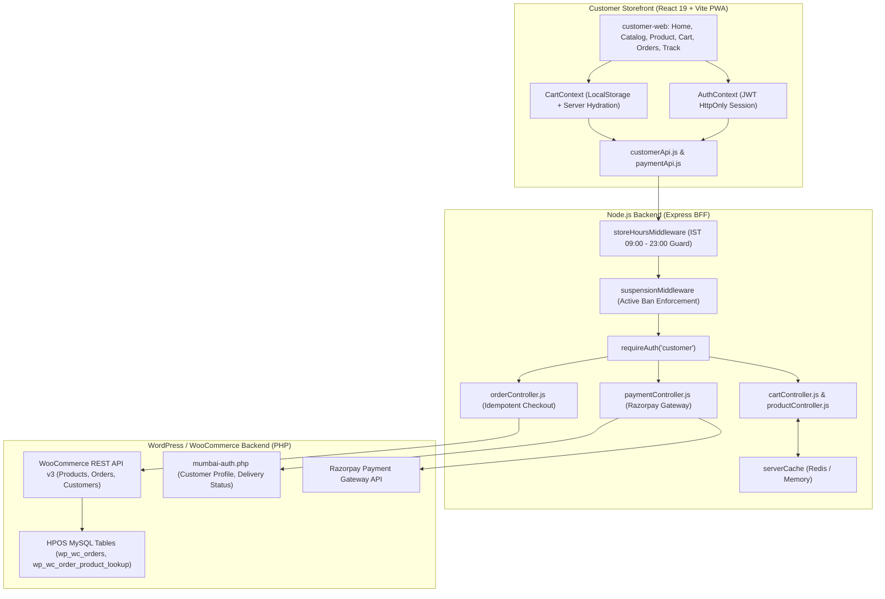

# Mumbai Collection: Customer Panel (Storefront) Technical Audit

> **Scope**: End-to-End Architectural, Frontend, Backend, and Database Audits of the Customer Storefront (`customer-web`)  
> **Repository Baseline**: Monorepo (`apps/customer-web`, `apps/backend`, `mumbai-auth.php`)  
> **Target Audience**: Core Engineering Team, Solutions Architects, and Security Auditors  
> **Date**: November 2026

---

## Executive Summary

The **Customer Panel** (`apps/customer-web`) is a high-performance, mobile-first progressive web application (PWA) built with React 19, Vite, and Tailwind CSS. It delivers a fast, frictionless quick-commerce shopping experience for customers in the Vasai-Virar region.

### Core Architectural Pillars
1. **Zero-Latency Shopping Experience**:
   - Client-side cart caching with automatic hydration from `localStorage`.
   - Debounced instant search and optimistic cart counter animations.
   - Intelligent multi-device image optimization.
2. **Fail-Closed Store Hours Guard**:
   - Enforces physical store opening hours (09:00 AM – 11:00 PM IST) at both UI and checkout controller boundaries, rejecting orders placed after hours.
3. **Automated Delivery Zone Classification**:
   - Categorizes destination pincodes and landmarks into localized fulfillment hubs (`vasai-east`, `vasai-west`, `nalasopara-east`, `nalasopara-west`).
4. **Idempotent Dual-Mode Checkout**:
   - Supports Cash on Delivery (COD) and Razorpay Payment Gateway integration with signature verification, webhook reconciliation, and stock row-level locking.
5. **Real-Time Fulfillment Tracking**:
   - 4-stage visual order progression stepper (`Placed` -> `Packing` -> `On the Way` -> `Delivered`).
   - Dedicated Live Tracking console (`/orders/:orderId/track`).
6. **Strict Account Security & Suspension Guards**:
   - Role-isolated JWT session cookies with `httpOnly`, `sameSite`, and `secure` attributes.
   - Real-time customer suspension evaluation blocking suspended accounts across both authenticated and guest checkout endpoints.

---

## Audit Index & Feature Modules

| Module # | Feature Name | Primary Route | Audit File | Status |
| :---: | :--- | :--- | :--- | :---: |
| **01** | **Storefront Home & Discovery** | `/` | [`01_Storefront_Home_and_Discovery.md`](file:///c:/Users/asus/Desktop/Mumbai%20Collection/Customer%20panel%20audit/01_Storefront_Home_and_Discovery.md) | **Completed** |
| **02** | **Catalog & Category Browsing** | `/categories`, `/category/:id` | [`02_Catalog_and_Category_Browsing.md`](file:///c:/Users/asus/Desktop/Mumbai%20Collection/Customer%20panel%20audit/02_Catalog_and_Category_Browsing.md) | **Completed** |
| **03** | **Product Details & Availability** | `/product/:id` | [`03_Product_Details_and_Availability.md`](file:///c:/Users/asus/Desktop/Mumbai%20Collection/Customer%20panel%20audit/03_Product_Details_and_Availability.md) | **Completed** |
| **04** | **Cart & LocalStorage Sync** | `/cart` | [`04_Cart_and_LocalStorage_Sync.md`](file:///c:/Users/asus/Desktop/Mumbai%20Collection/Customer%20panel%20audit/04_Cart_and_LocalStorage_Sync.md) | **Completed** |
| **05** | **Checkout & Razorpay Payments** | `/cart`, `/order-success` | [`05_Checkout_and_Razorpay_Payments.md`](file:///c:/Users/asus/Desktop/Mumbai%20Collection/Customer%20panel%20audit/05_Checkout_and_Razorpay_Payments.md) | **Completed** |
| **06** | **Customer Address Book & Zones** | `/account/addresses` | [`06_Customer_Address_Book_and_Zones.md`](file:///c:/Users/asus/Desktop/Mumbai%20Collection/Customer%20panel%20audit/06_Customer_Address_Book_and_Zones.md) | **Completed** |
| **07** | **Order History & Invoices** | `/orders`, `/account/orders` | [`07_Order_History_and_Invoices.md`](file:///c:/Users/asus/Desktop/Mumbai%20Collection/Customer%20panel%20audit/07_Order_History_and_Invoices.md) | **Completed** |
| **08** | **Live Order Tracking** | `/orders/:id/track` | [`08_Live_Order_Tracking.md`](file:///c:/Users/asus/Desktop/Mumbai%20Collection/Customer%20panel%20audit/08_Live_Order_Tracking.md) | **Completed** |
| **09** | **Customer Auth & Onboarding** | `/login`, `/register`, `/profile-setup` | [`09_Customer_Auth_and_Onboarding.md`](file:///c:/Users/asus/Desktop/Mumbai%20Collection/Customer%20panel%20audit/09_Customer_Auth_and_Onboarding.md) | **Completed** |
| **10** | **Account, Profile & Wishlist** | `/account`, `/account/profile`, `/favorites` | [`10_Account_Profile_and_Wishlist.md`](file:///c:/Users/asus/Desktop/Mumbai%20Collection/Customer%20panel%20audit/10_Account_Profile_and_Wishlist.md) | **Completed** |

---

## High-Level System Architecture



---

## Directory Structure

```
Customer panel audit/
├── Customer panel audit.md                       # Master Architecture & Feature Index
├── 01_Storefront_Home_and_Discovery.md           # (Upcoming)
├── 02_Catalog_and_Category_Browsing.md           # (Upcoming)
├── 03_Product_Details_and_Availability.md        # (Upcoming)
├── 04_Cart_and_LocalStorage_Sync.md              # (Upcoming)
├── 05_Checkout_and_Razorpay_Payments.md          # (Upcoming)
├── 06_Customer_Address_Book_and_Zones.md         # (Upcoming)
├── 07_Order_History_and_Invoices.md              # (Upcoming)
├── 08_Live_Order_Tracking.md                     # (Upcoming)
├── 09_Customer_Auth_and_Onboarding.md            # (Upcoming)
└── 10_Account_Profile_and_Wishlist.md            # (Upcoming)
```
