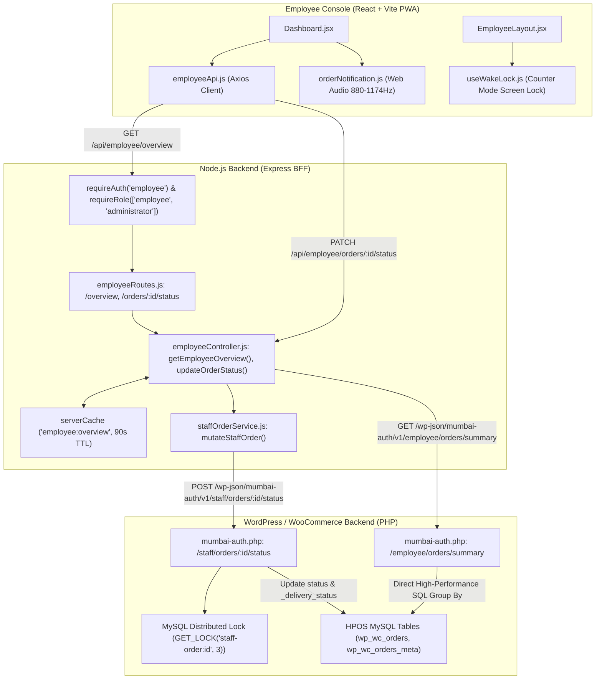
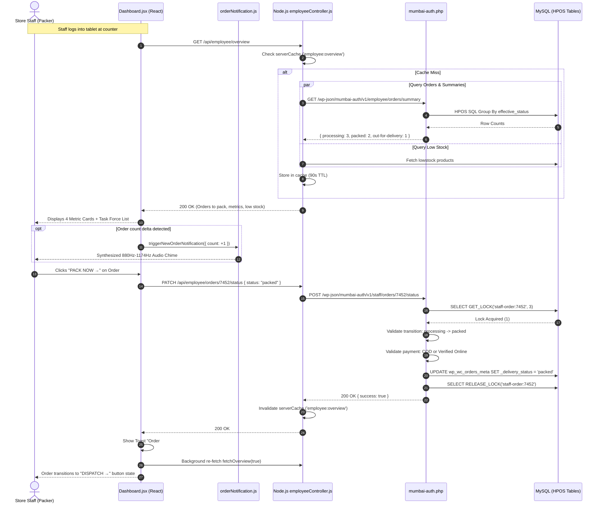

# Employee Panel Audit: Feature 01 — Operational Dashboard

> **Feature Scope**: Counter & Warehouse Operational Fulfillment Console  
> **Target Audience**: Technical Architects, Backend Developers, and System Auditors  
> **Authoritative Baseline**: WordPress HPOS, Node.js BFF, and Real-Time Tablet Web Audio / WakeLock  
> **Date**: November 2026

---

## 1. High-Level Architecture & System Role

The **Employee Dashboard** serves as the real-time operational mission control for floor staff, packers, and counter managers. Unlike the executive Admin Overview (which focuses on macro revenue, profit analytics, and reconciliation), the Employee Dashboard is engineered specifically for **rapid order packing, stage transitions, physical dispatch orchestration, and instant inventory alerts**.



---

## 2. Frontend Layer (React + Tailwind CSS)

### 2.1 File Map & Responsibilities
- **Primary Page Component**: [`apps/employee-panel/src/pages/Dashboard.jsx`](file:///c:/Users/asus/Desktop/Mumbai%20Collection/apps/employee-panel/src/pages/Dashboard.jsx)
- **Navigation & Layout Wrapper**: [`apps/employee-panel/src/layouts/EmployeeLayout.jsx`](file:///c:/Users/asus/Desktop/Mumbai%20Collection/apps/employee-panel/src/layouts/EmployeeLayout.jsx)
- **Employee API Client**: [`apps/employee-panel/src/services/employeeApi.js`](file:///c:/Users/asus/Desktop/Mumbai%20Collection/apps/employee-panel/src/services/employeeApi.js)
- **Audio & Push Alert System**: [`apps/employee-panel/src/utils/orderNotification.js`](file:///c:/Users/asus/Desktop/Mumbai%20Collection/apps/employee-panel/src/utils/orderNotification.js)
- **Screen Wake Lock Hook**: [`apps/employee-panel/src/hooks/useWakeLock.js`](file:///c:/Users/asus/Desktop/Mumbai%20Collection/apps/employee-panel/src/hooks/useWakeLock.js)

---

### 2.2 Deep Logic & Implementation Details

#### A. Race Condition Defense & Stale Data Elimination
In [`Dashboard.jsx`](file:///c:/Users/asus/Desktop/Mumbai%20Collection/apps/employee-panel/src/pages/Dashboard.jsx#L49-L99):
- **AbortController Inflight Protection (Lines 50–56)**: Stored in `activeRequestRef`. If an inflight promise exists and has not been aborted, `fetchOverview()` returns the existing active promise instead of firing duplicate HTTP requests.
- **Background vs Foreground Loading State (Lines 58–61)**: When `isBackground = true` (auto-polling), `loading` is preserved as `false` to avoid screen flashing or UI disruption for busy floor staff.

```javascript
// apps/employee-panel/src/pages/Dashboard.jsx: lines 50-56
const activeRequest = activeRequestRef.current;
if (activeRequest && !activeRequest.controller.signal.aborted) {
  return activeRequest.promise;
}
const controller = new AbortController();
```

#### B. Delta-Based Order Chime Detection
In [`Dashboard.jsx`](file:///c:/Users/asus/Desktop/Mumbai%20Collection/apps/employee-panel/src/pages/Dashboard.jsx#L65-L73):
- The dashboard tracks `prevToPackCountRef.current`.
- When `currentToPack > prevToPackCountRef.current`, the frontend invokes:
  ```javascript
  triggerNewOrderNotification({ count: currentToPack - prevToPackCountRef.current });
  ```
- This triggers a synthesized 2-tone audio chime (880 Hz -> 1174 Hz) via the Web Audio API without relying on external `.mp3` assets that might fail or get blocked by network policies.

#### C. Intelligent Polling & Tab Lifecycle Management
In [`Dashboard.jsx`](file:///c:/Users/asus/Desktop/Mumbai%20Collection/apps/employee-panel/src/pages/Dashboard.jsx#L107-L143):
- **30-Second Polling Cycle**: Configured via `setInterval(() => fetchOverview(true), 30000)`.
- **Visibility-Aware Throttle**: Listens for the `visibilitychange` browser event.
  - When the staff switches tabs or locks the mobile device (`document.hidden === true`), the polling interval is completely cleared to prevent socket leakage and unnecessary background battery drain.
  - When staff brings the tab back to the foreground, it immediately triggers an instant refresh (`fetchOverview(true)`) and re-engages the 30-second timer.

#### D. Screen Wake Lock for Shop Counter Mode
In [`apps/employee-panel/src/hooks/useWakeLock.js`](file:///c:/Users/asus/Desktop/Mumbai%20Collection/apps/employee-panel/src/hooks/useWakeLock.js#L23-L40):
- Interacts with the W3C Screen Wake Lock API (`navigator.wakeLock.request("screen")`).
- Prevents counter tablets and packing station laptops from sleeping during busy shifts.
- Re-requests the lock automatically upon document visibility return if counter mode is persisted in `localStorage.getItem("mumbai_counter_mode")`.

#### E. 4 Primary Operational Metric Cards
In [`Dashboard.jsx`](file:///c:/Users/asus/Desktop/Mumbai%20Collection/apps/employee-panel/src/pages/Dashboard.jsx#L218-L323):
1. **Orders to Pack (Amber Card)**:
   - Displays `summary.ordersToPack` (active `processing` orders).
   - High visual priority with direct deep link: `/orders?status=processing` and `PACK NOW` action button.
2. **Out for Delivery (Blue Card)**:
   - Displays `summary.ordersOutForDelivery` (`out-for-delivery` and `dispatched` states).
   - Deep link: `/orders?status=out-for-delivery`.
3. **Completed Today (Emerald Card)**:
   - Displays `summary.completedToday` (orders marked `completed` during the current IST day).
   - Deep link: `/orders?status=completed`.
4. **Stock Actions (Rose Card)**:
   - Displays `summary.lowStockCount` (items at or below low stock threshold).
   - Deep link: `/products`.

#### F. Today's Workload Horizontal Summary Bar
In [`Dashboard.jsx`](file:///c:/Users/asus/Desktop/Mumbai%20Collection/apps/employee-panel/src/pages/Dashboard.jsx#L325-L359):
- Displays immediate pipeline health metrics:
  - `Received Today`: All orders created in the store since 00:00:00 IST.
  - `To Pack`: Awaiting carton packaging.
  - `Packed`: Sealed in box, ready for courier handover.
  - `Out for Delivery`: In transit with field delivery agents.
  - `Delivered Today`: Successfully completed orders today.

#### G. High-Speed 1-Click Operational Status Advancer
In [`Dashboard.jsx`](file:///c:/Users/asus/Desktop/Mumbai%20Collection/apps/employee-panel/src/pages/Dashboard.jsx#L146-L160, #L463-L510):
- Floor staff can progress orders with a single tap of an oversized 44px button:
  - **Processing** -> `PACK NOW →` (calls `updateOrderStatus(order.id, "packed")`, purple button).
  - **Packed** -> `DISPATCH →` (calls `updateOrderStatus(order.id, "out-for-delivery")`, blue button).
  - **Out For Delivery** -> `MARK DELIVERED` (calls `updateOrderStatus(order.id, "completed")`, emerald button).
- **Awaiting Payment Guard (Lines 437–440, 465–470)**: If `order.is_unpaid` is `true` (an online Razorpay order where payment is not yet captured), action buttons are withheld and an amber badge warns `Awaiting Payment` to prevent unauthorized shipment dispatch.

---

## 3. Node.js BFF (Backend For Frontend) Layer

### 3.1 File Map & Responsibilities
- **Routes Configuration**: [`apps/backend/src/routes/employeeRoutes.js`](file:///c:/Users/asus/Desktop/Mumbai%20Collection/apps/backend/src/routes/employeeRoutes.js#L101-L106)
- **Controller Logic**: [`apps/backend/src/controllers/employeeController.js`](file:///c:/Users/asus/Desktop/Mumbai%20Collection/apps/backend/src/controllers/employeeController.js#L740-L925)
- **Staff Mutation Service**: [`apps/backend/src/services/staffOrderService.js`](file:///c:/Users/asus/Desktop/Mumbai%20Collection/apps/backend/src/services/staffOrderService.js)
- **IST Date Calculations**: [`apps/backend/src/utils/orderDateBounds.js`](file:///c:/Users/asus/Desktop/Mumbai%20Collection/apps/backend/src/utils/orderDateBounds.js)
- **Cache Management**: [`apps/backend/src/utils/memoryCache.js`](file:///c:/Users/asus/Desktop/Mumbai%20Collection/apps/backend/src/utils/memoryCache.js)

---

### 3.2 Deep Logic & Implementation Details

#### A. Security & Role Gates
In [`apps/backend/src/routes/employeeRoutes.js`](file:///c:/Users/asus/Desktop/Mumbai%20Collection/apps/backend/src/routes/employeeRoutes.js#L101-L106):
```javascript
router.get(
  "/overview",
  requireAuth("employee"),
  requireRole(["employee", "administrator"]),
  getEmployeeOverview
);
```
- Authenticates the session cookie specifically for the `employee` panel boundary.
- Enforces RBAC: Only users with role `employee` or `administrator` can access the operational pipeline.

#### B. Distributed Caching & Parallel Queries
In [`employeeController.js`](file:///c:/Users/asus/Desktop/Mumbai%20Collection/apps/backend/src/controllers/employeeController.js#L740-L807):
- Uses `serverCache.getOrFetch("employee:overview", callback, 90000)` with a 90-second TTL.
- Executes 7 parallel asynchronous queries using `Promise.all`:
  1. `api.get("orders", { status: "processing", per_page: 100 })`: Orders actively waiting for packing.
  2. `wp.get("/wp-json/mumbai-auth/v1/employee/orders/summary")`: Exact HPOS MySQL counts for `processing`, `packed`, and `out-for-delivery`.
  3. `api.get("orders", { after, before, dates_are_gmt: true, per_page: 1 })`: Reads `x-wp-total` header for total orders received today in IST.
  4. `api.get("orders", { status: "completed", after, before, dates_are_gmt: true, per_page: 1 })`: Reads `x-wp-total` for orders completed today in IST.
  5. `api.get("orders", { per_page: 10 })`: Fetches 10 most recent orders for operational activity stream.
  6. `fetchStockCounts()`: Catalog-wide live stock counts.
  7. `api.get("products", { stock_status: "lowstock", per_page: 6 })`: Top 6 low-stock inventory items for the quick-action sidebar.

#### C. Operational Priority Sorting Matrix
In [`employeeController.js`](file:///c:/Users/asus/Desktop/Mumbai%20Collection/apps/backend/src/controllers/employeeController.js#L852-L866):
Orders requiring staff intervention are strictly prioritized so urgent packing tasks always surface first:
```javascript
const statusPriority = {
  processing: 1,        // Immediate Pack Required
  packed: 2,            // Ready for Courier Pickup
  "out-for-delivery": 3, // In Transit / Needs Delivery Confirmation
  dispatched: 3,
  pending: 4,           // Unconfirmed / On-Hold
  "on-hold": 4,
};

actionOrders.sort((a, b) => {
  const pA = statusPriority[a.status] || 99;
  const pB = statusPriority[b.status] || 99;
  if (pA !== pB) return pA - pB;
  return new Date(b.date_created) - new Date(a.date_created);
});
```

#### D. Cache Invalidation Triggers
Whenever an employee changes an order status via `updateOrderStatus`, or an order is created or acknowledged, `serverCache.del("employee:overview")` is called to immediately flush stale counts.

---

## 4. WordPress & WooCommerce Backend Layer (PHP)

### 4.1 File Map & Responsibilities
- **Operational Summary Endpoint**: [`mumbai-auth.php`](file:///c:/Users/asus/Desktop/Mumbai%20Collection/mumbai-auth.php#L654-L658, #L6475-L6530)
- **Staff Status Mutation Engine**: [`mumbai-auth.php`](file:///c:/Users/asus/Desktop/Mumbai%20Collection/mumbai-auth.php#L660-L663, #L5709-L5780)

---

### 4.2 Deep Logic & Implementation Details

#### A. High-Performance SQL Aggregation (`/employee/orders/summary`)
In [`mumbai-auth.php`](file:///c:/Users/asus/Desktop/Mumbai%20Collection/mumbai-auth.php#L6475-L6525):
Instead of hydrating hundreds of heavy `WC_Order` PHP objects, the endpoint executes an optimized SQL query against WooCommerce HPOS:

```sql
SELECT LOWER(TRIM(COALESCE(NULLIF(dm.meta_value, ''), REPLACE(o.status, 'wc-', '')))) AS effective_status,
       COUNT(o.id) AS order_count
FROM wp_wc_orders o
LEFT JOIN (
    SELECT order_id, MAX(meta_value) AS meta_value
    FROM wp_wc_orders_meta
    WHERE meta_key = '_delivery_status'
    GROUP BY order_id
) dm ON dm.order_id = o.id
WHERE REPLACE(LOWER(TRIM(o.status)), 'wc-', '') IN ('pending', 'processing', 'on-hold')
GROUP BY effective_status
```

**Technical Nuances**:
- Respects the custom `_delivery_status` meta key: In WooCommerce, an order out for delivery remains in `processing` core status so payments and stock reserves stay active, while `_delivery_status` tracks granular sub-states (`packed`, `out-for-delivery`, `dispatched`).
- Uses `COALESCE(NULLIF(dm.meta_value, ''), REPLACE(o.status, 'wc-', ''))` to calculate the authoritative operational status directly inside MySQL in under 5ms.

#### B. Concurrency Control with MySQL Distributed Locks
In [`mumbai-auth.php`](file:///c:/Users/asus/Desktop/Mumbai%20Collection/mumbai-auth.php#L5712-L5715):
When an employee updates an order status:
```php
$key = hash('sha256', 'staff-order:' . $id);
if ((int) $wpdb->get_var($wpdb->prepare('SELECT GET_LOCK(%s, 3)', $key)) !== 1) {
    return new WP_Error('order_busy', 'Another staff member is updating this order.', ['status' => 409]);
}
```
- Obtains an application-level distributed lock on the exact order ID with a 3-second timeout.
- Prevents two packers from double-packing or double-dispatching the same package simultaneously.

#### C. Optimistic Concurrency & Modification Guard
In [`mumbai-auth.php`](file:///c:/Users/asus/Desktop/Mumbai%20Collection/mumbai-auth.php#L5724-L5728):
- Checks client-sent `expected_status`, `expected_delivery_status`, and `expected_modified` against the database's `modified_gmt`.
- If an admin or customer updated the order between the employee's screen render and the click, the request fails with HTTP 409 `order_changed`, prompting the employee to refresh.

#### D. Unpaid Online Order Shipment Gate
In [`mumbai-auth.php`](file:///c:/Users/asus/Desktop/Mumbai%20Collection/mumbai-auth.php#L5743-L5747):
```php
if (in_array($target, ['processing', 'packed', 'out-for-delivery', 'dispatched', 'completed'], true) &&
    $order->get_payment_method() !== 'cod' && !$order->get_date_paid() &&
    !$order->get_transaction_id() && !$order->get_meta('_payment_verified_at', true)) {
    return new WP_Error('unpaid_order', 'Online payment has not been confirmed.', ['status' => 409]);
}
```
- Eliminates shipping fraud: An online payment order cannot be advanced into packing or dispatch until either `date_paid`, `transaction_id`, or `_payment_verified_at` is firmly recorded.

---

## 5. End-to-End Operational Lifecycle Sequence



---

## 6. Deep Logic Code Index

| Component | File Path | Line Range | Functional Responsibility |
| :--- | :--- | :--- | :--- |
| **Frontend UI** | [`Dashboard.jsx`](file:///c:/Users/asus/Desktop/Mumbai%20Collection/apps/employee-panel/src/pages/Dashboard.jsx#L49-L99) | `L49-L99` | Inflight request deduplication & background fetching |
| **Audio Notification** | [`Dashboard.jsx`](file:///c:/Users/asus/Desktop/Mumbai%20Collection/apps/employee-panel/src/pages/Dashboard.jsx#L65-L73) | `L65-L73` | To-pack delta counter triggering Web Audio chimes |
| **Visibility Polling** | [`Dashboard.jsx`](file:///c:/Users/asus/Desktop/Mumbai%20Collection/apps/employee-panel/src/pages/Dashboard.jsx#L110-L142) | `L110-L142` | Document visibility event listener pausing/resuming 30s timer |
| **1-Click Actions** | [`Dashboard.jsx`](file:///c:/Users/asus/Desktop/Mumbai%20Collection/apps/employee-panel/src/pages/Dashboard.jsx#L463-L510) | `L463-L510` | 44px high-contrast status buttons (`PACK NOW`, `DISPATCH`, `MARK DELIVERED`) |
| **Screen Wake Lock** | [`useWakeLock.js`](file:///c:/Users/asus/Desktop/Mumbai%20Collection/apps/employee-panel/src/hooks/useWakeLock.js#L23-L59) | `L23-L59` | W3C Screen Wake Lock keeping tablet screens alive during shifts |
| **BFF Router** | [`employeeRoutes.js`](file:///c:/Users/asus/Desktop/Mumbai%20Collection/apps/backend/src/routes/employeeRoutes.js#L101-L106) | `L101-L106` | Auth and role verification (`employee`, `administrator`) |
| **BFF Overview Controller** | [`employeeController.js`](file:///c:/Users/asus/Desktop/Mumbai%20Collection/apps/backend/src/controllers/employeeController.js#L740-L807) | `L740-L807` | Parallel HPOS queries, IST date bounding, and 90s server caching |
| **Priority Sorter** | [`employeeController.js`](file:///c:/Users/asus/Desktop/Mumbai%20Collection/apps/backend/src/controllers/employeeController.js#L852-L866) | `L852-L866` | Fulfillment state priority sorting matrix (`processing` > `packed` > `out-for-delivery`) |
| **HPOS Summary SQL** | [`mumbai-auth.php`](file:///c:/Users/asus/Desktop/Mumbai%20Collection/mumbai-auth.php#L6475-L6525) | `L6475-L6525` | Direct MySQL aggregation across `wp_wc_orders` and `_delivery_status` |
| **Distributed Lock** | [`mumbai-auth.php`](file:///c:/Users/asus/Desktop/Mumbai%20Collection/mumbai-auth.php#L5712-L5715) | `L5712-L5715` | MySQL `GET_LOCK` concurrency defense against concurrent packing |
| **State Guard & Unpaid Block**| [`mumbai-auth.php`](file:///c:/Users/asus/Desktop/Mumbai%20Collection/mumbai-auth.php#L5733-L5747) | `L5733-L5747` | Valid transition state machine & prevention of shipping unpaid orders |
