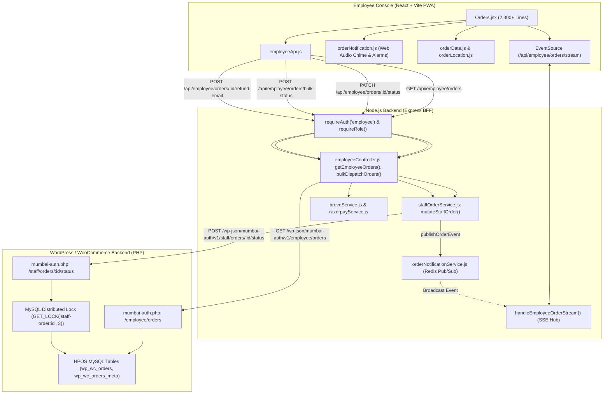
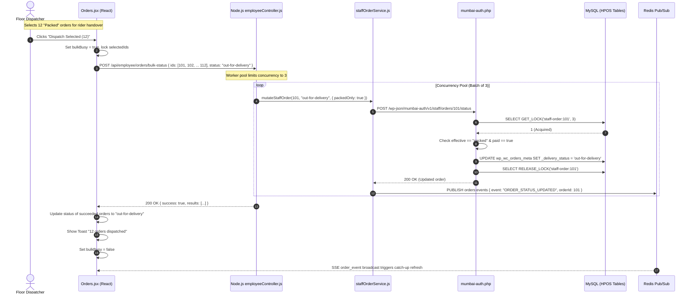

# Employee Panel Audit: Feature 02 — Orders & Dispatch Pipeline

> **Feature Scope**: High-Velocity Order Packing, Real-Time SSE Streaming, Bulk Dispatch & Courier Handover  
> **Target Audience**: Technical Architects, Backend Developers, and System Auditors  
> **Authoritative Baseline**: WordPress HPOS, Redis Pub/Sub SSE Pipeline, and Web Audio Alarm Engine  
> **Date**: November 2026

---

## 1. High-Level Architecture & System Role

The **Orders & Dispatch Pipeline** is the operational backbone of Mumbai Collection fulfillment. It provides counter staff and dispatchers with an interactive, real-time workspace to manage incoming orders from placement to final doorstep delivery.

It integrates low-latency Server-Sent Events (SSE), background Web Audio alarms for unacknowledged orders, multi-order bulk dispatching, optimistic concurrency status updates with instantaneous UI rollback, and strict fraud prevention preventing the dispatch of unpaid online orders.



---

## 2. Frontend Layer (React + Tailwind CSS)

### 2.1 File Map & Responsibilities
- **Core Screen**: [`apps/employee-panel/src/pages/Orders.jsx`](file:///c:/Users/asus/Desktop/Mumbai%20Collection/apps/employee-panel/src/pages/Orders.jsx) *(2,305 lines)*
- **API Client**: [`apps/employee-panel/src/services/employeeApi.js`](file:///c:/Users/asus/Desktop/Mumbai%20Collection/apps/employee-panel/src/services/employeeApi.js)
- **Audio Alarm & Chime Engine**: [`apps/employee-panel/src/utils/orderNotification.js`](file:///c:/Users/asus/Desktop/Mumbai%20Collection/apps/employee-panel/src/utils/orderNotification.js)
- **Timezone & Date Utilities**: [`apps/employee-panel/src/utils/orderDate.js`](file:///c:/Users/asus/Desktop/Mumbai%20Collection/apps/employee-panel/src/utils/orderDate.js)
- **Geographic Location Classifier**: [`apps/employee-panel/src/utils/orderLocation.js`](file:///c:/Users/asus/Desktop/Mumbai%20Collection/apps/employee-panel/src/utils/orderLocation.js)

---

### 2.2 Deep Logic & Implementation Details

#### A. Persistent SSE Connection with 45-Second Watchdog
In [`Orders.jsx`](file:///c:/Users/asus/Desktop/Mumbai%20Collection/apps/employee-panel/src/pages/Orders.jsx#L400-L550):
The employee panel connects to a continuous server stream via `EventSource`:
- **45s Watchdog Timer (Lines 409–417)**: If neither an event nor a server heartbeat arrives within 45 seconds, the client assumes the socket is half-open (a common issue on mobile Wi-Fi / LTE) and triggers `reconnectStream(true)`.
- **Visibility & Online Recovery (Lines 517–535)**:
  - When staff unlocks the tablet or returns to the active browser tab (`visibilitychange`), it executes an immediate catch-up query (`fetchOrderList(true)`) and validates if `eventSource.readyState === EventSource.CLOSED`.
  - When the browser transitions from offline to online (`online` event), it forces an immediate reconnection.
- **Event Debounce Buffer (Lines 419–427)**: When rapid events arrive (`ORDER_CREATED`, `ORDER_STATUS_UPDATED`), updates are debounced by 700ms (`eventRefreshTimerRef`) to avoid thrashing the UI.

#### B. Optimistic UI Updates with Snapshot Rollback
In [`Orders.jsx`](file:///c:/Users/asus/Desktop/Mumbai%20Collection/apps/employee-panel/src/pages/Orders.jsx#L632-L764):
To ensure zero perceived latency for counter staff during peak hours:
1. **Synchronous Ref Lock (Lines 634–637)**: Uses `updatingIdsRef.current.add(orderId)` immediately before state updates, preventing double-clicks from spawning race conditions.
2. **State Snapshotting (Lines 639–643)**: Clones `previousOrder` and `previousSelectedOrder`.
3. **Immediate Optimistic Render (Lines 647–689)**: Updates the local React orders array to `newStatus` in 0ms.
4. **Server Confirmation & Merge (Lines 691–738)**: Merges the authoritative server payload (`res.order`) including `_delivery_status` and completed timestamps.
5. **Atomic Rollback on Error (Lines 739–754)**: If the backend rejects the change (e.g., unpaid order or lock collision), the affected order is instantly reverted back to its previous state and an error toast is surfaced.

#### C. 72-Hour Terminal Order Locking (`isOrderDeliveredLocked`)
In [`Orders.jsx`](file:///c:/Users/asus/Desktop/Mumbai%20Collection/apps/employee-panel/src/pages/Orders.jsx#L102-L166):
To maintain auditing compliance and financial integrity:
- Once an order reaches `completed` (Delivered), status modifications are permitted for **72 hours only**.
- After 72 hours (`(now - timestamp) >= 72 * 60 * 60 * 1000`), the status selection UI is completely locked.
- **Timestamp Priority Resolution**:
  1. `_delivery_completed_at` (Authoritative delivery stamp)
  2. `date_completed_gmt`
  3. `date_completed`
  4. `date_created_gmt`
  5. `date_created`
- **Fail-Closed Security Guard (Line 165)**: If an order is marked `completed` but has no valid timestamps, it defaults to **locked**.

#### D. Bulk Dispatch Engine (Lines 552–575)
- Staff can multi-select up to 50 packed orders across the grid using `toggleDispatch(id)`.
- **Eligibility Filter (Line 552)**: Only orders where `status === "packed"`, `!order.is_unpaid`, and `!order.is_status_locked` can be checked.
- **Batch Dispatch (`dispatchSelected`)**:
  - Submits array of IDs to `bulkDispatchOrders(ids)`.
  - Disables UI controls with `bulkBusy` state.
  - Succeeded orders instantly update to `out-for-delivery`.
  - Failed orders remain selected with contextual error review dialog.

#### E. Audio Alert Engine & Counter Mode
In [`apps/employee-panel/src/utils/orderNotification.js`](file:///c:/Users/asus/Desktop/Mumbai%20Collection/apps/employee-panel/src/utils/orderNotification.js):
- **User Gesture Arming (`armOrderAlarm`)**: Satisfies strict browser autoplay policies by playing an imperceptible 1-sample silent buffer on user tap.
- **Loud Two-Tone Chime (`playOrderAlertChime`)**: Oscillates between 880 Hz (A5) and 1174 Hz (D6) at 85% volume.
- **Unacknowledged Order Loop**: Rings periodically every 8 seconds until counter staff clicks the banner to acknowledge the order via `acknowledgeOrder(id)`.

---

## 3. Node.js BFF (Backend For Frontend) Layer

### 3.1 File Map & Responsibilities
- **Routes Definition**: [`apps/backend/src/routes/employeeRoutes.js`](file:///c:/Users/asus/Desktop/Mumbai%20Collection/apps/backend/src/routes/employeeRoutes.js#L108-L138)
- **Controller Implementation**: [`apps/backend/src/controllers/employeeController.js`](file:///c:/Users/asus/Desktop/Mumbai%20Collection/apps/backend/src/controllers/employeeController.js#L216-L635)
- **Staff Mutation Service**: [`apps/backend/src/services/staffOrderService.js`](file:///c:/Users/asus/Desktop/Mumbai%20Collection/apps/backend/src/services/staffOrderService.js)
- **SSE & Pub/Sub Hub**: [`apps/backend/src/services/orderNotificationService.js`](file:///c:/Users/asus/Desktop/Mumbai%20Collection/apps/backend/src/services/orderNotificationService.js)

---

### 3.2 Deep Logic & Implementation Details

#### A. Scalable Server-Side Order Querying (`getEmployeeOrders`)
In [`employeeController.js`](file:///c:/Users/asus/Desktop/Mumbai%20Collection/apps/backend/src/controllers/employeeController.js#L216-L350):
- Supports multi-dimensional filtering: `status`, `search`, `location`, `date_filter`, and custom date ranges.
- **IST Date Bounding (Lines 248–255)**: Converts store-time date boundaries (e.g., "today", "yesterday") into GMT timestamps for accurate WooCommerce HPOS querying.
- **Direct HPOS Delegation (Lines 300–319)**: For custom operational states (`active`, `processing`, `packed`, `out-for-delivery`) or location queries (`vasai-east`, `nalasopara-west`), delegates directly to the internal WordPress endpoint `/wp-json/mumbai-auth/v1/employee/orders` to execute SQL-level pagination and filtering.

#### B. Worker Pool Bulk Dispatcher (`bulkDispatchOrders`)
In [`employeeController.js`](file:///c:/Users/asus/Desktop/Mumbai%20Collection/apps/backend/src/controllers/employeeController.js#L487-L508):
To prevent overwhelming MySQL when dispatching up to 50 orders simultaneously:
```javascript
const results = new Array(ids.length);
let cursor = 0;
const worker = async () => {
  while (cursor < ids.length) {
    const index = cursor++;
    try {
      const order = await mutateStaffOrder(ids[index], "out-for-delivery", { packedOnly: true });
      results[index] = { id: ids[index], success: true, order };
    } catch (error) {
      results[index] = { id: ids[index], success: false, message: error.message };
    }
  }
};
// Concurrency throttled to max 3 parallel workers
await Promise.all(Array.from({ length: Math.min(3, ids.length) }, worker));
return res.json({ success: true, results });
```

#### C. Order Status Mutation & Cache Purging (`mutateStaffOrder`)
In [`staffOrderService.js`](file:///c:/Users/asus/Desktop/Mumbai%20Collection/apps/backend/src/services/staffOrderService.js#L8-L36):
1. **Pre-Flight Status Check**: Reads the existing order from WooCommerce and verifies that transitions adhere to the state graph.
2. **PHP Delegation**: Sends `target_status`, `expected_status`, `expected_delivery_status`, and `expected_modified` to `/wp-json/mumbai-auth/v1/staff/orders/:id/status`.
3. **Broad In-Memory Cache Invalidation (Lines 29–33)**: Purges prefixes:
   - `employee:overview`
   - `employee:orders_scan`
   - `admin:analytics`
   - `admin:customers`
   - `customer:orders:<customer_id>:`
4. **Order Cache Eviction**: Calls `invalidateOrderDetailCache(id)`.
5. **Real-Time SSE Broadcast**: Dispatches `publishOrderEvent({ event: "ORDER_STATUS_UPDATED", orderId: id, status })`.

#### D. Real-Time SSE Hub with Connection Caps
In [`orderNotificationService.js`](file:///c:/Users/asus/Desktop/Mumbai%20Collection/apps/backend/src/services/orderNotificationService.js#L18-L98):
- **Connection Limits**:
  - `MAX_GLOBAL_SSE_CLIENTS = 100`: Caps active SSE listeners to protect server memory.
  - `MAX_PER_USER_SSE_CLIENTS = 3`: Prevents single users with multiple open tabs from exhausting resources.
- **Redis Pub/Sub Channel**: Subscribes to `orders:events`. When a multi-instance backend deployment is used, events published on one node are broadcast across all nodes. If Redis is unavailable, it gracefully degrades to a local Node.js `EventEmitter`.

#### E. Transactional Refund Notification Dispatch (`sendOrderRefundEmail`)
In [`employeeController.js`](file:///c:/Users/asus/Desktop/Mumbai%20Collection/apps/backend/src/controllers/employeeController.js#L605-L635):
- Guarded by distributed in-memory lock: `acquireLock('employee_refund_email_<id>', workerId, 10000)`.
- Verifies that a valid refund exists:
  - For COD orders: checks recorded WooCommerce refund total.
  - For online orders: verifies captured Razorpay refund via `fetchRazorpayPayment(paymentId)`.
- Dispatches transactional refund template via Brevo (`sendRefundEmail`) and stamps `_manual_refund_email_sent_at` in order metadata to block duplicates.

---

## 4. WordPress & WooCommerce Backend Layer (PHP)

### 4.1 File Map & Responsibilities
- **Employee Orders Search Endpoint**: [`mumbai-auth.php`](file:///c:/Users/asus/Desktop/Mumbai%20Collection/mumbai-auth.php#L6532-L6660)
- **Staff Status Mutation Engine**: [`mumbai-auth.php`](file:///c:/Users/asus/Desktop/Mumbai%20Collection/mumbai-auth.php#L5709-L5780)

---

### 4.2 Deep Logic & Implementation Details

#### A. Server-Side HPOS Meta Query (`mumbai_employee_get_orders`)
In [`mumbai-auth.php`](file:///c:/Users/asus/Desktop/Mumbai%20Collection/mumbai-auth.php#L6570-L6616):
- Translates high-level employee panel states into precise HPOS MySQL queries:
  - **`active` status**:
    ```php
    $args['status'] = ['pending', 'processing', 'on-hold'];
    $args['meta_query'] = [
        'relation' => 'OR',
        ['key' => '_delivery_status', 'value' => ['pending', 'processing', 'on-hold', 'packed', 'out-for-delivery', 'dispatched'], 'compare' => 'IN'],
        ['key' => '_delivery_status', 'compare' => 'NOT EXISTS'],
        ['key' => '_delivery_status', 'value' => '', 'compare' => '='],
    ];
    ```
  - **`packed` / `out-for-delivery`**: Orders keep core status `processing` while filtering `_delivery_status = status`.
- **Delivery Zone Segmentation (Lines 6603–6616)**: Applies `_mumbai_delivery_location_key = location` (`vasai-east`, `vasai-west`, etc.) directly into the MySQL query index, avoiding full-table memory scans.

#### B. Distributed Mutex & Concurrency Verification
In [`mumbai-auth.php`](file:///c:/Users/asus/Desktop/Mumbai%20Collection/mumbai-auth.php#L5712-L5728):
```php
$key = hash('sha256', 'staff-order:' . $id);
if ((int) $wpdb->get_var($wpdb->prepare('SELECT GET_LOCK(%s, 3)', $key)) !== 1) {
    return new WP_Error('order_busy', 'Another staff member is updating this order.', ['status' => 409]);
}
```
1. **Distributed Lock**: Secures a lock named `staff-order:<id>` for 3 seconds.
2. **Optimistic Modification Verification**: Compares client-sent `expected_modified` against actual `modified_gmt`. If another staff member updated the order in the background, rejects with HTTP 409 `order_changed`.

#### C. Transition State Machine
In [`mumbai-auth.php`](file:///c:/Users/asus/Desktop/Mumbai%20Collection/mumbai-auth.php#L5733-L5742):
Strictly validates operational stage progression:
- `pending` -> `processing`, `cancelled`, `failed`
- `processing` -> `packed`, `out-for-delivery`, `dispatched`, `cancelled`, `failed`
- `packed` -> `out-for-delivery`, `dispatched`, `cancelled`
- `out-for-delivery` / `dispatched` -> `completed`
- Reopening terminal orders (`completed`, `cancelled`, `refunded`, `failed`) is rejected with HTTP 409 `terminal_order`.

#### D. Fraud Prevention: Unpaid Online Order Block
In [`mumbai-auth.php`](file:///c:/Users/asus/Desktop/Mumbai%20Collection/mumbai-auth.php#L5743-L5747):
```php
if (in_array($target, ['processing', 'packed', 'out-for-delivery', 'dispatched', 'completed'], true) &&
    $order->get_payment_method() !== 'cod' && !$order->get_date_paid() &&
    !$order->get_transaction_id() && !$order->get_meta('_payment_verified_at', true)) {
    return new WP_Error('unpaid_order', 'Online payment has not been confirmed.', ['status' => 409]);
}
```
Staff cannot mark an online payment order as `packed`, `out-for-delivery`, or `completed` unless Razorpay has confirmed payment.

---

## 5. End-to-End Bulk Dispatch Sequence Diagram



---

## 6. Deep Logic Code Index

| Component | File Path | Line Range | Functional Responsibility |
| :--- | :--- | :--- | :--- |
| **SSE Watchdog** | [`Orders.jsx`](file:///c:/Users/asus/Desktop/Mumbai%20Collection/apps/employee-panel/src/pages/Orders.jsx#L400-L428) | `L400-L428` | 45-second heartbeat watchdog and debounced event listener |
| **Optimistic Status Update** | [`Orders.jsx`](file:///c:/Users/asus/Desktop/Mumbai%20Collection/apps/employee-panel/src/pages/Orders.jsx#L632-L764) | `L632-L764` | 0ms instant UI update with atomic state rollback on error |
| **72-Hour Status Lock** | [`Orders.jsx`](file:///c:/Users/asus/Desktop/Mumbai%20Collection/apps/employee-panel/src/pages/Orders.jsx#L102-L166) | `L102-L166` | Terminal delivered order lock evaluation (`isOrderDeliveredLocked`) |
| **Bulk Dispatch UI** | [`Orders.jsx`](file:///c:/Users/asus/Desktop/Mumbai%20Collection/apps/employee-panel/src/pages/Orders.jsx#L552-L575) | `L552-L575` | Multi-order checkbox selection, eligibility filter, batch submission |
| **Audio Alarm Engine** | [`orderNotification.js`](file:///c:/Users/asus/Desktop/Mumbai%20Collection/apps/employee-panel/src/utils/orderNotification.js#L46-L100) | `L46-L100` | Autoplay policy gesture arming and synthesized 880-1174Hz alert chime |
| **Order Query Controller** | [`employeeController.js`](file:///c:/Users/asus/Desktop/Mumbai%20Collection/apps/backend/src/controllers/employeeController.js#L216-L350) | `L216-L350` | Server-side HPOS pagination, IST date bounding, and location filters |
| **Worker Pool Dispatcher** | [`employeeController.js`](file:///c:/Users/asus/Desktop/Mumbai%20Collection/apps/backend/src/controllers/employeeController.js#L487-L508) | `L487-L508` | Max 3 parallel workers processing bulk dispatch requests |
| **Staff Mutation Engine** | [`staffOrderService.js`](file:///c:/Users/asus/Desktop/Mumbai%20Collection/apps/backend/src/services/staffOrderService.js#L8-L36) | `L8-L36` | Pre-flight validation, cache invalidation, and SSE event publication |
| **Real-time SSE Hub** | [`orderNotificationService.js`](file:///c:/Users/asus/Desktop/Mumbai%20Collection/apps/backend/src/services/orderNotificationService.js#L76-L160) | `L76-L160` | Client streaming hub, Redis pub/sub listener, client connection limits |
| **Refund Notification Mailer** | [`employeeController.js`](file:///c:/Users/asus/Desktop/Mumbai%20Collection/apps/backend/src/controllers/employeeController.js#L605-L635) | `L605-L635` | Distributed lock, Razorpay/COD refund verification, Brevo dispatch |
| **HPOS Query Endpoint** | [`mumbai-auth.php`](file:///c:/Users/asus/Desktop/Mumbai%20Collection/mumbai-auth.php#L6532-L6660) | `L6532-L6660` | Direct MySQL meta queries across delivery status and location key |
| **Distributed Lock & Gates** | [`mumbai-auth.php`](file:///c:/Users/asus/Desktop/Mumbai%20Collection/mumbai-auth.php#L5712-L5747) | `L5712-L5747` | MySQL `GET_LOCK`, optimistic modification check, unpaid order block |
