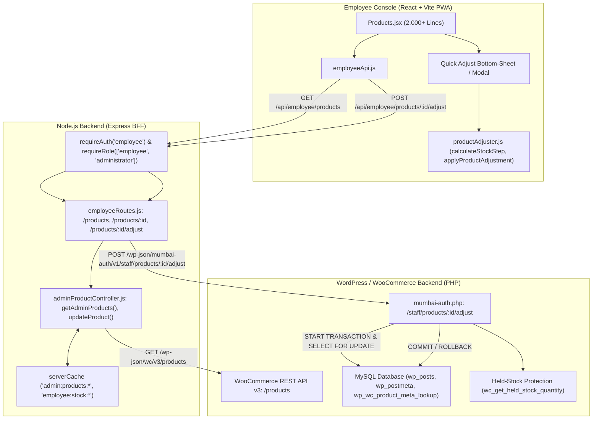
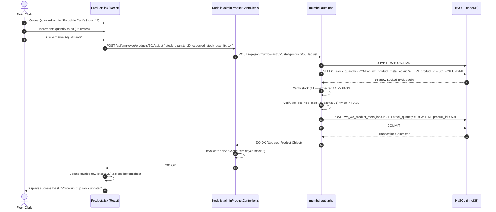

# Employee Panel Audit: Feature 03 — Products & Stock

> **Feature Scope**: Fast Floor Inventory Management, Stock Counter, and Concurrency-Safe Price/Quantity Adjustments  
> **Target Audience**: Technical Architects, Backend Developers, and System Auditors  
> **Authoritative Baseline**: WooCommerce HPOS, Row-Level MySQL Locks (`FOR UPDATE`), and Held-Stock Guards  
> **Date**: November 2026

---

## 1. High-Level Architecture & System Role

The **Products & Stock** feature provides store clerks, inventory specialists, and floor managers with a rapid catalog management and stock-level adjustment workspace. 

Unlike back-office ERPs that require deep navigation menus, this interface is optimized for handheld tablets and counter stations. Clerks can instantly search products, filter by live stock status (`instock`, `outofstock`, `lowstock`) or category hierarchies, and perform instant micro-adjustments to stock levels and prices with full database row-locking concurrency defense.



---

## 2. Frontend Layer (React + Tailwind CSS)

### 2.1 File Map & Responsibilities
- **Core Screen**: [`apps/employee-panel/src/pages/Products.jsx`](file:///c:/Users/asus/Desktop/Mumbai%20Collection/apps/employee-panel/src/pages/Products.jsx) *(2,028 lines)*
- **API Client**: [`apps/employee-panel/src/services/employeeApi.js`](file:///c:/Users/asus/Desktop/Mumbai%20Collection/apps/employee-panel/src/services/employeeApi.js)
- **Adjustment Utilities**: [`apps/employee-panel/src/utils/productAdjuster.js`](file:///c:/Users/asus/Desktop/Mumbai%20Collection/apps/employee-panel/src/utils/productAdjuster.js)
- **Image Compression Utilities**: [`apps/employee-panel/src/utils/imageCompressor.js`](file:///c:/Users/asus/Desktop/Mumbai%20Collection/apps/employee-panel/src/utils/imageCompressor.js)

---

### 2.2 Deep Logic & Implementation Details

#### A. Multi-Dimensional Search & Debouncing
In [`Products.jsx`](file:///c:/Users/asus/Desktop/Mumbai%20Collection/apps/employee-panel/src/pages/Products.jsx#L50-L75):
- Listens to URL query parameters (`stock_status`, `category`, `search`, `page`, `per_page`).
- **Debounced Search Input (Lines 58–59)**: Staff can scan barcodes or type partial product names or SKUs. The input debounces at 350ms to eliminate redundant network traffic.
- **Stock Status Filter Pills (Lines 60–62)**: Filter states: `all`, `instock`, `outofstock`. Clicking any pill updates both component state and URL parameters, resetting pagination to page 1.

#### B. Quick Adjust Modal & Bottom Sheet (Mobile First)
In [`Products.jsx`](file:///c:/Users/asus/Desktop/Mumbai%20Collection/apps/employee-panel/src/pages/Products.jsx#L85-L89):
- Opening any product initiates the Quick Adjust sheet without navigating away from the catalog list.
- **Form Schema (`adjustForm`)**:
  - `regular_price`: Base MRP in INR.
  - `sale_price`: Discounted selling price (enforced `< regular_price`).
  - `stock_quantity`: Physical items currently available in warehouse bins.
- **Adaptive Step Calculation (`calculateStockStep`)**:
  ```javascript
  // apps/employee-panel/src/utils/productAdjuster.js
  export const calculateStockStep = (currentQty, direction) => {
    const step = currentQty >= 50 ? 10 : currentQty >= 10 ? 5 : 1;
    return direction === "increment" ? currentQty + step : Math.max(0, currentQty - step);
  };
  ```
  Provides dynamic `+1`, `+5`, `+10` step buttons allowing warehouse workers to increment crates of items rapidly.

#### C. Optimistic Concurrency Payload Tracking
When submitting stock edits, the frontend does not merely post the new number; it passes `expected_stock_quantity: originalProduct.stock_quantity`.
If an online shopper completed a checkout in the intervening seconds, the server will detect that database stock has diverged from `expected_stock_quantity` and block the overwrite.

#### D. SKU Clipboard Accelerator
In [`Products.jsx`](file:///c:/Users/asus/Desktop/Mumbai%20Collection/apps/employee-panel/src/pages/Products.jsx#L82-L84):
- Single-tap SKU copying with temporary visual confirmation badge (`copiedSkuId`).
- Prevents mistyped SKUs when transferring items to third-party shipping manifests or ERP software.

#### E. Single-Product Soft Deletion
In [`Products.jsx`](file:///c:/Users/asus/Desktop/Mumbai%20Collection/apps/employee-panel/src/pages/Products.jsx#L90-L95):
- Double-confirmation modal (`deleteConfirmProduct`).
- Protected by `isDeletingRef.current` preventing double-click trash attempts.
- Re-fetches current catalog page and recalculates total stock counters on success.

---

## 3. Node.js BFF (Backend For Frontend) Layer

### 3.1 File Map & Responsibilities
- **Routes Definition**: [`apps/backend/src/routes/employeeRoutes.js`](file:///c:/Users/asus/Desktop/Mumbai%20Collection/apps/backend/src/routes/employeeRoutes.js#L20-L24, #L150-L165)
- **Shared Product Controller**: [`apps/backend/src/controllers/adminProductController.js`](file:///c:/Users/asus/Desktop/Mumbai%20Collection/apps/backend/src/controllers/adminProductController.js)
- **Stock Counter Utility**: [`apps/backend/src/controllers/adminProductController.js`](file:///c:/Users/asus/Desktop/Mumbai%20Collection/apps/backend/src/controllers/adminProductController.js#L14-L65)

---

### 3.2 Deep Logic & Implementation Details

#### A. RBAC & Protected Employee Routes
In [`apps/backend/src/routes/employeeRoutes.js`](file:///c:/Users/asus/Desktop/Mumbai%20Collection/apps/backend/src/routes/employeeRoutes.js):
```javascript
router.get("/products", requireAuth("employee"), requireRole(["employee", "administrator"]), getAdminProducts);
router.put("/products/:id", requireAuth("employee"), requireRole(["employee", "administrator"]), updateProduct);
router.delete("/products/:id", requireAuth("employee"), requireRole(["employee", "administrator"]), deleteProduct);
```
Employee catalog adjustments share the battle-tested validation logic of the administrative product controller while enforcing panel-specific token boundaries.

#### B. Accurate Stock Statistics (`fetchStockCounts`)
In [`adminProductController.js`](file:///c:/Users/asus/Desktop/Mumbai%20Collection/apps/backend/src/controllers/adminProductController.js):
- Queries WooCommerce stock statuses: `instock`, `outofstock`, `lowstock`.
- Caches aggregate counts in `serverCache` (`employee:stock:counts`) with a 60-second TTL to avoid slamming WooCommerce on high-traffic days.
- Automatically flushes cache keys upon any product creation, update, or deletion.

---

## 4. WordPress & WooCommerce Backend Layer (PHP)

### 4.1 File Map & Responsibilities
- **Staff Product Adjustment Endpoint**: [`mumbai-auth.php`](file:///c:/Users/asus/Desktop/Mumbai%20Collection/mumbai-auth.php#L664-L667, #L5765-L5803)

---

### 4.2 Deep Logic & Implementation Details

#### A. Row-Level Locking (`SELECT ... FOR UPDATE`)
In [`mumbai-auth.php`](file:///c:/Users/asus/Desktop/Mumbai%20Collection/mumbai-auth.php#L5773-L5777):
When a staff member updates stock:
```php
if ($wpdb->query('START TRANSACTION') === false) {
    return new WP_Error('stock_unavailable', 'Inventory is unavailable.', ['status' => 503]);
}
$managed_id = $product->get_stock_managed_by_id();
$stock = $wpdb->get_var(WC_Data_Store::load('product')->get_query_for_stock($managed_id) . ' FOR UPDATE');
```
- Starts an isolated database transaction.
- Queries `wp_postmeta` / `wp_wc_product_meta_lookup` using `FOR UPDATE`, acquiring an exclusive row-level lock on the product's inventory record.
- Prevents any other customer checkout, web order, or admin action from mutating the stock count during the execution of this script.

#### B. Optimistic Concurrency Verification
In [`mumbai-auth.php`](file:///c:/Users/asus/Desktop/Mumbai%20Collection/mumbai-auth.php#L5778-L5782):
```php
if (($payload['expected_stock_quantity'] === null && $product->managing_stock()) ||
    ($payload['expected_stock_quantity'] !== null && (float) $stock !== (float) $payload['expected_stock_quantity'])) {
    $wpdb->query('ROLLBACK');
    return new WP_Error('stock_changed', 'Stock changed since you opened this product. Refresh and review the new quantity.', ['status' => 409]);
}
```
If an order was placed between the time the employee opened the modal and clicked "Save", `$stock` will not match `$payload['expected_stock_quantity']`. The transaction immediately rolls back and returns HTTP 409 `stock_changed`, preventing accidental inventory overstatement.

#### C. Held-Stock Active Checkout Shield
In [`mumbai-auth.php`](file:///c:/Users/asus/Desktop/Mumbai%20Collection/mumbai-auth.php#L5783-L5786):
```php
if ((float) $payload['stock_quantity'] < (float) wc_get_held_stock_quantity(wc_get_product($managed_id))) {
    $wpdb->query('ROLLBACK');
    return new WP_Error('stock_reserved', 'This quantity is reserved by active checkouts. Review those orders before reducing stock.', ['status' => 409]);
}
```
WooCommerce holds stock for customers currently on the payment gateway page. Staff are physically blocked from manually reducing stock below the currently held reservation threshold, preventing cart abandonment and order fulfillment failures.

---

## 5. End-to-End Stock Adjustment Sequence Diagram



---

## 6. Deep Logic Code Index

| Component | File Path | Line Range | Functional Responsibility |
| :--- | :--- | :--- | :--- |
| **Catalog UI** | [`Products.jsx`](file:///c:/Users/asus/Desktop/Mumbai%20Collection/apps/employee-panel/src/pages/Products.jsx#L47-L120) | `L47-L120` | Debounced search, status pills, category dropdown, and pagination |
| **Quick Adjust Modal** | [`Products.jsx`](file:///c:/Users/asus/Desktop/Mumbai%20Collection/apps/employee-panel/src/pages/Products.jsx#L85-L89) | `L85-L89` | Mobile bottom-sheet & desktop modal for price and quantity changes |
| **Dynamic Stock Steps** | [`productAdjuster.js`](file:///c:/Users/asus/Desktop/Mumbai%20Collection/apps/employee-panel/src/utils/productAdjuster.js#L1-L46) | `L1-L46` | Adaptive step math (`+1`, `+5`, `+10`) based on quantity magnitude |
| **BFF Router** | [`employeeRoutes.js`](file:///c:/Users/asus/Desktop/Mumbai%20Collection/apps/backend/src/routes/employeeRoutes.js#L20-L24) | `L20-L24` | RBAC validation for `/products`, `/products/:id`, and `/products/:id/adjust` |
| **Stock Count Cache** | [`adminProductController.js`](file:///c:/Users/asus/Desktop/Mumbai%20Collection/apps/backend/src/controllers/adminProductController.js#L14-L65) | `L14-L65` | In-memory 60s caching of live stock statistics (`instock`, `outofstock`) |
| **Row Locking (`FOR UPDATE`)** | [`mumbai-auth.php`](file:///c:/Users/asus/Desktop/Mumbai%20Collection/mumbai-auth.php#L5773-L5777) | `L5773-L5777` | MySQL InnoDB row lock on inventory records during adjustments |
| **Optimistic Concurrency Check** | [`mumbai-auth.php`](file:///c:/Users/asus/Desktop/Mumbai%20Collection/mumbai-auth.php#L5778-L5782) | `L5778-L5782` | Rollback and HTTP 409 if live stock diverged from `expected_stock_quantity` |
| **Held-Stock Protection** | [`mumbai-auth.php`](file:///c:/Users/asus/Desktop/Mumbai%20Collection/mumbai-auth.php#L5783-L5786) | `L5783-L5786` | Guard preventing stock reduction below active cart checkout reservations |
