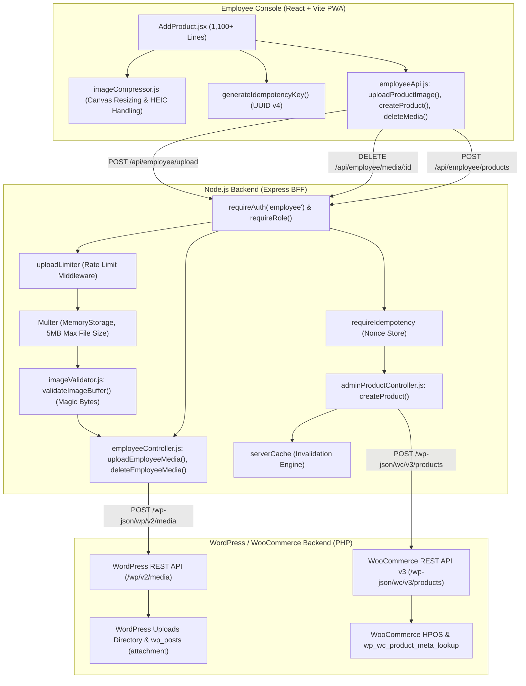
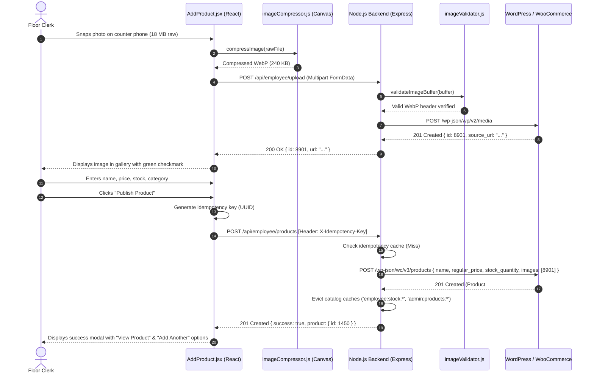

# Employee Panel Audit: Feature 04 — Add Product

> **Feature Scope**: Fast Store Onboarding, Mobile Camera Ingestion, Client-Side Compression, and Idempotent Publishing  
> **Target Audience**: Technical Architects, Backend Developers, and System Auditors  
> **Authoritative Baseline**: WordPress Media Library, Multer Magic-Byte Validation, and Idempotent REST API  
> **Date**: November 2026

---

## 1. High-Level Architecture & System Role

The **Add Product** feature enables floor clerks and inventory staff to rapidly onboard new store items directly from mobile phones, tablets, or counter laptops. 

It eliminates desktop workstation friction by integrating direct mobile camera capture, client-side HTML5 Canvas image compression (shrinking 15MB mobile photos to under 400KB in milliseconds), staged WordPress media library uploads with automatic orphan cleanup, and idempotent product creation that protects against accidental double-posting on intermittent store Wi-Fi.



---

## 2. Frontend Layer (React + Tailwind CSS)

### 2.1 File Map & Responsibilities
- **Primary Screen**: [`apps/employee-panel/src/pages/AddProduct.jsx`](file:///c:/Users/asus/Desktop/Mumbai%20Collection/apps/employee-panel/src/pages/AddProduct.jsx) *(1,162 lines)*
- **API Client**: [`apps/employee-panel/src/services/employeeApi.js`](file:///c:/Users/asus/Desktop/Mumbai%20Collection/apps/employee-panel/src/services/employeeApi.js)
- **Image Compression & Canvas Pipeline**: [`apps/employee-panel/src/utils/imageCompressor.js`](file:///c:/Users/asus/Desktop/Mumbai%20Collection/apps/employee-panel/src/utils/imageCompressor.js)

---

### 2.2 Deep Logic & Implementation Details

#### A. Mobile Camera Ingestion & Client-Side Canvas Compression
In [`AddProduct.jsx`](file:///c:/Users/asus/Desktop/Mumbai%20Collection/apps/employee-panel/src/pages/AddProduct.jsx#L37-L40, #L200-L280) and [`imageCompressor.js`](file:///c:/Users/asus/Desktop/Mumbai%20Collection/apps/employee-panel/src/utils/imageCompressor.js):
- Provides dual image inputs: file system gallery (`galleryInputRef`) and direct mobile hardware camera (`cameraInputRef` with `capture="environment"`).
- **Client-Side Compression (`compressImage`)**:
  - Raw mobile photos (often 12–25 MB from modern smartphone cameras) are rejected if over `RAW_IMAGE_MAX_INPUT_BYTES` (50MB) to protect device memory.
  - Draws the image to an HTML5 off-screen `<canvas>`, proportionally constraining dimensions to a maximum bounding box of 1600x1600 pixels.
  - Encodes the canvas as a high-efficiency WebP or JPEG with quality factor `0.82`, reducing the upload payload to typically 150KB–350KB.
  - Eliminates slow upload times and reduces mobile data consumption on physical store counters.

#### B. Staged Media Upload & Automatic Orphan Cleanup
In [`AddProduct.jsx`](file:///c:/Users/asus/Desktop/Mumbai%20Collection/apps/employee-panel/src/pages/AddProduct.jsx#L280-L330):
- As soon as a photo is selected or snapped, it uploads in the background via `uploadProductImage(file)`.
- The user sees an immediate optimistic preview with a loading spinner while the media ID is registered in WordPress.
- **Orphan Media Defense (`deleteMedia`)**:
  If a staff member removes an image from the staging gallery before clicking "Create Product", the frontend calls `deleteMedia(image.id)` immediately. This prevents unused draft photos from permanently cluttering the WordPress Media Library.

#### C. Idempotency Key Defense
In [`AddProduct.jsx`](file:///c:/Users/asus/Desktop/Mumbai%20Collection/apps/employee-panel/src/pages/AddProduct.jsx#L42-L46, #L420-L460):
- Generates a cryptographically strong UUID v4 idempotency token (`generateIdempotencyKey()`).
- Passes this token in the `X-Idempotency-Key` request header.
- **Double-Submit Lock (`isSubmittingRef.current`)**: Disables the submit button and ignores repeated clicks while the creation request is inflight.

#### D. Form Validation & Hierarchy Rules
In [`AddProduct.jsx`](file:///c:/Users/asus/Desktop/Mumbai%20Collection/apps/employee-panel/src/pages/AddProduct.jsx#L340-L410):
- **Pricing Sanity Checks**:
  - `regular_price` must be a positive number greater than 0.
  - `sale_price` (if provided) must be strictly less than `regular_price`.
- **Category & Subcategory Hierarchy**:
  - Selecting a primary category auto-filters the subcategory dropdown to only show children whose parent ID matches the selected category.
  - If the user changes the parent category, the subcategory is automatically reset to prevent taxonomical mismatches.

---

## 3. Node.js BFF (Backend For Frontend) Layer

### 3.1 File Map & Responsibilities
- **Routes Configuration**: [`apps/backend/src/routes/employeeRoutes.js`](file:///c:/Users/asus/Desktop/Mumbai%20Collection/apps/backend/src/routes/employeeRoutes.js#L48-L95, #L160-L175)
- **Employee Controller**: [`apps/backend/src/controllers/employeeController.js`](file:///c:/Users/asus/Desktop/Mumbai%20Collection/apps/backend/src/controllers/employeeController.js#L117-L165)
- **Product Creation Controller**: [`apps/backend/src/controllers/adminProductController.js`](file:///c:/Users/asus/Desktop/Mumbai%20Collection/apps/backend/src/controllers/adminProductController.js)
- **Magic Byte Image Validator**: [`apps/backend/src/utils/imageValidator.js`](file:///c:/Users/asus/Desktop/Mumbai%20Collection/apps/backend/src/utils/imageValidator.js)

---

### 3.2 Deep Logic & Implementation Details

#### A. Strict Magic Byte Header Inspection (`validateImageBuffer`)
In [`apps/backend/src/routes/employeeRoutes.js`](file:///c:/Users/asus/Desktop/Mumbai%20Collection/apps/backend/src/routes/employeeRoutes.js#L81-L91) and [`imageValidator.js`](file:///c:/Users/asus/Desktop/Mumbai%20Collection/apps/backend/src/utils/imageValidator.js):
To prevent malicious script uploads masquerading as product images:
```javascript
// Do not trust the client-provided MIME type or file extension.
const validation = validateImageBuffer(req.file, {
  maxFileSizeBytes: EMPLOYEE_MAX_IMAGE_SIZE_BYTES, // 5MB
});
if (!validation.valid) {
  return res.status(400).json({ success: false, message: validation.message });
}
```
- Inspects the raw binary buffer of the file stored in Multer memory:
  - **PNG**: `89 50 4E 47 0D 0A 1A 0A`
  - **JPEG**: `FF D8 FF`
  - **WebP**: `RIFF....WEBP`
- Rejects renamed `.php`, `.sh`, `.exe`, or HTML files with HTTP 400 before anything touches disk or WordPress.

#### B. Rate Limiting (`uploadLimiter`)
In [`apps/backend/src/routes/employeeRoutes.js`](file:///c:/Users/asus/Desktop/Mumbai%20Collection/apps/backend/src/routes/employeeRoutes.js#L45):
- Attaches `uploadLimiter` middleware to `/api/employee/upload`.
- Caps upload frequency per IP and staff session, safeguarding the backend and WordPress media endpoints against resource exhaustion attacks.

#### C. Idempotent Product Publishing (`createProduct`)
In [`apps/backend/src/controllers/adminProductController.js`](file:///c:/Users/asus/Desktop/Mumbai%20Collection/apps/backend/src/controllers/adminProductController.js):
- Checks the `X-Idempotency-Key` header via `requireIdempotency`.
- If an identical token was processed within the TTL window, the cached previous response is returned immediately without creating a duplicate WooCommerce product.
- **Cache Eviction**: Automatically purges `admin:products:*`, `employee:stock:*`, and `admin:categories:*` so the new product is visible store-wide instantly.

---

## 4. WordPress & WooCommerce Backend Layer (PHP)

### 4.1 File Map & Responsibilities
- **WordPress Media API**: Core WP REST API (`/wp/v2/media`)
- **WooCommerce Product API**: WooCommerce REST API v3 (`/wp-json/wc/v3/products`)

---

### 4.2 Deep Logic & Implementation Details

#### A. Media Attachment Attribution
When [`uploadEmployeeMedia`](file:///c:/Users/asus/Desktop/Mumbai%20Collection/apps/backend/src/controllers/employeeController.js#L117-L141) posts to `/wp/v2/media`:
- Passes `uploaderId: req.user?.id`.
- WordPress records the staff user's ID as the post author in `wp_posts`, maintaining an audit log of who uploaded each marketing asset.

#### B. Taxonomy & Inventory Indexing
When [`createProduct`](file:///c:/Users/asus/Desktop/Mumbai%20Collection/apps/backend/src/controllers/adminProductController.js) posts the payload:
- Maps `category_id` and optional `subcategory_id` into `categories: [{ id: ... }, { id: ... }]`.
- Configures inventory management flags:
  - `manage_stock = true`
  - `stock_quantity = formData.stock_quantity`
  - `stock_status = stock_quantity > 0 ? "instock" : "outofstock"`
- Writes directly to WooCommerce HPOS tables and `wp_wc_product_meta_lookup`, ensuring instant availability on both customer-facing storefront and employee fulfillment consoles.

---

## 5. End-to-End Product Creation Sequence Diagram



---

## 6. Deep Logic Code Index

| Component | File Path | Line Range | Functional Responsibility |
| :--- | :--- | :--- | :--- |
| **Add Product UI** | [`AddProduct.jsx`](file:///c:/Users/asus/Desktop/Mumbai%20Collection/apps/employee-panel/src/pages/AddProduct.jsx#L52-L89) | `L52-L89` | Form state, image staging gallery, and category hierarchy selectors |
| **Canvas Image Compressor** | [`imageCompressor.js`](file:///c:/Users/asus/Desktop/Mumbai%20Collection/apps/employee-panel/src/utils/imageCompressor.js#L1-L60) | `L1-L60` | Client-side Canvas resizing and quality optimization (15MB -> 250KB) |
| **Orphan Media Cleanup** | [`AddProduct.jsx`](file:///c:/Users/asus/Desktop/Mumbai%20Collection/apps/employee-panel/src/pages/AddProduct.jsx#L280-L330) | `L280-L330` | Staged image removal calling `deleteMedia(id)` to prevent WP media bloat |
| **Multer Buffer Intake** | [`employeeRoutes.js`](file:///c:/Users/asus/Desktop/Mumbai%20Collection/apps/backend/src/routes/employeeRoutes.js#L48-L60) | `L48-L60` | Multer memory storage configuration with 5MB strict limit |
| **Magic Byte Validator** | [`employeeRoutes.js`](file:///c:/Users/asus/Desktop/Mumbai%20Collection/apps/backend/src/routes/employeeRoutes.js#L81-L93) | `L81-L93` | Inspection of image buffer headers (PNG, JPEG, WebP) blocking scripts |
| **Media Upload Controller** | [`employeeController.js`](file:///c:/Users/asus/Desktop/Mumbai%20Collection/apps/backend/src/controllers/employeeController.js#L117-L141) | `L117-L141` | Uploads validated buffer to WordPress Media Library with user attribution |
| **Media Deletion Controller** | [`employeeController.js`](file:///c:/Users/asus/Desktop/Mumbai%20Collection/apps/backend/src/controllers/employeeController.js#L146-L165) | `L146-L165` | Safe deletion of unattached staging media items |
| **Product Creation Controller** | [`adminProductController.js`](file:///c:/Users/asus/Desktop/Mumbai%20Collection/apps/backend/src/controllers/adminProductController.js) | — | Idempotent WooCommerce product publishing and catalog cache invalidation |
