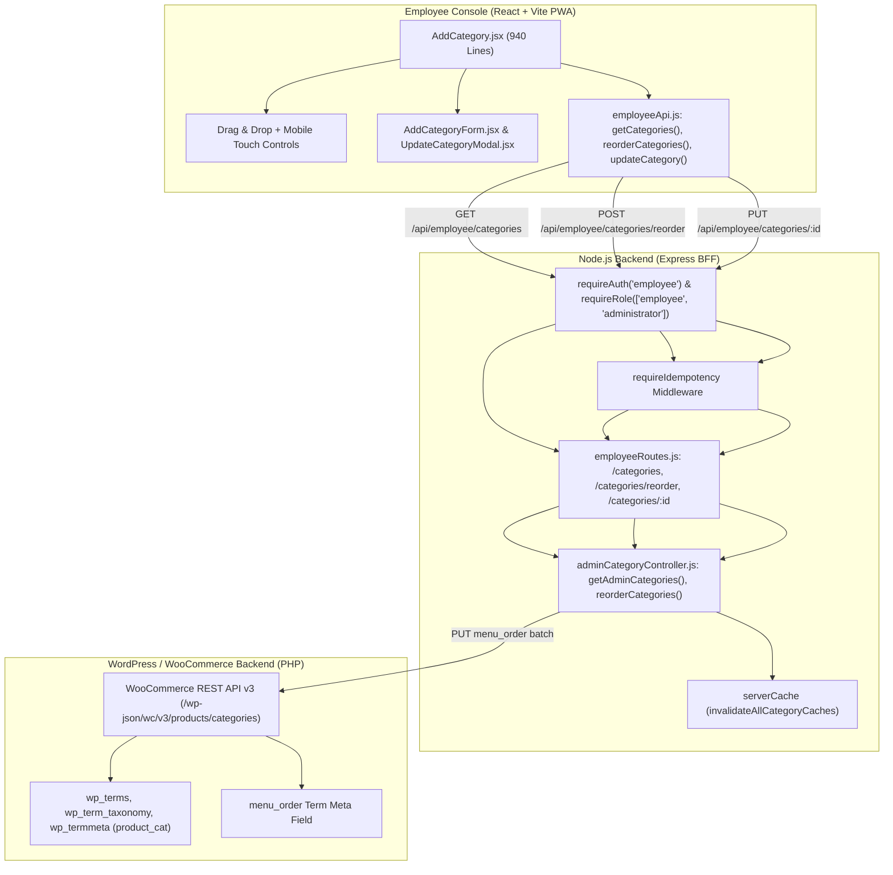
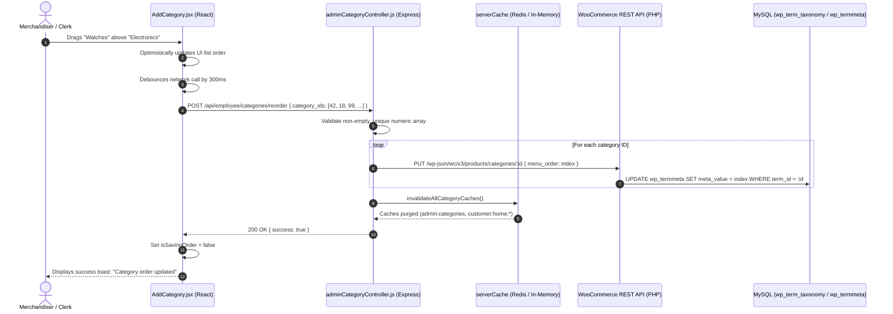

# Employee Panel Audit: Feature 05 — Categories & Merchandising

> **Feature Scope**: Top-Level Department Taxonomy, Storefront Drag & Drop Reordering, and Visual Merchandising  
> **Target Audience**: Technical Architects, Backend Developers, and System Auditors  
> **Authoritative Baseline**: WordPress Taxonomy (`product_cat`), WooCommerce HPOS, and Redis Batch Invalidation  
> **Date**: November 2026

---

## 1. High-Level Architecture & System Role

The **Categories** feature (`/categories/add`) manages top-level departments across Mumbai Collection. It enables floor staff and merchandising leads to define primary storefront departments, upload category banner iconography, and control the exact visual display sequence shown on the customer storefront via interactive drag-and-drop and touch controls.

---

## 2. Frontend Layer (React + Tailwind CSS)

### 2.1 File Map & Responsibilities
- **Primary Page Component**: [`apps/employee-panel/src/pages/AddCategory.jsx`](file:///c:/Users/asus/Desktop/Mumbai%20Collection/apps/employee-panel/src/pages/AddCategory.jsx) *(940 lines)*
- **Add Form Component**: [`apps/employee-panel/src/components/category/AddCategoryForm.jsx`](file:///c:/Users/asus/Desktop/Mumbai%20Collection/apps/employee-panel/src/components/category/AddCategoryForm.jsx)
- **Reorder List Item**: [`apps/employee-panel/src/components/category/CategoryOrderItem.jsx`](file:///c:/Users/asus/Desktop/Mumbai%20Collection/apps/employee-panel/src/components/category/CategoryOrderItem.jsx)
- **Update Modal**: [`apps/employee-panel/src/components/category/UpdateCategoryModal.jsx`](file:///c:/Users/asus/Desktop/Mumbai%20Collection/apps/employee-panel/src/components/category/UpdateCategoryModal.jsx)
- **System Category Banner**: [`apps/employee-panel/src/components/category/SystemCategoryCard.jsx`](file:///c:/Users/asus/Desktop/Mumbai%20Collection/apps/employee-panel/src/components/category/SystemCategoryCard.jsx)
- **API Client**: [`apps/employee-panel/src/services/employeeApi.js`](file:///c:/Users/asus/Desktop/Mumbai%20Collection/apps/employee-panel/src/services/employeeApi.js)

---

### 2.2 Deep Logic & Implementation Details

#### A. Separation of Storefront Departments vs Subcategories
In [`AddCategory.jsx`](file:///c:/Users/asus/Desktop/Mumbai%20Collection/apps/employee-panel/src/pages/AddCategory.jsx#L104-L121):
- WooCommerce lumps root categories and subcategories into a single flat taxonomy (`product_cat`).
- The frontend separates them into distinct functional scopes using memoized filters:
  - **Storefront Categories (Lines 106–109)**: Top-level departments only (`!category.parent || Number(category.parent) === 0`) and excludes the system `uncategorized` term.
  - **Subcategories (Lines 111–114)**: Child categories (`Number(category.parent) > 0`).
  - **System Categories (Lines 118–120)**: Term `uncategorized`.
- Reordering operations operate strictly on root departments so subcategories are never accidentally elevated to root navigation bars.

#### B. HTML5 Drag-and-Drop & Mobile Touch Reordering
In [`AddCategory.jsx`](file:///c:/Users/asus/Desktop/Mumbai%20Collection/apps/employee-panel/src/pages/AddCategory.jsx#L167-L245):
- **Desktop HTML5 DnD (Lines 167–221)**:
  - `handleDragStart`: Records `draggedIndexRef.current` and sets drag effect to `move`.
  - `handleDragOver`: Prevents default browser drop behavior and highlights the target insertion line via `dragOverIndex`.
  - `handleDrop`: Splices the dragged item out of its original position and inserts it at the target slot.
- **Mobile Touch Fallback (Lines 223–245)**:
  - Because HTML5 drag events are unsupported or clunky on mobile capacitive touchscreens, each item renders dedicated `↑` and `↓` touch buttons (`handleMoveCategory`).
  - Shifts elements up or down by 1 index safely within storefront boundary limits.

#### C. Debounced Persistence & Conflict Retry Queue
In [`AddCategory.jsx`](file:///c:/Users/asus/Desktop/Mumbai%20Collection/apps/employee-panel/src/pages/AddCategory.jsx#L248-L290):
- Reordering an array can generate dozens of state updates in seconds if a user drags an item across the list.
- **Queued In-Flight State (`queuedOrderRef.current`)**: Buffers the latest full list order.
- **Debounce Timer (300ms)**: Only triggers `reorderCategories({ category_ids: [...] })` after the user has paused dragging, preventing database thrashing.
- **Optimistic State with 409 Conflict Retry**: If a concurrent staff member modified categories, the queue automatically re-fetches the live catalog and retries.

#### D. System "Uncategorized" Protection
In [`AddCategory.jsx`](file:///c:/Users/asus/Desktop/Mumbai%20Collection/apps/employee-panel/src/pages/AddCategory.jsx#L97-L102) and [`SystemCategoryCard.jsx`](file:///c:/Users/asus/Desktop/Mumbai%20Collection/apps/employee-panel/src/components/category/SystemCategoryCard.jsx):
- Detects the default WooCommerce `uncategorized` slug.
- Disables rename, delete, and reorder controls for this category.
- Displays a permanent lock badge explaining that WooCommerce requires this fallback bucket for uncategorized inventory.

---

## 3. Node.js BFF (Backend For Frontend) Layer

### 3.1 File Map & Responsibilities
- **Routes Definition**: [`apps/backend/src/routes/employeeRoutes.js`](file:///c:/Users/asus/Desktop/Mumbai%20Collection/apps/backend/src/routes/employeeRoutes.js#L186-L216)
- **Controller Implementation**: [`apps/backend/src/controllers/adminCategoryController.js`](file:///c:/Users/asus/Desktop/Mumbai%20Collection/apps/backend/src/controllers/adminCategoryController.js#L586-L650)
- **Cache Eviction Batcher**: [`apps/backend/src/controllers/adminCategoryController.js`](file:///c:/Users/asus/Desktop/Mumbai%20Collection/apps/backend/src/controllers/adminCategoryController.js#L51-L85)

---

### 3.2 Deep Logic & Implementation Details

#### A. RBAC & Idempotency Pipeline
In [`apps/backend/src/routes/employeeRoutes.js`](file:///c:/Users/asus/Desktop/Mumbai%20Collection/apps/backend/src/routes/employeeRoutes.js#L186-L216):
- All category mutations (`POST /categories`, `POST /categories/reorder`, `PUT /categories/:id`) enforce:
  1. `requireAuth("employee")`
  2. `requireRole(["employee", "administrator"])`
  3. `requireIdempotency`: Caches mutation tokens to eliminate duplicate insertions.
  4. Joi Schema Validation: `schemas.categoryCreate`, `schemas.categoryReorder`, `schemas.categoryUpdate`.

#### B. Batch Category Reordering (`reorderCategories`)
In [`adminCategoryController.js`](file:///c:/Users/asus/Desktop/Mumbai%20Collection/apps/backend/src/controllers/adminCategoryController.js#L586-L650):
- Takes an array of numeric `category_ids` in the intended display order.
- Validates that IDs are distinct, positive integers without duplicates.
- Executes WooCommerce category updates, setting each category's `menu_order` property equal to its index (`0, 1, 2, ...`).
- **Atomic Cache Flush (`invalidateAllCategoryCaches`)**:
  Purges all related cache prefixes across both customer storefront and employee panels:
  - `admin:categories`
  - `categories:all`
  - `categories:tree`
  - `customer:categories:*`
  - `customer:home:*`

---

## 4. WordPress & WooCommerce Backend Layer (PHP)

### 4.1 File Map & Responsibilities
- **WooCommerce Taxonomy Controller**: Core `WC_REST_Product_Categories_Controller`
- **Database Tables**:
  - `wp_terms`: Term IDs, names, and sanitized slugs.
  - `wp_term_taxonomy`: Taxonomy classification (`taxonomy = 'product_cat'`) and `parent` ID hierarchy.
  - `wp_termmeta`: Merchandising display order (`meta_key = 'order'` or `menu_order`).

---

### 4.2 Deep Logic & Implementation Details

#### A. Storefront Menu Ordering
WooCommerce category display queries order terms by `menu_order ASC, name ASC`. When `reorderCategories` updates the `menu_order` field:
- The customer homepage department carousel reflects the exact custom order configured by staff.
- Newly created categories default to `menu_order = 0`, placing them at the beginning of the list until explicitly repositioned by floor staff.

---

## 5. End-to-End Category Reordering Sequence Diagram

---

## 6. Deep Logic Code Index

| Component | File Path | Line Range | Functional Responsibility |
| :--- | :--- | :--- | :--- |
| **Storefront Filter** | [`AddCategory.jsx`](file:///c:/Users/asus/Desktop/Mumbai%20Collection/apps/employee-panel/src/pages/AddCategory.jsx#L104-L121) | `L104-L121` | Separates root departments (`parent === 0`) from subcategories and uncategorized |
| **Drag & Drop Engine** | [`AddCategory.jsx`](file:///c:/Users/asus/Desktop/Mumbai%20Collection/apps/employee-panel/src/pages/AddCategory.jsx#L167-L221) | `L167-L221` | HTML5 drag-and-drop event handlers (`dragStart`, `dragOver`, `drop`) |
| **Mobile Touch Mover** | [`AddCategory.jsx`](file:///c:/Users/asus/Desktop/Mumbai%20Collection/apps/employee-panel/src/pages/AddCategory.jsx#L223-L245) | `L223-L245` | Touch-safe `↑` and `↓` buttons shifting items 1 position in storefront list |
| **Debounced Order Queue** | [`AddCategory.jsx`](file:///c:/Users/asus/Desktop/Mumbai%20Collection/apps/employee-panel/src/pages/AddCategory.jsx#L248-L290) | `L248-L290` | 300ms debounce buffer preventing database thrashing during rapid reorders |
| **BFF Router** | [`employeeRoutes.js`](file:///c:/Users/asus/Desktop/Mumbai%20Collection/apps/backend/src/routes/employeeRoutes.js#L186-L216) | `L186-L216` | Route protection, idempotency enforcement, and validation schemas |
| **Reorder Controller** | [`adminCategoryController.js`](file:///c:/Users/asus/Desktop/Mumbai%20Collection/apps/backend/src/controllers/adminCategoryController.js#L586-L650) | `L586-L650` | Batch assignment of `menu_order` across WooCommerce category IDs |
| **Cache Invalidation** | [`adminCategoryController.js`](file:///c:/Users/asus/Desktop/Mumbai%20Collection/apps/backend/src/controllers/adminCategoryController.js#L51-L85) | `L51-L85` | Multi-prefix cache eviction across customer and staff consoles |
