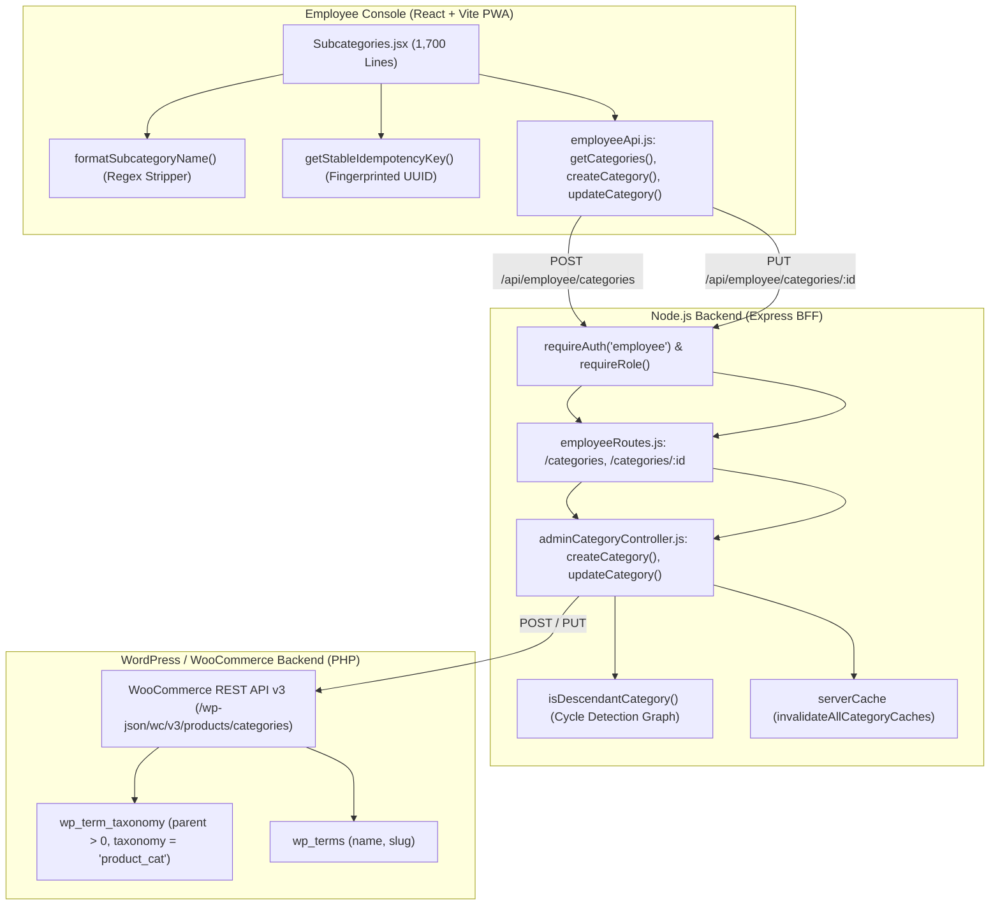
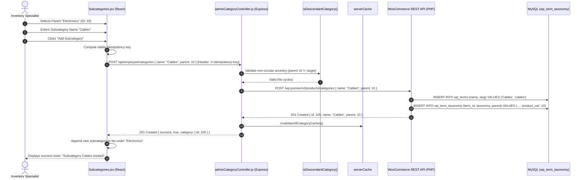

# Employee Panel Audit: Feature 06 — Subcategories & Department Mapping

> **Feature Scope**: Hierarchical Parent-Child Taxonomy, Department Mapping, and Circular Ancestry Protection  
> **Target Audience**: Technical Architects, Backend Developers, and System Auditors  
> **Authoritative Baseline**: WordPress Taxonomy (`product_cat`), Parent-Child Term Trees, and Graph Traversal  
> **Date**: November 2026

---

## 1. High-Level Architecture & System Role

The **Subcategories** feature (`/subcategories`) manages granular classification within parent departments. While top-level categories define high-level store sections (e.g., *Footwear*, *Electronics*, *Apparel*), subcategories represent the child groups that customers use to drill down (e.g., *Sneakers*, *Chargers*, *Jackets*).

This module enables store staff to create subcategories linked to parent departments, dynamically strip redundant parent prefixes from legacy product names, upload optimized category icons, and safely reparent subcategories with strict circular-ancestry graph validation.



---

## 2. Frontend Layer (React + Tailwind CSS)

### 2.1 File Map & Responsibilities
- **Primary Page Component**: [`apps/employee-panel/src/pages/Subcategories.jsx`](file:///c:/Users/asus/Desktop/Mumbai%20Collection/apps/employee-panel/src/pages/Subcategories.jsx) *(1,698 lines)*
- **API Client**: [`apps/employee-panel/src/services/employeeApi.js`](file:///c:/Users/asus/Desktop/Mumbai%20Collection/apps/employee-panel/src/services/employeeApi.js)
- **Image Compressor**: [`apps/employee-panel/src/utils/imageCompressor.js`](file:///c:/Users/asus/Desktop/Mumbai%20Collection/apps/employee-panel/src/utils/imageCompressor.js)
- **Image Helper**: [`apps/employee-panel/src/utils/categoryImage.js`](file:///c:/Users/asus/Desktop/Mumbai%20Collection/apps/employee-panel/src/utils/categoryImage.js)

---

### 2.2 Deep Logic & Implementation Details

#### A. Intelligent Parent Prefix Normalizer (`formatSubcategoryName`)
In [`Subcategories.jsx`](file:///c:/Users/asus/Desktop/Mumbai%20Collection/apps/employee-panel/src/pages/Subcategories.jsx#L38-L50):
Many legacy e-commerce stores import subcategories with repetitive names like `"Footwear - Sneakers"` or `"Footwear / Loafers"`. The frontend applies an automated prefix stripper:
```javascript
const formatSubcategoryName = (name, parentName = "") => {
  if (!name || typeof name !== "string") return "";
  const subName = name.trim();
  const parent = (parentName || "").trim();
  if (parent) {
    const escaped = parent.replace(/[.*+?^${}()|[\]\\]/g, "\\$&");
    const prefix = new RegExp("^" + escaped + "\\s*[-–—/:]\\s*", "i");
    if (prefix.test(subName)) {
      return subName.replace(prefix, "").trim();
    }
  }
  return subName;
};
```
- Intelligently recognizes dashes, en-dashes, slashes, and colons.
- Displays a clean, uncluttered subcategory title (`"Sneakers"`) while preserving the full taxonomy identity in the database.

#### B. Stable Fingerprinted Idempotency Keys
In [`Subcategories.jsx`](file:///c:/Users/asus/Desktop/Mumbai%20Collection/apps/employee-panel/src/pages/Subcategories.jsx#L63-L72):
```javascript
const getStableIdempotencyKey = (keyRef, payload) => {
  const fingerprint = JSON.stringify(payload);
  if (keyRef.current?.fingerprint !== fingerprint) {
    const key = typeof crypto !== "undefined" && crypto.randomUUID
      ? crypto.randomUUID()
      : `idemp_category_${Date.now()}_${Math.random().toString(36).slice(2, 10)}`;
    keyRef.current = { fingerprint, key };
  }
  return keyRef.current.key;
};
```
- Computes a deterministic fingerprint of the form payload (`name`, `parentId`, `image_id`).
- If a mobile network timeout occurs and staff clicks "Submit" again without altering the form, the **exact same** idempotency key is replayed, preventing duplicate category entries in WordPress.

#### C. Department Filtering & Live Search
In [`Subcategories.jsx`](file:///c:/Users/asus/Desktop/Mumbai%20Collection/apps/employee-panel/src/pages/Subcategories.jsx#L112-L175):
- **Department Filter**: Dropdown allowing staff to isolate subcategories by specific parent department (e.g., show only children of *Watches*).
- **Auto-Parent Selection**: When opening the "Add Subcategory" dialog while filtering by a department, `parentId` is automatically locked to that active department to minimize input friction.

---

## 3. Node.js BFF (Backend For Frontend) Layer

### 3.1 File Map & Responsibilities
- **Routes Configuration**: [`apps/backend/src/routes/employeeRoutes.js`](file:///c:/Users/asus/Desktop/Mumbai%20Collection/apps/backend/src/routes/employeeRoutes.js#L186-L216)
- **Controller Implementation**: [`apps/backend/src/controllers/adminCategoryController.js`](file:///c:/Users/asus/Desktop/Mumbai%20Collection/apps/backend/src/controllers/adminCategoryController.js#L118-L165, #L239-L580)

---

### 3.2 Deep Logic & Implementation Details

#### A. Circular Ancestry & Cycle Detection (`isDescendantCategory`)
In [`adminCategoryController.js`](file:///c:/Users/asus/Desktop/Mumbai%20Collection/apps/backend/src/controllers/adminCategoryController.js#L118-L165):
When staff edits a category's parent, there is a risk of creating an infinite loop (e.g., Setting Category A's parent to Category B, while Category B's parent is Category A):
```javascript
export const isDescendantCategory = (categoryId, targetParentId, allCategories) => {
  const catId = Number(categoryId);
  let currentParentId = Number(targetParentId);
  const visited = new Set();
  const parentMap = new Map();

  for (const cat of allCategories) {
    parentMap.set(Number(cat.id), Number(cat.parent || 0));
  }

  while (currentParentId > 0) {
    if (currentParentId === catId) return true; // Direct circular dependency!
    if (visited.has(currentParentId)) break;   // Cycle loop detected
    visited.add(currentParentId);
    currentParentId = parentMap.get(currentParentId) || 0;
  }
  return false;
};
```
- Performs a graph traversal up the parent hierarchy tree.
- If `currentParentId === catId` at any step, the backend immediately rejects the request with HTTP 400: *"Cannot set a category or its descendants as its own parent."*

#### B. Validation & Slug Generation
In [`adminCategoryController.js`](file:///c:/Users/asus/Desktop/Mumbai%20Collection/apps/backend/src/controllers/adminCategoryController.js#L239-L375):
- Validates that `parent > 0` points to a currently active root category.
- Sanitizes the name and generates a URL-safe slug, deduplicating with a numeric suffix (e.g., `sneakers-2`) if a collision exists in another department.

---

## 4. WordPress & WooCommerce Backend Layer (PHP)

### 4.1 File Map & Responsibilities
- **Core Controller**: `WC_REST_Product_Categories_Controller`
- **Database Tables**:
  - `wp_term_taxonomy`: Sets `parent = parent_id` where `taxonomy = 'product_cat'`.
  - `wp_terms`: Stores term name and unique slug.

---

### 4.2 Deep Logic & Implementation Details

#### A. Hierarchical Tree Queries
WooCommerce builds breadcrumbs and navigation menus by recursively joining `wp_term_taxonomy` on `parent`:
- When an order contains a product in subcategory *Sneakers*, the store inherits reporting properties and filtering attributes from parent department *Footwear*.
- Updating a subcategory automatically clears the WordPress taxonomy transients (`wc_term_counts`, `category_children`).

---

## 5. End-to-End Subcategory Creation Sequence Diagram



---

## 6. Deep Logic Code Index

| Component | File Path | Line Range | Functional Responsibility |
| :--- | :--- | :--- | :--- |
| **Prefix Formatter** | [`Subcategories.jsx`](file:///c:/Users/asus/Desktop/Mumbai%20Collection/apps/employee-panel/src/pages/Subcategories.jsx#L38-L50) | `L38-L50` | Strips redundant parent prefixes from subcategory names with regex |
| **Idempotency Fingerprint** | [`Subcategories.jsx`](file:///c:/Users/asus/Desktop/Mumbai%20Collection/apps/employee-panel/src/pages/Subcategories.jsx#L63-L72) | `L63-L72` | Payload-fingerprinted UUID generation preventing duplicate submissions |
| **Department Filter** | [`Subcategories.jsx`](file:///c:/Users/asus/Desktop/Mumbai%20Collection/apps/employee-panel/src/pages/Subcategories.jsx#L152-L175) | `L152-L175` | Filters child terms (`parent > 0`) by selected root department |
| **Cycle Detection Guard** | [`adminCategoryController.js`](file:///c:/Users/asus/Desktop/Mumbai%20Collection/apps/backend/src/controllers/adminCategoryController.js#L118-L165) | `L118-L165` | Graph traversal blocking circular ancestry loops (`isDescendantCategory`) |
| **Creation Controller** | [`adminCategoryController.js`](file:///c:/Users/asus/Desktop/Mumbai%20Collection/apps/backend/src/controllers/adminCategoryController.js#L239-L375) | `L239-L375` | Parent verification, slug generation, and taxonomy insertion |
| **Update Controller** | [`adminCategoryController.js`](file:///c:/Users/asus/Desktop/Mumbai%20Collection/apps/backend/src/controllers/adminCategoryController.js#L380-L580) | `L380-L580` | Reparenting validation, cycle prevention, and cache flushing |
