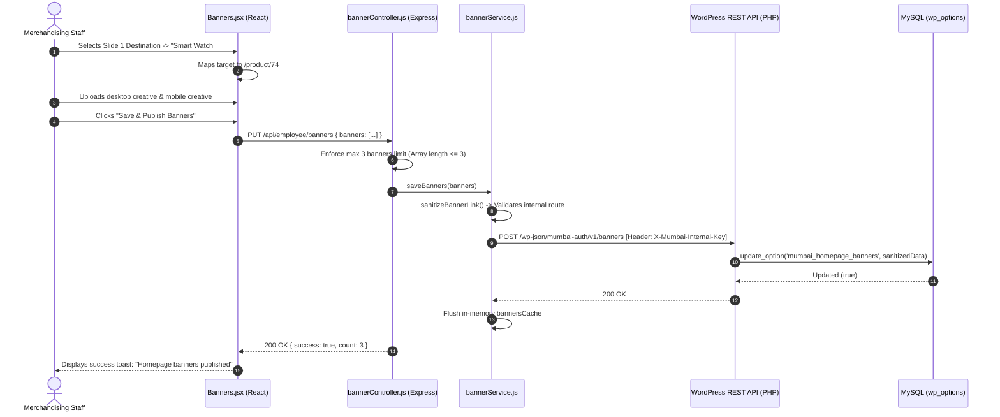

# Employee Panel Audit: Feature 07 — Homepage Banners

> **Feature Scope**: Visual Merchandising, Multi-Device Banners, Open-Redirect Sanitization, and WordPress Storage  
> **Target Audience**: Technical Architects, Backend Developers, and System Auditors  
> **Authoritative Baseline**: WordPress Options Table (`wp_options`), Express BFF Caching, and Responsive Preview Simulator  
> **Date**: November 2026

---

## 1. High-Level Architecture & System Role

The **Homepage Banners** module (`/banners`) governs the hero promotional banners displayed at the top of the Mumbai Collection customer web and mobile storefront. 

It provides floor staff and marketing clerks with an intuitive control deck to configure up to **3 active promotional slides**. Features include dual-viewport asset management (independent desktop vs mobile banners), an interactive destination link selector with live catalog autocomplete, a real-time device preview simulator, and strict backend URL sanitization to prevent open-redirect vulnerabilities.

```mermaid
flowchart TD
    subgraph Frontend["Employee Console (React + Vite PWA)"]
        UI["Banners.jsx (1,240 Lines)"]
        TargetSelector["DestinationLinkSelector (Product/Category/Custom)"]
        Simulator["Device Simulator (Desktop vs Mobile Viewports)"]
        ClientAPI["employeeApi.js: getBanners(), updateBanners(), uploadProductImage()"]

        UI --> TargetSelector
        UI --> Simulator
        UI --> ClientAPI
    end

    subgraph BFF["Node.js Backend (Express BFF)"]
        Auth["requireAuth('employee') & requireRole()"]
        BannerRoutes["employeeRoutes.js: /banners"]
        BannerCtrl["bannerController.js: getEmployeeBanners(), updateEmployeeBanners()"]
        BannerSvc["bannerService.js: sanitizeBannerLink(), sanitizeBannerItem()"]
        Cache["bannersCache (30s In-Memory TTL)"]

        ClientAPI -->|GET /api/employee/banners| Auth --> BannerRoutes --> BannerCtrl
        ClientAPI -->|PUT /api/employee/banners| Auth --> BannerRoutes --> BannerCtrl
        BannerCtrl <--> BannerSvc <--> Cache
    end

    subgraph WordPress["WordPress Backend (PHP)"]
        InternalAPI["mumbai-auth.php: /wp-json/mumbai-auth/v1/banners"]
        OptionsDB["wp_options (mumbai_homepage_banners)"]
        MediaLib["WordPress Media Library (Attachments)"]

        BannerSvc -->|GET / PUT (Internal API Key)| InternalAPI --> OptionsDB
        ClientAPI -->|POST /api/employee/upload| MediaLib
    end
```

---

## 2. Frontend Layer (React + Tailwind CSS)

### 2.1 File Map & Responsibilities
- **Primary Page Component**: [`apps/employee-panel/src/pages/Banners.jsx`](file:///c:/Users/asus/Desktop/Mumbai%20Collection/apps/employee-panel/src/pages/Banners.jsx) *(1,240 lines)*
- **API Client**: [`apps/employee-panel/src/services/employeeApi.js`](file:///c:/Users/asus/Desktop/Mumbai%20Collection/apps/employee-panel/src/services/employeeApi.js)
- **Image Compressor & Dimension Checker**: [`apps/employee-panel/src/utils/imageCompressor.js`](file:///c:/Users/asus/Desktop/Mumbai%20Collection/apps/employee-panel/src/utils/imageCompressor.js)

---

### 2.2 Deep Logic & Implementation Details

#### A. Interactive Destination Target Selector (`DestinationLinkSelector`)
In [`Banners.jsx`](file:///c:/Users/asus/Desktop/Mumbai%20Collection/apps/employee-panel/src/pages/Banners.jsx#L44-L184):
Rather than forcing staff to manually copy and paste raw URL strings, the component provides 3 smart destination modes:
1. **Specific Product Mode (`mode === "product"`)**:
   - Searches products by name, SKU, or numeric ID in real time.
   - Shows live product price and out-of-stock badges.
   - Automatically maps link to `/product/:id`.
2. **Category Mode (`mode === "category"`)**:
   - Lists all top-level departments and subcategories.
   - Maps destination to `/category/:slug`.
3. **Custom Link Mode (`mode === "custom"`)**:
   - Allows relative internal paths (`/sale`, `/orders`).

#### B. Dual-Viewport Asset Ingestion (Desktop vs Mobile)
In [`Banners.jsx`](file:///c:/Users/asus/Desktop/Mumbai%20Collection/apps/employee-panel/src/pages/Banners.jsx#L340-L460):
- Supports wide-aspect desktop creatives (recommended 16:9 or 21:9 ratio) and vertical mobile creatives (recommended 4:5 or 1:1 ratio).
- Automatically inspects image header dimensions using `parseImageDimensionsFromHeader` to advise clerks if the uploaded image matches optimal aspect ratios.
- Fallback: If no mobile asset is explicitly uploaded, the customer storefront automatically falls back to the desktop asset with smart center cropping.

#### C. Responsive Device Simulator
In [`Banners.jsx`](file:///c:/Users/asus/Desktop/Mumbai%20Collection/apps/employee-panel/src/pages/Banners.jsx#L600-L720):
- Includes a live preview toggle: **Desktop (Monitor icon)** vs **Smartphone (Phone icon)**.
- Renders the carousel inside a simulated viewport frame so staff can verify banner legibility and call-to-action button contrast before publishing.

#### D. Maximum 3 Banners Constraint
In [`Banners.jsx`](file:///c:/Users/asus/Desktop/Mumbai%20Collection/apps/employee-panel/src/pages/Banners.jsx#L280-L310):
- Strictly caps total active promotional banners to **3**.
- Prevents excessive banner carousel bloat that degrades customer Core Web Vitals (LCP) and increases mobile bundle weight.

---

## 3. Node.js BFF (Backend For Frontend) Layer

### 3.1 File Map & Responsibilities
- **Routes Configuration**: [`apps/backend/src/routes/employeeRoutes.js`](file:///c:/Users/asus/Desktop/Mumbai%20Collection/apps/backend/src/routes/employeeRoutes.js#L218-L230)
- **Controller Implementation**: [`apps/backend/src/controllers/bannerController.js`](file:///c:/Users/asus/Desktop/Mumbai%20Collection/apps/backend/src/controllers/bannerController.js)
- **Banner Sanitization & Persistence Service**: [`apps/backend/src/services/bannerService.js`](file:///c:/Users/asus/Desktop/Mumbai%20Collection/apps/backend/src/services/bannerService.js)

---

### 3.2 Deep Logic & Implementation Details

#### A. Open-Redirect Vulnerability Defense (`sanitizeBannerLink`)
In [`bannerService.js`](file:///c:/Users/asus/Desktop/Mumbai%20Collection/apps/backend/src/services/bannerService.js#L17-L34):
To eliminate phishing and open-redirect vulnerabilities where attackers could craft malicious links:
```javascript
export const sanitizeBannerLink = (link) => {
  const raw = String(link || "").trim();
  if (!raw) return "";
  if (raw.startsWith("/")) {
    if (raw.startsWith("//")) return ""; // Disallow protocol-relative URLs (//attacker.com)
    return raw;                          // Allow local relative paths (/product/123)
  }
  try {
    const parsed = new URL(raw);
    const allowedHosts = ["mumbaicollection.in", "www.mumbaicollection.in", "localhost"];
    if (allowedHosts.includes(parsed.hostname.toLowerCase())) {
      return parsed.pathname + parsed.search; // Normalize to relative path
    }
  } catch {
    return "";
  }
  return ""; // Reject all external third-party domains
};
```
- Completely disallows protocol-relative URLs (`//attacker.com`).
- Parses absolute URLs and strictly verifies host against the whitelist (`mumbaicollection.in`, `localhost`).
- Strips host information and normalizes the target to an internal relative route.

#### B. In-Memory 30-Second TTL Caching
In [`bannerService.js`](file:///c:/Users/asus/Desktop/Mumbai%20Collection/apps/backend/src/services/bannerService.js#L58-L88):
- Because the homepage banner is fetched on every visitor load on `mumbaicollection.in`, responses are cached in `bannersCache` for 30 seconds.
- Saving new banners via `updateEmployeeBanners` invalidates `bannersCache` immediately so updates go live in real time.

---

## 4. WordPress Backend Layer (PHP)

### 4.1 File Map & Responsibilities
- **REST Endpoints**: [`mumbai-auth.php`](file:///c:/Users/asus/Desktop/Mumbai%20Collection/mumbai-auth.php)
  - `GET /wp-json/mumbai-auth/v1/banners` (Guarded by `mumbai_internal_server_permission`)
  - `POST /wp-json/mumbai-auth/v1/banners` (Guarded by `mumbai_internal_server_permission`)
- **Database Table**: `wp_options` (`option_name = 'mumbai_homepage_banners'`)

---

### 4.2 Deep Logic & Implementation Details

#### A. Persistent Options Storage
In `mumbai-auth.php`:
- The banner configuration is stored as a serialized JSON array in WordPress `wp_options`.
- **Media Attachment Integrity**: Stores both `desktop_media_id` and `mobile_media_id` alongside image URLs, ensuring links remain valid even if the store domain name or CDN URL changes.

---

## 5. End-to-End Banner Publishing Sequence Diagram



---

## 6. Deep Logic Code Index

| Component | File Path | Line Range | Functional Responsibility |
| :--- | :--- | :--- | :--- |
| **Link Selector** | [`Banners.jsx`](file:///c:/Users/asus/Desktop/Mumbai%20Collection/apps/employee-panel/src/pages/Banners.jsx#L44-L184) | `L44-L184` | 3-mode target selector with live product/category auto-search |
| **Viewport Simulator** | [`Banners.jsx`](file:///c:/Users/asus/Desktop/Mumbai%20Collection/apps/employee-panel/src/pages/Banners.jsx#L600-L720) | `L600-L720` | Responsive Desktop vs Mobile live banner preview frame |
| **BFF Router** | [`employeeRoutes.js`](file:///c:/Users/asus/Desktop/Mumbai%20Collection/apps/backend/src/routes/employeeRoutes.js#L218-L230) | `L218-L230` | Route protection and role verification (`employee`, `administrator`) |
| **BFF Controller** | [`bannerController.js`](file:///c:/Users/asus/Desktop/Mumbai%20Collection/apps/backend/src/controllers/bannerController.js#L59-L94) | `L59-L94` | Array length validation (max 3) and URL media transformation |
| **Open-Redirect Guard** | [`bannerService.js`](file:///c:/Users/asus/Desktop/Mumbai%20Collection/apps/backend/src/services/bannerService.js#L17-L34) | `L17-L34` | Rejects protocol-relative URLs and enforces domain whitelist |
| **Persistence Engine** | [`bannerService.js`](file:///c:/Users/asus/Desktop/Mumbai%20Collection/apps/backend/src/services/bannerService.js#L58-L100) | `L58-L100` | WordPress `wp_options` synchronization and 30s in-memory caching |
