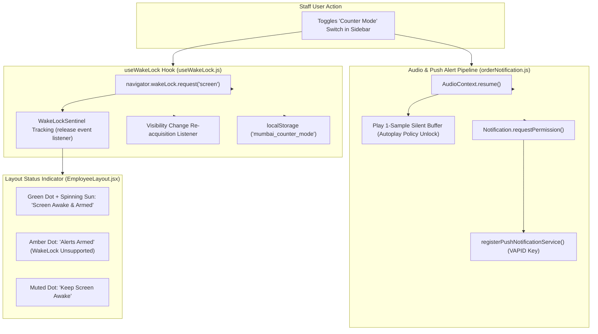
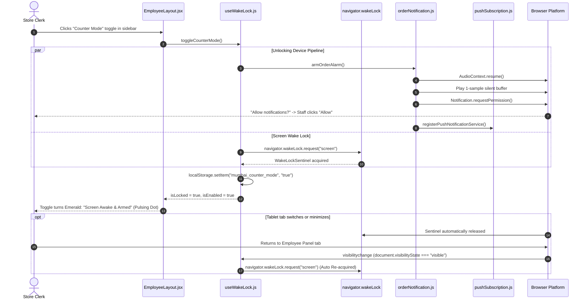

# Employee Panel Audit: Feature 08 — Counter Mode & Screen WakeLock

> **Feature Scope**: Counter Tablet Ergonomics, Screen Wake Lock API, AudioContext Arming, and Background Push Alerts  
> **Target Audience**: Technical Architects, Frontend Engineers, and System Auditors  
> **Authoritative Baseline**: W3C Screen Wake Lock API, Web Audio Autoplay Policy, and ServiceWorker Web Push  
> **Date**: November 2026

---

## 1. High-Level Architecture & System Role

The **Counter Mode & Screen WakeLock** feature is a specialized device ergonomic system built for physical store workstations, warehouse packing desks, and dispatch counters.

Tablets and mobile phones operating at shop counters typically sleep or dim after 30–60 seconds of inactivity to save battery. Counter Mode keeps the screen continuously awake using the W3C Screen Wake Lock API. 

Crucially, toggling Counter Mode acts as an authoritative **browser user gesture**, simultaneously:
1. Unlocking the browser's restricted `AudioContext` via a silent 1-sample audio buffer so incoming order alarms can sound loudly at 85% volume.
2. Prompting the staff for system notification permissions.
3. Automatically subscribing the physical device to background Web Push notifications.



---

## 2. Frontend Layer (React + Web Platform APIs)

### 2.1 File Map & Responsibilities
- **Core Hook**: [`apps/employee-panel/src/hooks/useWakeLock.js`](file:///c:/Users/asus/Desktop/Mumbai%20Collection/apps/employee-panel/src/hooks/useWakeLock.js) *(112 lines)*
- **Layout Switch & Visual Indicator**: [`apps/employee-panel/src/layouts/EmployeeLayout.jsx`](file:///c:/Users/asus/Desktop/Mumbai%20Collection/apps/employee-panel/src/layouts/EmployeeLayout.jsx#L148-L175)
- **Audio & Push Alert Engine**: [`apps/employee-panel/src/utils/orderNotification.js`](file:///c:/Users/asus/Desktop/Mumbai%20Collection/apps/employee-panel/src/utils/orderNotification.js#L46-L94)

---

### 2.2 Deep Logic & Implementation Details

#### A. W3C Screen Wake Lock Lifecycle (`useWakeLock.js`)
In [`useWakeLock.js`](file:///c:/Users/asus/Desktop/Mumbai%20Collection/apps/employee-panel/src/hooks/useWakeLock.js#L23-L50):
```javascript
const requestLock = useCallback(async () => {
  if (!isSupported || sentinelRef.current) return;

  try {
    const sentinel = await navigator.wakeLock.request("screen");
    sentinelRef.current = sentinel;
    setIsLocked(true);

    sentinel.addEventListener("release", () => {
      sentinelRef.current = null;
      setIsLocked(false);
    });
  } catch (err) {
    // Device or battery saver policy prevented wake lock
    sentinelRef.current = null;
    setIsLocked(false);
  }
}, [isSupported]);
```
- Acquires a `"screen"` wake lock sentinel.
- Listens to the `release` event: If the operating system or browser releases the lock (e.g. low battery policy or system screensaver), the state cleanly updates without unhandled exceptions.

#### B. Automatic Visibility Re-acquisition
In [`useWakeLock.js`](file:///c:/Users/asus/Desktop/Mumbai%20Collection/apps/employee-panel/src/hooks/useWakeLock.js#L61-L75):
Browsers automatically release wake locks whenever the tab is minimized or the user switches applications.
- Attaches a `visibilitychange` listener.
- When `document.visibilityState === "visible"` and `isEnabled` is true, the hook immediately re-requests the wake lock sentinel so staff never return to a sleeping screen.

#### C. Multi-System User Gesture Unlocking (`toggleCounterMode`)
In [`useWakeLock.js`](file:///c:/Users/asus/Desktop/Mumbai%20Collection/apps/employee-panel/src/hooks/useWakeLock.js#L87-L103) and [`orderNotification.js`](file:///c:/Users/asus/Desktop/Mumbai%20Collection/apps/employee-panel/src/utils/orderNotification.js#L46-L94):
Modern mobile browsers (iOS Safari, Android Chrome) strictly block audio playback and notification prompts unless directly initiated by a user gesture.
When staff taps "Counter Mode":
1. **AudioContext Unlock**:
   ```javascript
   const buffer = ctx.createBuffer(1, 1, 22050);
   const source = ctx.createBufferSource();
   source.buffer = buffer;
   source.connect(ctx.destination);
   source.start(0);
   ```
   Plays an imperceptible 1-sample silent buffer, moving the `AudioContext` from `suspended` to `running`. This guarantees that background order alerts can chime immediately without being blocked.
2. **Notification Permission**: Calls `Notification.requestPermission()` from within the same tap event.
3. **Web Push Registration**: If granted, triggers `registerPushNotificationService()` to register the browser with the Node.js VAPID push gateway.

#### D. Persistent State & Clean Logout Release
- Persists state in `localStorage.setItem("mumbai_counter_mode", "true")`.
- **Logout Release Guard (`handleLogout`)**:
  In [`EmployeeLayout.jsx`](file:///c:/Users/asus/Desktop/Mumbai%20Collection/apps/employee-panel/src/layouts/EmployeeLayout.jsx#L53-L57):
  Staff logging out automatically executes `await releaseLock()` so personal devices return to normal screen-timeout behavior.

#### E. Tri-State Visual Feedback Pill
In [`EmployeeLayout.jsx`](file:///c:/Users/asus/Desktop/Mumbai%20Collection/apps/employee-panel/src/layouts/EmployeeLayout.jsx#L150-L174):
1. **Active (Green)**: `isLocked = true` -> Pulsing green dot and spinning sun icon (*"Screen Awake & Armed"*).
2. **Degraded (Amber)**: `isEnabled = true`, but `isLocked = false` (e.g., Firefox without wake lock support) -> Amber dot (*"Alerts Armed"*).
3. **Inactive (Slate)**: `isEnabled = false` -> Muted gray dot (*"Keep Screen Awake"*).

---

## 3. End-to-End Counter Mode Activation Flow



---

## 4. Deep Logic Code Index

| Component | File Path | Line Range | Functional Responsibility |
| :--- | :--- | :--- | :--- |
| **WakeLock Hook** | [`useWakeLock.js`](file:///c:/Users/asus/Desktop/Mumbai%20Collection/apps/employee-panel/src/hooks/useWakeLock.js#L23-L50) | `L23-L50` | W3C Screen Wake Lock acquisition, error handling, and release |
| **Visibility Handler** | [`useWakeLock.js`](file:///c:/Users/asus/Desktop/Mumbai%20Collection/apps/employee-panel/src/hooks/useWakeLock.js#L61-L75) | `L61-L75` | Automatic lock re-acquisition when app returns to foreground |
| **Combined Toggle** | [`useWakeLock.js`](file:///c:/Users/asus/Desktop/Mumbai%20Collection/apps/employee-panel/src/hooks/useWakeLock.js#L87-L103) | `L87-L103` | User gesture handler synchronizing audio arming, push alerts, and wake lock |
| **Audio Pipeline Unlock** | [`orderNotification.js`](file:///c:/Users/asus/Desktop/Mumbai%20Collection/apps/employee-panel/src/utils/orderNotification.js#L46-L94) | `L46-L94` | Silent 1-sample buffer playback unlocking mobile browser autoplay policy |
| **Sidebar Switch UI** | [`EmployeeLayout.jsx`](file:///c:/Users/asus/Desktop/Mumbai%20Collection/apps/employee-panel/src/layouts/EmployeeLayout.jsx#L148-L175) | `L148-L175` | High-contrast tri-state status pill with animations and state feedback |
| **Logout Release Guard**| [`EmployeeLayout.jsx`](file:///c:/Users/asus/Desktop/Mumbai%20Collection/apps/employee-panel/src/layouts/EmployeeLayout.jsx#L53-L57) | `L53-L57` | Explicit wake lock release upon staff logout to restore normal device battery sleep |
