# Mumbai Collection: Employee Panel Technical Audit

> **Scope**: End-to-End Architectural, Frontend, Backend, and Database Audits of all Employee Panel Features  
> **Repository Baseline**: Monorepo (`apps/employee-panel`, `apps/backend`, `mumbai-auth.php`)  
> **Target Audience**: Core Engineering Team, Solutions Architects, and Security Auditors  
> **Date**: November 2026

---

## Executive Summary

The **Employee Panel** is a specialized, high-velocity operational suite engineered for physical store counter staff, packers, and warehouse personnel. Unlike the executive Admin Panel (which prioritizes macro revenue, customer lifetime value, and financial reconciliation), the Employee Panel focuses on:
- **Instantaneous Fulfillment Velocity**: Single-tap order stage progression (`processing` -> `packed` -> `out-for-delivery` -> `completed`).
- **Warehouse Floor Ergonomics**: Tablet Screen Wake Lock, Web Audio alarm chimes on incoming orders, and high-contrast 44px tap targets.
- **Fail-Safe Inventory Controls**: Stock level increments/decrements with optimistic concurrency controls.
- **Strict Role Boundaries**: Access isolation enforcing `employee` and `administrator` privileges, with complete segregation from customer and admin data scopes.

---

## Audit Index & Feature Modules

| Module # | Feature Name | Primary Route | Audit File | Status |
| :---: | :--- | :--- | :--- | :---: |
| **01** | **Operational Dashboard** | `/` | [`01_Dashboard.md`](file:///c:/Users/asus/Desktop/Mumbai%20Collection/Employee%20panel%20audit/01_Dashboard.md) | **Completed** |
| **02** | **Orders & Dispatch Pipeline** | `/orders` | [`02_Orders_and_Dispatch.md`](file:///c:/Users/asus/Desktop/Mumbai%20Collection/Employee%20panel%20audit/02_Orders_and_Dispatch.md) | **Completed** |
| **03** | **Product Inventory & Stock** | `/products` | [`03_Products_and_Stock.md`](file:///c:/Users/asus/Desktop/Mumbai%20Collection/Employee%20panel%20audit/03_Products_and_Stock.md) | **Completed** |
| **04** | **Add New Product** | `/products/add` | [`04_Add_Product.md`](file:///c:/Users/asus/Desktop/Mumbai%20Collection/Employee%20panel%20audit/04_Add_Product.md) | **Completed** |
| **05** | **Categories & Merchandising** | `/categories/add` | [`05_Categories.md`](file:///c:/Users/asus/Desktop/Mumbai%20Collection/Employee%20panel%20audit/05_Categories.md) | **Completed** |
| **06** | **Subcategories & Mapping** | `/subcategories` | [`06_Subcategories.md`](file:///c:/Users/asus/Desktop/Mumbai%20Collection/Employee%20panel%20audit/06_Subcategories.md) | **Completed** |
| **07** | **Homepage Banners** | `/banners` | [`07_Homepage_Banners.md`](file:///c:/Users/asus/Desktop/Mumbai%20Collection/Employee%20panel%20audit/07_Homepage_Banners.md) | **Completed** |
| **08** | **Counter Mode & WakeLock** | Global | [`08_Counter_Mode_and_WakeLock.md`](file:///c:/Users/asus/Desktop/Mumbai%20Collection/Employee%20panel%20audit/08_Counter_Mode_and_WakeLock.md) | **Completed** |

---

## Core System Architecture & Technology Stack

```mermaid
flowchart LR
    subgraph Client["Employee Console PWA"]
        UI["React 19 + Vite + Tailwind CSS"]
        Audio["Web Audio API (880-1174Hz Chime)"]
        WakeLock["Screen Wake Lock API"]
    end

    subgraph Middleware["Node.js BFF (Express)"]
        Auth["requireAuth('employee') + requireRole()"]
        Controllers["employeeController.js & adminProductController.js"]
        Cache["serverCache (In-Memory 90s TTL)"]
    end

    subgraph Engine["WordPress & WooCommerce"]
        HPOS["HPOS MySQL Tables (wp_wc_orders, wp_wc_orders_meta)"]
        Lock["MySQL Distributed Lock (GET_LOCK)"]
        CustomPlugin["mumbai-auth.php (Internal REST Endpoints)"]
    end

    Client <-->|REST with Credentials| Middleware
    Middleware <-->|Signed Internal REST & HPOS SQL| Engine
```

---

## Key Highlights of Feature 01: Operational Dashboard

1. **Screen Wake Lock & Web Audio Alerts**:
   - Implements W3C Screen Wake Lock to prevent counter devices from sleeping during store operations.
   - Synthesizes 2-tone alarm chimes via `AudioContext` upon order delta detection without external `.mp3` dependencies.
2. **1-Click High-Speed Fulfillment**:
   - Oversized status transition buttons advancing orders straight to `packed`, `out-for-delivery`, and `completed`.
   - Concurrency protected by MySQL `GET_LOCK(SHA2('staff-order:<id>', 256), 3)` to eliminate duplicate packing.
3. **Unpaid Online Order Shield**:
   - Blocks advancement of uncaptured online payments to prevent inventory theft or shipment leakage.
4. **Visibility-Aware Polling**:
   - Auto-throttles 30s background polling when the browser tab is hidden, immediately refreshing upon tab focus.

*Refer to the complete technical document at [`01_Dashboard.md`](file:///c:/Users/asus/Desktop/Mumbai%20Collection/Employee%20panel%20audit/01_Dashboard.md) for full-stack code citations, database queries, and sequence flows.*
