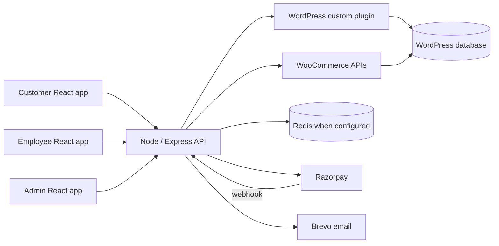

# Runtime flows: how the applications communicate

This guide follows the source code in this checkout, reviewed 2026-11-15. It is
a map for debugging, not a trace captured from a running system or a guarantee
that every branch succeeds. When changing a flow, follow the linked code and run
the relevant tests and staging checks. Paths below are relative to the repository
root. Related setup is in [README](../README.md) and the shorter [feature map](feature-map.md).

## The participants



The arrows are possible communications, not one request that always calls every
service. Node is not the only place holding state: WordPress/WooCommerce stores
commerce and plugin data, and Node also has caches and background workers.
Redis can be unavailable; fallback behavior depends on the operation. See
`apps/backend/src/config/redis.js` and the individual service before assuming a
fallback is safe for a particular operation.

## How to follow a request

1. Find the action in the app's `src/pages` or `src/components`, then follow
   its call into `src/services`.
2. Node mounts `/api` routes in `apps/backend/src/app.js`. A route declares the
   handler and middleware in `apps/backend/src/routes/`.
3. Follow its controller into `apps/backend/src/services/` and `utils/`. Node's
   WooCommerce client is `src/config/woocommerce.js`; its WordPress client is
   `src/services/wordpress.js`.
4. Custom WordPress routes are registered near the top of `mumbai-auth.php`.
   Search that file for the route and callback. Many internal routes require
   `X-Mumbai-Internal-Key`; never expose this key to the browser.
5. Check both success and failure responses, background retries, and the tests.
   Route-specific middleware order matters; the summaries below are not a
   substitute for reading the actual chain.

## Customer sign-in and session

```text
Login page -> customer-web/src/services/authService.js
  -> POST /api/auth/login -> authRoute.js -> authController.login
  -> POST WordPress /wp-json/mumbai-auth/v1/login
  -> check roles for requested panel -> set panel cookies -> browser
```

`apps/backend/src/controllers/authController.js` normalizes the email and
checks the returned roles. `utils/authCookieUtils.js` sets the cookie and seeds
session cache. A role mismatch is rejected and the issued WordPress session is
requested to be revoked. `GET /api/auth/me` obtains the current profile through
session validation and, for customer accounts, may enrich it from WooCommerce.

Protected routes use `middlewares/authMiddleware.js`: it parses the credential,
checks revocation and expiry, and may use a verified cache entry or consult the
WordPress `/me` endpoint. Authentication, Redis and WordPress failures can have
different responses; do not interpret every `401` or `403` as the same problem.
Customer, employee and admin panels have separate context and cookie rules.

Registration calls `POST /api/auth/register`, whose controller sends the hashed
OTP or registration token to the WordPress `/register` endpoint. OTP send and
verify calls go through `services/authOtpService.js` to plugin `/otp/*` routes;
email dispatch uses `services/brevoService.js`. Google sign-in uses
`services/googleAuthService.js` to validate the Google identity before the
controller calls the plugin `/sso` endpoint. Logout clears panel cookies and
attempts to revoke the WordPress session; see the controller for error handling.

Start with `apps/backend/src/routes/authRoute.js`, `authController.js`,
`services/authOtpService.js`, `services/googleAuthService.js`, and
`utils/authCookieUtils.js` for the specific branch being debugged.

## Products, search, cart and addresses

* The customer app's `src/services/productService.js` calls Node product routes
  under `/api/products`. `routes/productRoutes.js` dispatches to
  `controllers/productController.js`; `services/productService.js` and
  `services/searchIndexService.js` use WooCommerce, the plugin and caches
  according to the request and fallback path. Search and category paths differ.
* `customer-web/src/services/storeApi.js` manages cart token and nonce state and
  sends cart requests to Node's `/api/store` routes. The Node routes in
  `routes/storeRoutes.js` interact with the WooCommerce Store API. The customer
  Vite configuration also contains a local `/api/store` proxy; inspect the active
  browser URL and configuration rather than assuming which proxy handled a call.
* Saved addresses use `/api/addresses` and `routes/addressRoute.js`, then
  `controllers/addressController.js` and the plugin `/addresses` routes.
  Account details use `/api/profile`, `routes/profileRoutes.js`,
  `controllers/profileController.js`, and plugin `/profile` routes.
* Customer order history and detail use `/api/orders` and `/api/orders/:id` via
  `routes/orderRoutes.js` and `controllers/orderController.js`.

## Online payment: creation, verification and recovery

The following describes the normal **Razorpay** path, not every checkout method:

```text
BillingForm -> useRazorpayCheckout -> paymentService
  -> POST /api/payments/create-order -> validation / auth / idempotency
  -> read WooCommerce cart and total -> reserve stock through WordPress plugin
  -> create Razorpay order -> store payment intent -> return payment details
  -> Razorpay checkout in browser
  -> verify / callback / webhook / status recovery -> payment finalization
  -> plugin creates or resolves WooCommerce order after confirmed payment
```

1. `customer-web/src/components/checkout/BillingForm.jsx` and
   `useRazorpayCheckout.js` call `src/services/paymentService.js`.
2. `POST /api/payments/create-order` is registered in
   `backend/src/routes/paymentRoutes.js`. Its chain validates input, requires a
   customer session and a valid delivery contact, checks idempotency and applies
   checkout rate limiting. The owner's stated rule is that account-phone
   verification is not required for this paid checkout.
3. `paymentController.createOrder` checks store availability and address data,
   loads the WooCommerce cart, uses its calculated total, handles an existing
   intent when applicable, and checks stock. The plugin `/stock/reserve` endpoint
   is called before creating a new gateway order. A new successful path creates a
   Razorpay order, stores a payment intent, and returns `order_id: null`; the
   WooCommerce order is finalized after payment, not at this point.
4. Browser verification (`/verify`), server callback (`/callback`) and signed
   gateway webhook (`/webhook`) enter different controller handlers. They use
   the common payment finalization machinery, with checks and branches specific
   to the source. Do not treat a browser success screen alone as proof of payment.
5. `services/paymentIntentService.js` calls plugin endpoints including
   `/payment-intent/*`, `/stock/release`, `/orders/finalize-payment`, and
   webhook-event storage. It and `services/paymentLease.js` support durable
   state and coordination. `services/razorpayService.js` wraps gateway calls.
6. `/check-status` supports a customer returning after an interrupted checkout;
   `/cancel` handles an explicit cancellation. `server.js` starts reconciliation
   workers that use `services/reconciliationService.js`; administrators can
   also use the protected `/reconcile/:id` route. An unsuccessful finalization
   after capture may need reconciliation or support; inspect the actual state
   before retrying, refunding, or manually changing an order.

Failures include an empty cart, invalid address, insufficient stock, gateway
errors, invalid signatures, expired or missing intents, and database failures.
The controller contains different responses and recovery actions for each. Use
gateway test mode and isolated WordPress data when exercising this flow.

## Employee operations and admin dashboard

The employee app's `src/services/employeeApi.js` calls `/api/employee/*`.
`backend/src/routes/employeeRoutes.js` applies employee authentication and role
checks before its handlers. For example:

* `GET /orders` -> `employeeController.getEmployeeOrders` -> plugin
  `/employee/orders` or WooCommerce order queries, depending on the path.
* `GET /orders/packing-alarms` -> employee alarm handling in
  `services/employeeAlarmService.js`; acknowledgement has its own POST route
  and uses `services/orderNotificationService.js`.
* `PATCH /orders/:id/status` -> employee controller ->
  `services/staffOrderService.js` -> plugin `/staff/orders/:id/status`. Bulk
  dispatch and SSE updates have separate routes and need separate checks.

The admin dashboard uses `apps/admin-dashboard/src/services/adminApi.js` and
Node's `/api/admin/*` routes. `routes/adminRoutes.js` applies admin access
checks. Customer history and payment lookup are handled in
`controllers/adminCustomerController.js`; analytics uses
`controllers/adminAnalyticsController.js` and plugin analytics endpoints;
catalog operations use `controllers/adminProductController.js`, WooCommerce and,
for stock adjustments, the plugin `/staff/products/:id/adjust` endpoint.
Consult each route's actual checks and controller rather than assuming all
operations have identical permissions or fallback behavior.

## Following one live request

1. In the browser's Network tab, find the request, method, URL, status and
   response. Avoid copying cookies, authorization headers or personal data.
2. Node's `app.js` accepts an `X-Request-ID` header or generates one and puts it
   in the response. Search backend logs for that ID; `utils/logger.js` includes
   it in `logError` output. Request logging is configured to record warnings and
   errors; successful requests are normally silent at that layer.
3. For a payment, also use the relevant order or gateway identifier in authorized
   operational tools and backend logs. A browser request, gateway webhook and
   reconciliation worker are separate events: the request ID is **not shown to
   be propagated end-to-end** across Node, WordPress and Razorpay. Some logs use
   the shared payment/order identifiers instead.
4. If the request reached WordPress, inspect its server/plugin logs and relevant
   response. Background workers and retries can run after the browser response.
   Do not paste secrets, OTPs, full payment payloads, or customer data into logs
   or support tickets. Use staging and test accounts for reproduction.

For backup, restore, alerts and reconciliation operations, see
[production recovery](production-recovery.md).
